# Звіт до лабораторної роботи №02

**Тема:** Створення складних SQL запитів

**Виконав:** Остаповець Данило Олександрович, група_ІПЗ-31
**Дата виконання:** 08.11.2026
**Середовище:** Supabase (PostgreSQL), SQL Editor
**Навчальна база даних:** створена в ЛР1 (таблиці `products`, `categories`, `suppliers`, `customers`, `regions`, `orders`, `order_items`, `employees`)

---

## 🎯 Мета роботи

Набути практичних навичок створення складних SQL запитів для аналізу даних: з'єднання таблиць, агрегатні функції, групування, підзапити, віконні функції, CTE, матеріалізовані представлення та параметризована аналітика в PostgreSQL.

---

## 1. Підключення до бази даних

Підключився до проєкту Supabase з навчальною базою з ЛР1 і відкрив **SQL Editor**. Усі запити нижче виконані в ньому.

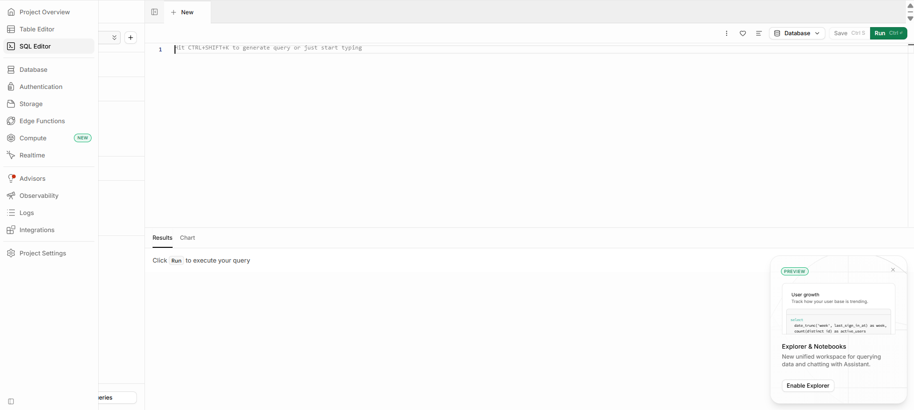
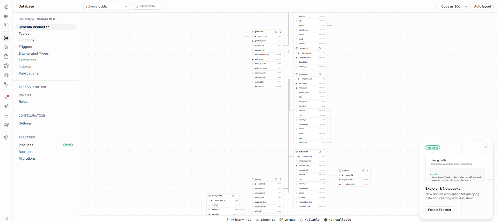 

---

## 2. Рівень 1

### 2.1. З'єднання таблиць

#### Запит 1.1 — INNER JOIN: товари з категоріями та постачальниками

```sql
SELECT p.product_name, c.category_name, s.company_name, p.unit_price
FROM products p
INNER JOIN categories c ON p.category_id = c.category_id
INNER JOIN suppliers s ON p.supplier_id = s.supplier_id
ORDER BY c.category_name, p.product_name;
```

**Опис:** з'єднує три таблиці (`products` → `categories`, `products` → `suppliers`) і виводить товар, його категорію, постачальника та ціну. Товари без категорії або без постачальника у вибірку не потрапляють (властивість INNER JOIN).

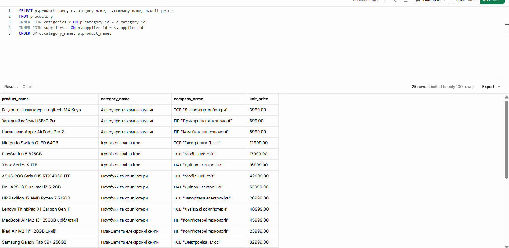

**Оцінка складності:** низька. Два з'єднання за ключами та сортування; зазвичай Hash Join + Sort.
**Оптимізація:** індекси на зовнішні ключі `products(category_id)`, `products(supplier_id)`; не вибирати зайвих стовпців.

---

#### Запит 1.2 — LEFT JOIN: усі клієнти, включно з тими, що без замовлень

```sql
SELECT c.contact_name, c.customer_type, r.region_name,
       COUNT(o.order_id) AS order_count
FROM customers c
LEFT JOIN orders  o ON c.customer_id = o.customer_id
LEFT JOIN regions r ON c.region_id   = r.region_id
GROUP BY c.customer_id, c.contact_name, c.customer_type, r.region_name
ORDER BY order_count DESC;
```

**Опис:** `LEFT JOIN` зберігає всіх клієнтів. Для клієнтів без замовлень `COUNT(o.order_id)` дає 0 (COUNT по стовпцю ігнорує NULL). Також підтягується назва регіону.

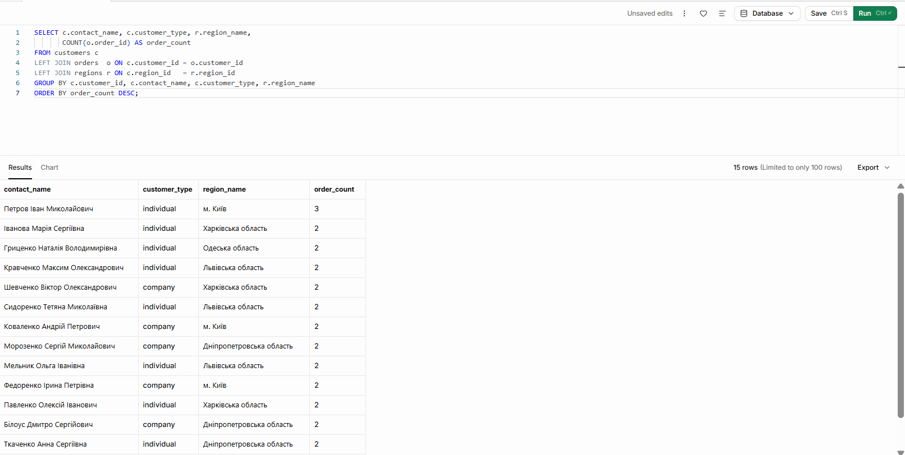

**Оцінка складності:** низька–середня. Два LEFT JOIN, групування по 4 стовпцях, сортування.
**Оптимізація:** індекс `orders(customer_id)`; групувати за ключем `customer_id` (решта стовпців функціонально залежні).

---

#### Запит 1.3 — Множинне з'єднання (6 таблиць): деталі замовлень

```sql
SELECT o.order_id,
       o.order_date,
       cu.contact_name                AS customer,
       p.product_name,
       c.category_name,
       s.company_name                 AS supplier,
       oi.quantity,
       oi.unit_price,
       ROUND((oi.quantity * oi.unit_price * (1 - oi.discount))::numeric, 2) AS line_total
FROM orders o
    JOIN customers   cu ON o.customer_id  = cu.customer_id
    JOIN order_items oi ON o.order_id     = oi.order_id
    JOIN products    p  ON oi.product_id  = p.product_id
    JOIN categories  c  ON p.category_id  = c.category_id
    JOIN suppliers   s  ON p.supplier_id  = s.supplier_id
ORDER BY o.order_date DESC, o.order_id
LIMIT 50;
```

**Опис:** послідовно з'єднує замовлення → клієнтів → позиції замовлення → товари → категорії → постачальників. Розраховує суму позиції зі знижкою. `LIMIT 50` обмежує вивід для зручності.

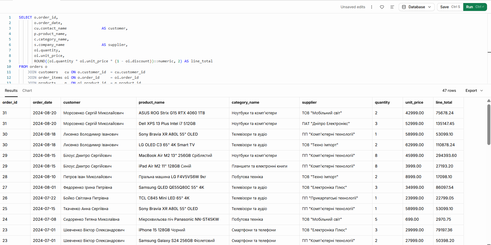

**Оцінка складності:** середня. П'ять з'єднань; планувальник обирає порядок і тип (Hash/Nested Loop) залежно від розміру таблиць.
**Оптимізація:** індекси на всі FK (`order_items(order_id)`, `order_items(product_id)`, `orders(customer_id)`); фільтр по даті в `WHERE` зменшить обсяг; для частого використання — представлення (VIEW).

---

### 2.2. Агрегатні функції

#### Запит 1.4 — Кількість товарів у категорії та статистика цін

```sql
SELECT c.category_name,
       COUNT(p.product_id) AS product_count,
       AVG(p.unit_price)   AS avg_price,
       MIN(p.unit_price)   AS min_price,
       MAX(p.unit_price)   AS max_price
FROM categories c
LEFT JOIN products p ON c.category_id = p.category_id
GROUP BY c.category_id, c.category_name
ORDER BY product_count DESC;
```

**Опис:** для кожної категорії рахує кількість товарів та середню/мінімальну/максимальну ціну. `LEFT JOIN` залишає категорії без товарів (для них агрегати MIN/MAX/AVG = NULL, COUNT = 0).

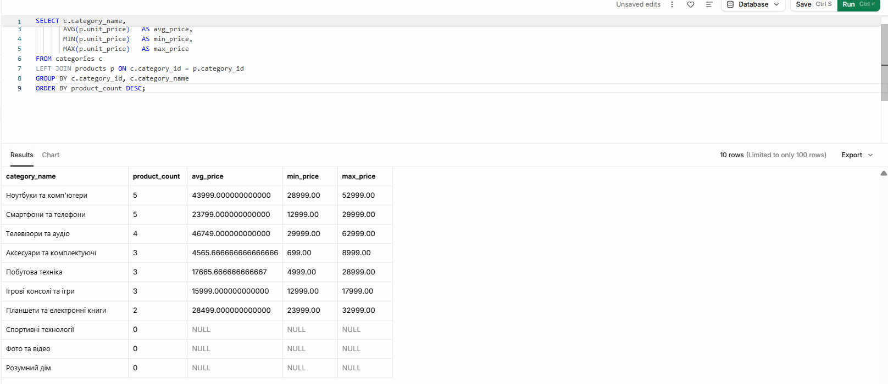

**Оцінка складності:** низька. Одне з'єднання + GROUP BY (HashAggregate).
**Оптимізація:** індекс `products(category_id, unit_price)` може дозволити Index Only Scan.

---

#### Запит 1.5 — Загальні продажі за регіонами (SUM + GROUP BY + HAVING)

```sql
SELECT r.region_name,
       COUNT(DISTINCT o.order_id) AS orders_count,
       SUM(oi.quantity * oi.unit_price * (1 - oi.discount)) AS total_sales
FROM regions r
JOIN customers   cu ON cu.region_id   = r.region_id
JOIN orders      o  ON o.customer_id  = cu.customer_id
JOIN order_items oi ON oi.order_id    = o.order_id
GROUP BY r.region_id, r.region_name
HAVING SUM(oi.quantity * oi.unit_price * (1 - oi.discount)) > 1000
ORDER BY total_sales DESC;
```

**Опис:** підсумовує виручку (кількість × ціна × (1 − знижка)) по регіонах клієнтів. `HAVING` відсікає регіони, де сума продажів не перевищує 1000 (поріг можна змінити під ваші дані).

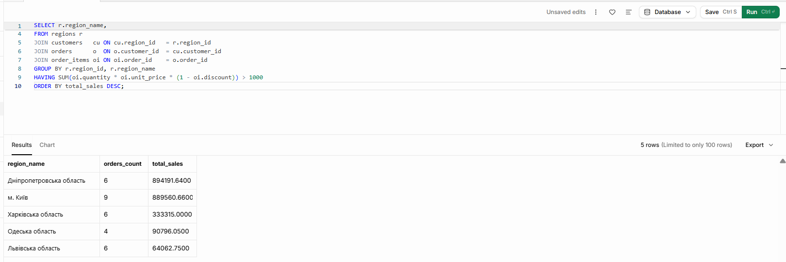

**Оцінка складності:** середня. Чотири таблиці, агрегація над найбільшою таблицею `order_items`, `COUNT(DISTINCT)` додає сортування/хешування.
**Оптимізація:** індекси `orders(customer_id)`, `order_items(order_id)`, `customers(region_id)`; фільтр по даті перед групуванням; для регулярної звітності — матеріалізоване представлення (див. п. 4.1).

---

#### Запит 1.6 — Постачальники з кількістю товарів більше 2

```sql
SELECT s.company_name,
       COUNT(p.product_id) AS product_count
FROM suppliers s
JOIN products p ON p.supplier_id = s.supplier_id
GROUP BY s.supplier_id, s.company_name
HAVING COUNT(p.product_id) > 2
ORDER BY product_count DESC, s.company_name;
```

**Опис:** групує товари за постачальником і через `HAVING` залишає тільки тих, у кого більше двох товарів. Умова на агрегат у `WHERE` неможлива, тому використано `HAVING`.

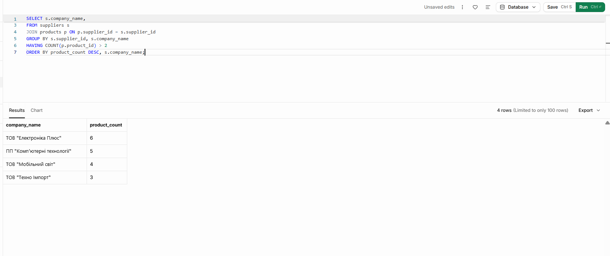

**Оцінка складності:** низька.
**Оптимізація:** індекс `products(supplier_id)`.

---

### 2.3. Базові підзапити

#### Запит 1.7 — Підзапит у WHERE: товари дорожчі за середню ціну своєї категорії

```sql
SELECT p.product_name, p.unit_price, c.category_name
FROM products p
INNER JOIN categories c ON p.category_id = c.category_id
WHERE p.unit_price > (
    SELECT AVG(p2.unit_price)
    FROM products p2
    WHERE p2.category_id = p.category_id
)
ORDER BY c.category_name, p.unit_price DESC;
```

**Опис:** корельований підзапит для кожного товару обчислює середню ціну його категорії; у результат потрапляють лише товари з ціною вище середньої.

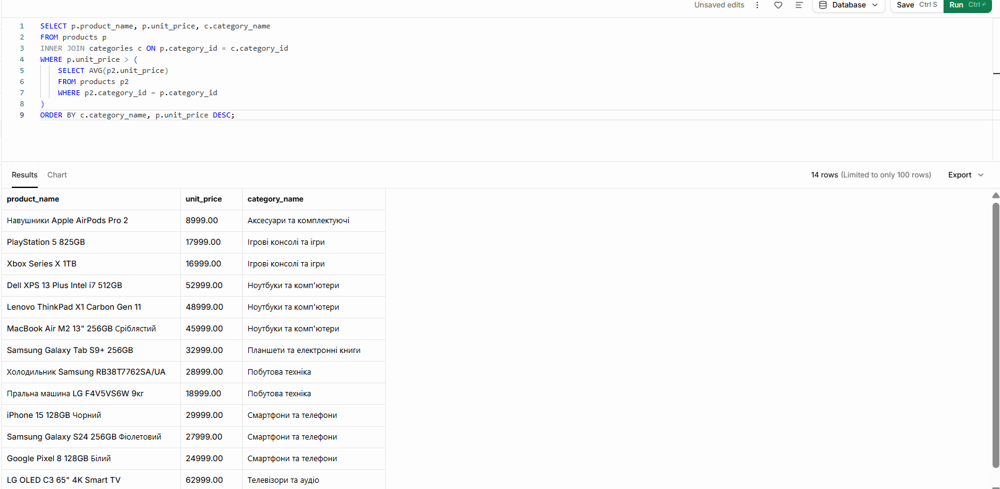

**Оцінка складності:** середня. Корельований підзапит концептуально виконується для кожного рядка (O(N·M) без оптимізації).
**Оптимізація:** індекс `products(category_id, unit_price)`; альтернатива — віконна функція `AVG(...) OVER (PARTITION BY category_id)` у підзапиті/CTE (один прохід по таблиці).

---

#### Запит 1.8 — Підзапит з IN: клієнти із замовленнями у 2024 році

```sql
SELECT customer_id, contact_name
FROM customers
WHERE customer_id IN (
    SELECT customer_id
    FROM orders
    WHERE order_date >= '2024-01-01'
      AND order_date <  '2025-01-01'
);
```

**Опис:** внутрішній запит повертає список ID клієнтів, які мали замовлення у 2024 році; зовнішній виводить їх дані. Діапазон дат замість `YEAR(order_date)` дозволяє використовувати індекс.

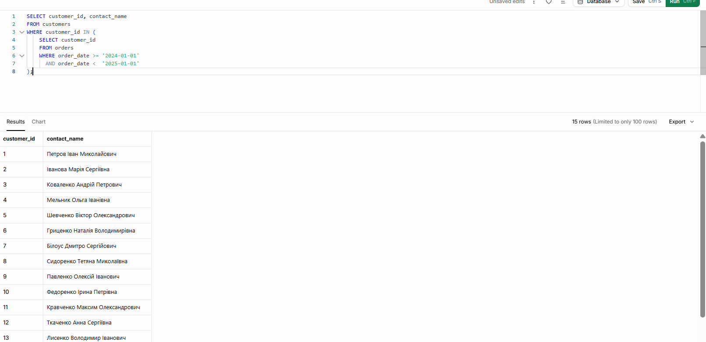

**Оцінка складності:** низька–середня. PostgreSQL зазвичай перетворює `IN` у semi-join.
**Оптимізація:** індекс `orders(order_date, customer_id)` або `orders(customer_id, order_date)`.

---

#### Запит 1.9 — Підзапит у SELECT: загальна кількість продажів по товару

```sql
SELECT p.product_name,
       p.unit_price,
       (SELECT COALESCE(SUM(oi.quantity), 0)
        FROM order_items oi
        WHERE oi.product_id = p.product_id) AS total_sold
FROM products p
ORDER BY total_sold DESC, p.product_name;
```

**Опис:** до кожного товару додається обчислюване поле — загальна кількість проданих одиниць. `COALESCE` повертає 0 для товарів, що ніколи не продавались.

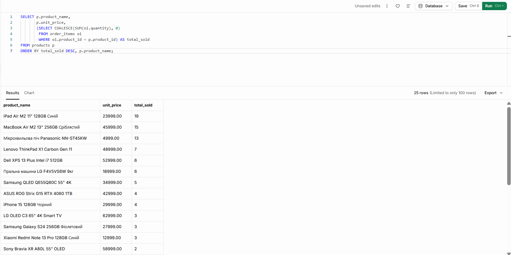

**Оцінка складності:** середня. Скалярний корельований підзапит виконується для кожного товару.
**Оптимізація:** індекс `order_items(product_id)`; або переписати як `LEFT JOIN` з попередньою агрегацією по `order_items`.

---

#### Запит 1.10 — Оператор EXISTS / NOT EXISTS

```sql
-- Клієнти, які робили замовлення
SELECT c.customer_id, c.contact_name
FROM customers c
WHERE EXISTS (
    SELECT 1 FROM orders o WHERE o.customer_id = c.customer_id
);

-- Клієнти БЕЗ замовлень
SELECT c.customer_id, c.contact_name
FROM customers c
WHERE NOT EXISTS (
    SELECT 1 FROM orders o WHERE o.customer_id = c.customer_id
);
```

**Опис:** `EXISTS` лише перевіряє наявність хоча б одного рядка і зупиняється на першому знайденому, тому ефективний для великих таблиць. `NOT EXISTS` знаходить «сиріт» — клієнтів без замовлень (безпечніший за `NOT IN` при наявності NULL).

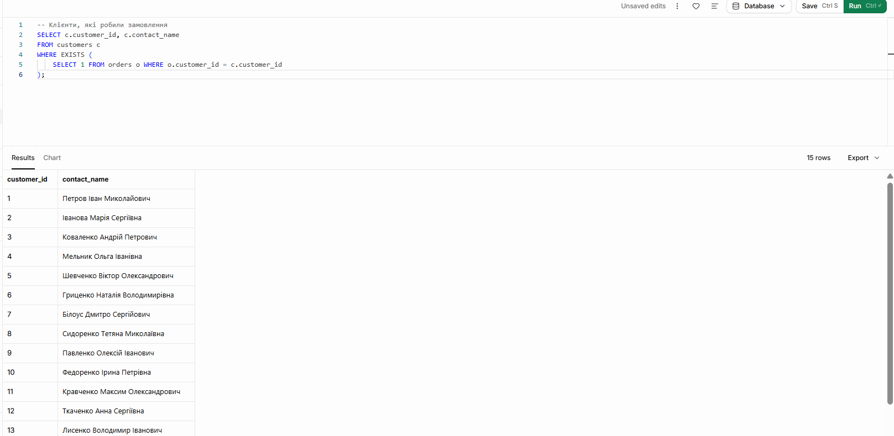
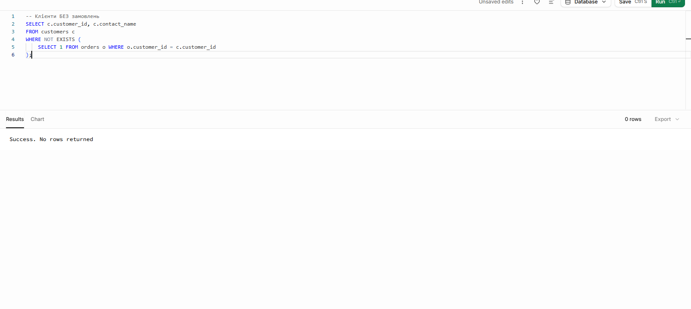

**Оцінка складності:** низька. Semi-join / Anti-join.
**Оптимізація:** індекс `orders(customer_id)`.

---

## 3. Рівень 2

### 3.1. Складні з'єднання та аналіз

#### Запит 2.1 — RIGHT JOIN: категорії та кількість товарів

```sql
SELECT c.category_name,
       COUNT(p.product_id)            AS products_count,
       COALESCE(AVG(p.unit_price), 0) AS avg_price
FROM products p
RIGHT JOIN categories c ON p.category_id = c.category_id
GROUP BY c.category_id, c.category_name
ORDER BY products_count DESC;
```

**Опис:** `RIGHT JOIN` зберігає всі рядки з правої таблиці (`categories`), навіть якщо в категорії немає товарів. `COALESCE` замінює NULL середньої ціни на 0.

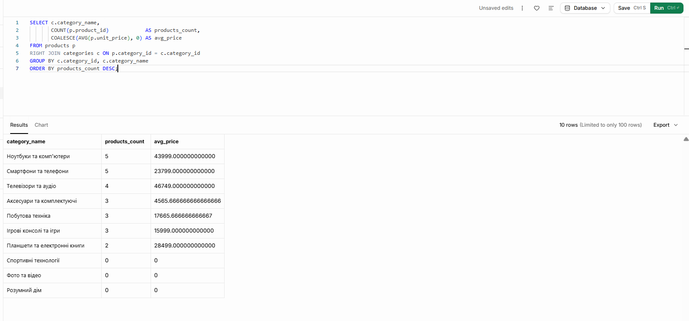

**Оцінка складності:** низька. Еквівалентний `categories LEFT JOIN products`.
**Оптимізація:** переписати як LEFT JOIN для читабельності; індекс `products(category_id)`.

---

#### Запит 2.2 — FULL OUTER JOIN: «осиротілі» записи з обох боків

```sql
SELECT c.category_name, p.product_name
FROM categories c
FULL OUTER JOIN products p ON c.category_id = p.category_id
WHERE c.category_id IS NULL      -- товари без категорії
   OR p.product_id  IS NULL;     -- категорії без товарів
```

**Опис:** `FULL OUTER JOIN` повертає всі рядки обох таблиць; фільтр залишає лише ті, що не мають пари — це корисно для перевірки цілісності даних.

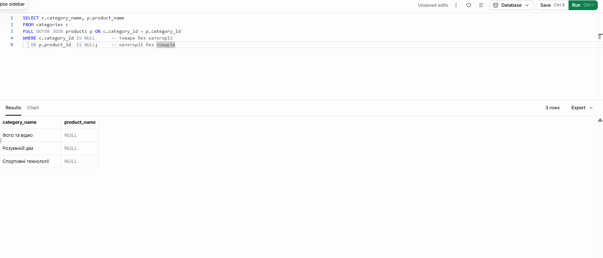

**Оцінка складності:** середня. Потребує Hash Full Join / Merge Full Join, обидві таблиці читаються повністю.
**Оптимізація:** використовувати лише для аудиту даних; для звичайних вибірок — LEFT/INNER JOIN.

---

#### Запит 2.3 — Self-join: співробітники та їхні керівники

```sql
SELECT e1.first_name || ' ' || e1.last_name AS employee,
       e1.title                              AS employee_title,
       e2.first_name || ' ' || e2.last_name AS manager,
       e2.title                              AS manager_title
FROM employees e1
LEFT JOIN employees e2 ON e1.reports_to = e2.employee_id
ORDER BY e2.last_name, e1.last_name;
```

**Опис:** таблиця `employees` з'єднується сама з собою за зв'язком `reports_to → employee_id`. `LEFT JOIN` залишає співробітників без керівника (топ-менеджерів).

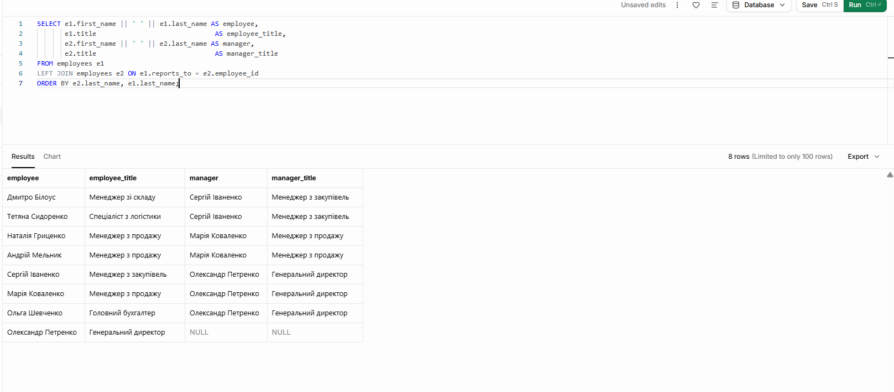

**Оцінка складності:** низька (мала таблиця).
**Оптимізація:** індекс `employees(reports_to)`; PK на `employee_id` вже є.

---

#### Запит 2.4 — Умовне з'єднання (додаткові умови в ON)

```sql
SELECT c.contact_name,
       COUNT(o.order_id) AS orders_2024
FROM customers c
LEFT JOIN orders o
       ON  o.customer_id = c.customer_id
       AND o.order_date >= '2024-01-01'
       AND o.order_date <  '2025-01-01'
WHERE c.customer_type = 'company'
GROUP BY c.customer_id, c.contact_name
ORDER BY orders_2024 DESC;
```

**Опис:** умова по даті винесена в `ON`, тому клієнти-компанії без замовлень у 2024 році **не зникають** з результату (отримують 0). Якби ту ж умову поставити в `WHERE`, `LEFT JOIN` фактично став би `INNER JOIN`.

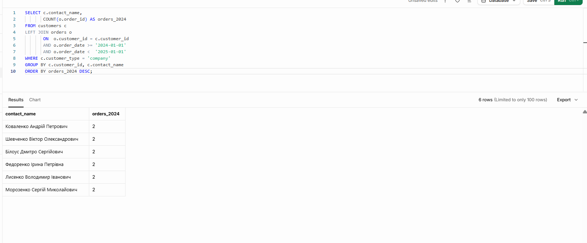

**Оцінка складності:** низька–середня.
**Оптимізація:** складений індекс `orders(customer_id, order_date)`; індекс `customers(customer_type)`.

---

### 3.2. Віконні функції та аналітика

#### Запит 2.5 — ROW_NUMBER, RANK, DENSE_RANK: ранжування товарів у категорії

```sql
SELECT p.product_name,
       c.category_name,
       p.unit_price,
       RANK()       OVER (PARTITION BY c.category_name ORDER BY p.unit_price DESC) AS price_rank,
       DENSE_RANK() OVER (PARTITION BY c.category_name ORDER BY p.unit_price DESC) AS price_dense_rank,
       ROW_NUMBER() OVER (PARTITION BY c.category_name ORDER BY p.unit_price DESC) AS row_num
FROM products p
JOIN categories c ON p.category_id = c.category_id
ORDER BY c.category_name, p.unit_price DESC;
```

**Опис:** у межах кожної категорії (`PARTITION BY`) товари ранжуються за ціною. `ROW_NUMBER` — унікальні номери; `RANK` — однакові ціни мають однаковий ранг із пропуском наступних; `DENSE_RANK` — без пропусків.

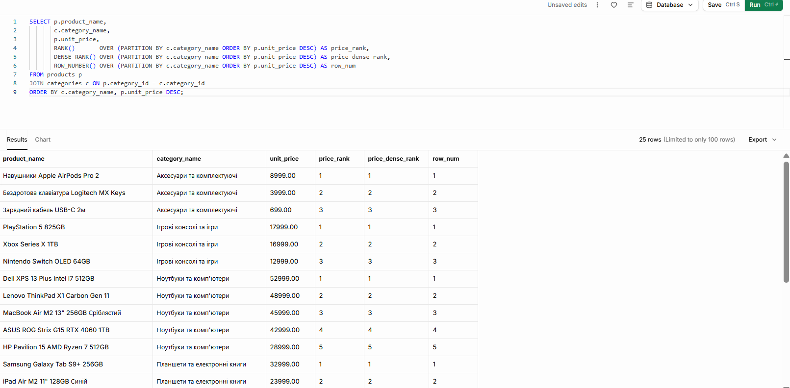

**Оцінка складності:** середня. Сортування по `(category_name, unit_price)` для віконних функцій.
**Оптимізація:** індекс `products(category_id, unit_price DESC)`; винести однакове вікно в `WINDOW w AS (...)`, щоб сортування виконувалось один раз.

---

#### Запит 2.6 — LAG / LEAD: порівняння замовлення клієнта з попереднім і наступним

```sql
SELECT o.customer_id,
       cu.contact_name,
       o.order_id,
       o.order_date,
       o.freight,
       LAG(o.order_date)  OVER w AS prev_order_date,
       LEAD(o.order_date) OVER w AS next_order_date,
       o.order_date - LAG(o.order_date) OVER w AS since_prev_order,
       o.freight - LAG(o.freight, 1, 0) OVER w  AS freight_change
FROM orders o
JOIN customers cu ON cu.customer_id = o.customer_id
WINDOW w AS (PARTITION BY o.customer_id ORDER BY o.order_date, o.order_id)
ORDER BY o.customer_id, o.order_date, o.order_id;
```

**Опис:** для кожного замовлення в межах клієнта (`PARTITION BY customer_id`) показано дату попереднього та наступного замовлення, інтервал між замовленнями та зміну вартості доставки. Для першого замовлення `prev_*` = NULL, для останнього `next_*` = NULL.

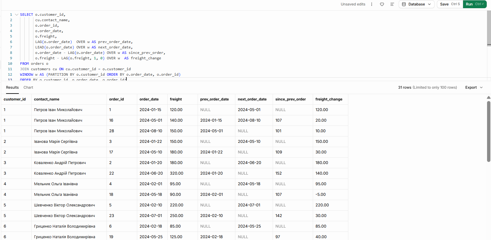

**Оцінка складності:** середня. Одне вікно, одне сортування за `(customer_id, order_date, order_id)`.
**Оптимізація:** індекс `orders(customer_id, order_date, order_id)`; іменоване вікно `WINDOW w`.

---

#### Запит 2.7 — Аналітика в розрізах: накопичувальна сума, ковзне середнє, частка

```sql
SELECT o.customer_id,
       o.order_id,
       o.order_date,
       o.freight,
       SUM(o.freight) OVER (
           PARTITION BY o.customer_id
           ORDER BY o.order_date, o.order_id
       ) AS running_freight,
       AVG(o.freight) OVER (
           PARTITION BY o.customer_id
           ORDER BY o.order_date, o.order_id
           ROWS BETWEEN 2 PRECEDING AND CURRENT ROW
       ) AS moving_avg_3,
       ROUND((o.freight * 100.0 / NULLIF(SUM(o.freight) OVER (PARTITION BY o.customer_id), 0))::numeric, 2)
           AS pct_of_customer_total
FROM orders o
ORDER BY o.customer_id, o.order_date, o.order_id;
```

**Опис:** агрегатні функції використані як віконні — без «схлопування» рядків. Показано накопичувальну суму, ковзне середнє за 3 замовлення та частку замовлення в загальній сумі клієнта. `NULLIF` захищає від ділення на нуль.

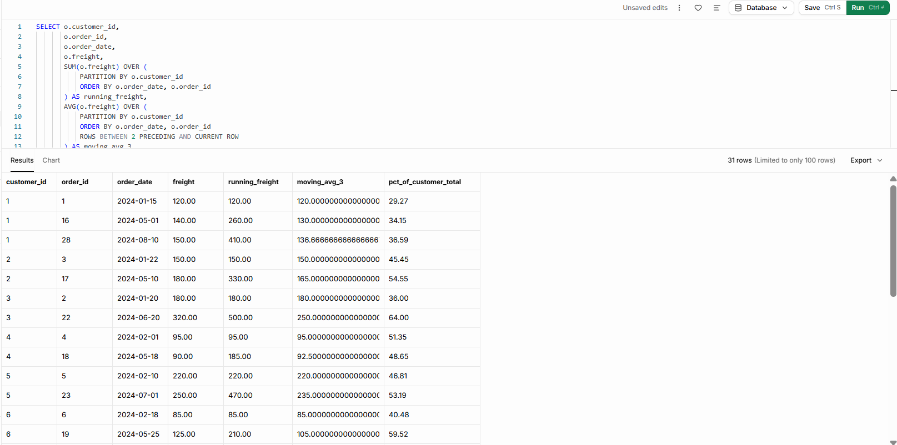

**Оцінка складності:** середня.
**Оптимізація:** індекс `orders(customer_id, order_date, order_id)`; не дублювати різні вікна без потреби.

---

## 4. Рівень 3

### 4.1. Матеріалізоване представлення

```sql
-- Видаляємо старе, якщо воно існувало, щоб уникнути помилок
DROP MATERIALIZED VIEW IF EXISTS mv_monthly_sales CASCADE;

-- Створення матеріалізованого представлення
CREATE MATERIALIZED VIEW mv_monthly_sales AS
SELECT 
    EXTRACT(YEAR  FROM o.order_date)::int AS year,
    EXTRACT(MONTH FROM o.order_date)::int AS month,
    c.category_name,
    COALESCE(r.region_name, 'Unknown')    AS region_name,
    SUM(oi.quantity * oi.unit_price * (1 - COALESCE(oi.discount, 0))) AS total_revenue,
    COUNT(DISTINCT o.order_id)                                       AS orders_count,
    AVG(oi.quantity * oi.unit_price * (1 - COALESCE(oi.discount, 0))) AS avg_line_value
FROM orders o
JOIN order_items oi ON o.order_id    = oi.order_id
JOIN products    p  ON oi.product_id = p.product_id
JOIN categories  c  ON p.category_id = c.category_id
JOIN customers   cu ON o.customer_id = cu.customer_id
LEFT JOIN regions r ON cu.region_id  = r.region_id
WHERE o.order_status = 'delivered'
GROUP BY 1, 2, 3, 4;

-- Індекси для матеріалізованого представлення
CREATE INDEX idx_mv_monthly_sales_date ON mv_monthly_sales (year, month);
CREATE UNIQUE INDEX idx_mv_monthly_sales_uq 
    ON mv_monthly_sales (year, month, category_name, region_name);


SELECT * 
FROM mv_monthly_sales
WHERE year = 2024
ORDER BY total_revenue DESC
LIMIT 10;
```

**Опис:** матеріалізоване представлення **фізично зберігає** результат важкого запиту (6 таблиць + агрегація) — продажі за місяцями, категоріями та регіонами лише для доставлених замовлень. Подальші звернення читають готову таблицю, а не перераховують усе. Дані не оновлюються автоматично — для цього `REFRESH`. Унікальний індекс дозволяє `REFRESH ... CONCURRENTLY`.

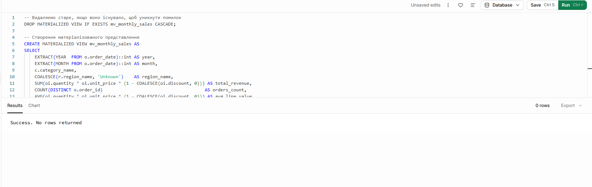
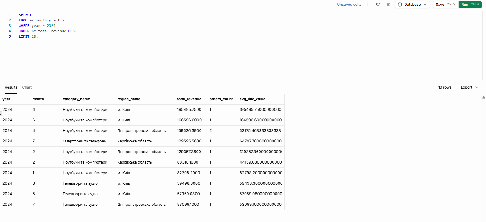

**Оцінка складності:** створення — висока (повний прохід по замовленнях та позиціях); читання — низька (проста вибірка з індексом).
**Оптимізація:** індекси на MV; регулярний `REFRESH` за розкладом (наприклад, `pg_cron` у Supabase); обмежувати набір стовпців.

---

### 4.2. Рекурсивний запит (CTE)

```sql
WITH RECURSIVE employee_hierarchy AS (
    -- Базовий випадок: топ-менеджери (без керівника)
    SELECT employee_id, first_name, last_name, title, reports_to,
           0 AS level,
           CAST(last_name || ' ' || first_name AS VARCHAR(1000)) AS hierarchy_path
    FROM employees
    WHERE reports_to IS NULL

    UNION ALL

    -- Рекурсивний випадок: підлеглі
    SELECT e.employee_id, e.first_name, e.last_name, e.title, e.reports_to,
           eh.level + 1,
           CAST(eh.hierarchy_path || ' -> ' || e.last_name || ' ' || e.first_name AS VARCHAR(1000))
    FROM employees e
    JOIN employee_hierarchy eh ON e.reports_to = eh.employee_id
    WHERE eh.level < 10          -- захист від нескінченної рекурсії
)
SELECT employee_id, first_name, last_name, title, level, hierarchy_path
FROM employee_hierarchy
ORDER BY hierarchy_path;
```

**Опис:** рекурсивний CTE обходить ієрархію «керівник → підлеглий». Anchor-частина вибирає співробітників без керівника (рівень 0); рекурсивна частина на кожній ітерації додає їхніх підлеглих, збільшуючи `level` і будуючи шлях `hierarchy_path`. Умова `level < 10` запобігає зациклюванню при помилках у даних.

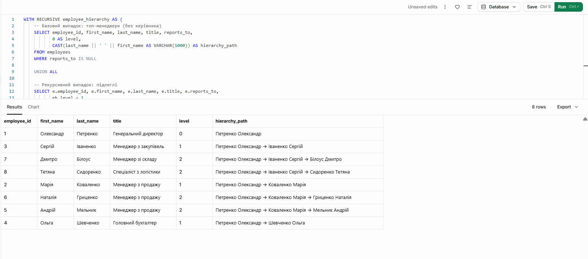

**Оцінка складності:** середня. Кількість ітерацій = глибина ієрархії; на кожній — з'єднання з `employees`.
**Оптимізація:** індекс `employees(reports_to)`; обмеження глибини; для великих дерев — перевірка циклів (масив відвіданих ID).

---

### 4.3. Збережена функція з динамічним SQL (параметризована аналітика)

```sql
CREATE OR REPLACE FUNCTION sales_report(
    p_year     INT  DEFAULT NULL,        -- рік (NULL = усі роки)
    p_category TEXT DEFAULT NULL,        -- категорія (NULL = усі)
    p_group_by TEXT DEFAULT 'category'   -- category | region | supplier | month
)
RETURNS TABLE (group_name TEXT, orders_count BIGINT, total_revenue NUMERIC)
LANGUAGE plpgsql
AS $$
DECLARE
    v_col TEXT;
    v_sql TEXT;
BEGIN
    -- Білий список виразів групування (захист від SQL-ін'єкцій)
    v_col := CASE p_group_by
        WHEN 'category' THEN 'c.category_name'
        WHEN 'region'   THEN 'COALESCE(r.region_name, ''Unknown'')'
        WHEN 'supplier' THEN 's.company_name'
        WHEN 'month'    THEN 'TO_CHAR(o.order_date, ''YYYY-MM'')'
        ELSE NULL
    END;

    IF v_col IS NULL THEN
        RAISE EXCEPTION 'Непідтримуване значення p_group_by: %', p_group_by;
    END IF;

    v_sql := format($q$
        SELECT (%s)::text AS group_name,
               COUNT(DISTINCT o.order_id) AS orders_count,
               SUM(oi.quantity * oi.unit_price * (1 - oi.discount))::numeric AS total_revenue
        FROM orders o
        JOIN order_items oi ON oi.order_id   = o.order_id
        JOIN products    p  ON p.product_id  = oi.product_id
        JOIN categories  c  ON c.category_id = p.category_id
        JOIN suppliers   s  ON s.supplier_id = p.supplier_id
        JOIN customers   cu ON cu.customer_id = o.customer_id
        LEFT JOIN regions r ON r.region_id   = cu.region_id
        WHERE ($1 IS NULL OR EXTRACT(YEAR FROM o.order_date) = $1)
          AND ($2 IS NULL OR c.category_name = $2)
        GROUP BY 1
        ORDER BY 3 DESC
    $q$, v_col);

    RETURN QUERY EXECUTE v_sql USING p_year, p_category;
END;
$$;

-- Приклади виклику
SELECT * FROM sales_report(2024, NULL, 'category');   -- продажі по категоріях за 2024
SELECT * FROM sales_report(NULL, NULL, 'region');     -- продажі по регіонах за весь час
SELECT * FROM sales_report(2024, NULL, 'month');      -- динаміка по місяцях 2024
SELECT * FROM sales_report(NULL, 'Beverages', 'supplier'); -- постачальники в одній категорії
```


**Опис:** функція приймає параметри (рік, категорія, спосіб групування) і формує SQL динамічно за допомогою `format()` та `EXECUTE`. Значення фільтрів передаються через `USING` (безпечно), а вираз групування вибирається з **білого списку**, тому ін'єкція неможлива. Одна функція замінює кілька схожих запитів.

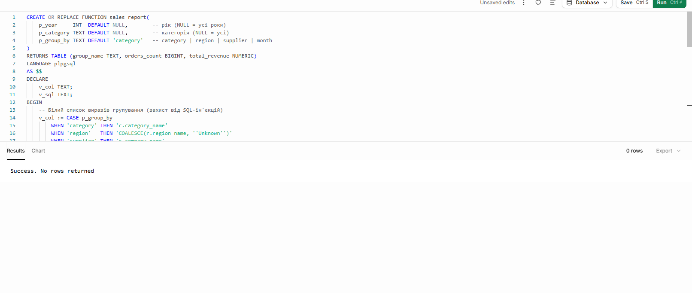
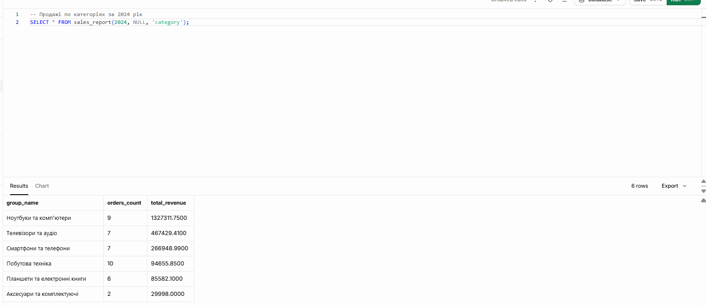

**Оцінка складності:** висока (динамічний SQL, 6 таблиць, агрегація); складність виконання залежить від параметрів.
**Оптимізація:** фільтрувати по даті якомога раніше; використовувати `mv_monthly_sales` для типових звітів; індекси на FK; не підставляти параметри в рядок без `%I`/`%L`/білого списку.

---

## 5. Аналіз продуктивності (EXPLAIN ANALYZE)

Для аналізу обрано найважчий з базових запитів — **Запит 1.5** (продажі за регіонами, 4 таблиці + агрегація).

### 5.1. План виконання до створення індексів

```sql
EXPLAIN (ANALYZE, BUFFERS)
SELECT r.region_name,
       COUNT(DISTINCT o.order_id) AS orders_count,
       SUM(oi.quantity * oi.unit_price * (1 - oi.discount)) AS total_sales
FROM regions r
JOIN customers   cu ON cu.region_id  = r.region_id
JOIN orders      o  ON o.customer_id = cu.customer_id
JOIN order_items oi ON oi.order_id   = o.order_id
GROUP BY r.region_id, r.region_name
HAVING SUM(oi.quantity * oi.unit_price * (1 - oi.discount)) > 1000
ORDER BY total_sales DESC;
```
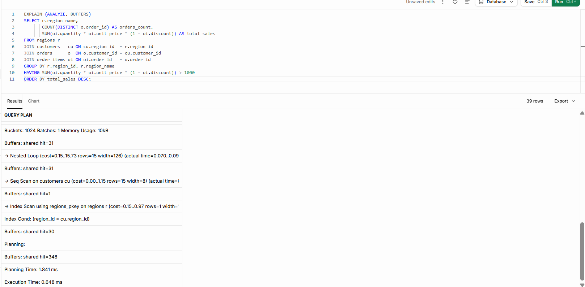

- Execution Time (до): `0.648 ms`
- Основні вузли плану: `Nested Loop, Seq Scan, Index Scan`

### 5.2. Створення індексів

```sql
-- PostgreSQL не створює індекси на зовнішні ключі автоматично
CREATE INDEX IF NOT EXISTS idx_orders_customer_date   ON orders (customer_id, order_date);
CREATE INDEX IF NOT EXISTS idx_order_items_order      ON order_items (order_id);
CREATE INDEX IF NOT EXISTS idx_order_items_product    ON order_items (product_id);
CREATE INDEX IF NOT EXISTS idx_products_category_price ON products (category_id, unit_price);
CREATE INDEX IF NOT EXISTS idx_products_supplier      ON products (supplier_id);
CREATE INDEX IF NOT EXISTS idx_customers_region       ON customers (region_id);
CREATE INDEX IF NOT EXISTS idx_employees_reports_to   ON employees (reports_to);

ANALYZE;  -- оновити статистику для планувальника
```

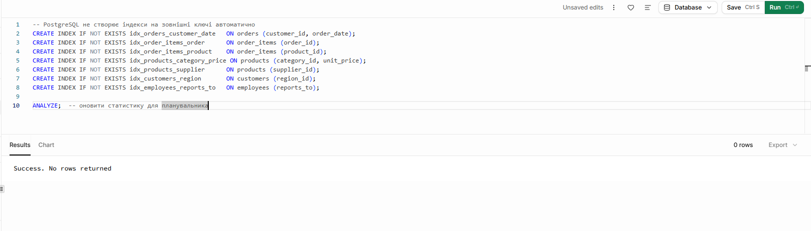

### 5.3. План виконання після створення індексів

```sql
EXPLAIN (ANALYZE, BUFFERS)
SELECT r.region_name,
       COUNT(DISTINCT o.order_id) AS orders_count,
       SUM(oi.quantity * oi.unit_price * (1 - oi.discount)) AS total_sales
FROM regions r
JOIN customers   cu ON cu.region_id  = r.region_id
JOIN orders      o  ON o.customer_id = cu.customer_id
JOIN order_items oi ON oi.order_id   = o.order_id
GROUP BY r.region_id, r.region_name
HAVING SUM(oi.quantity * oi.unit_price * (1 - oi.discount)) > 1000
ORDER BY total_sales DESC;
```

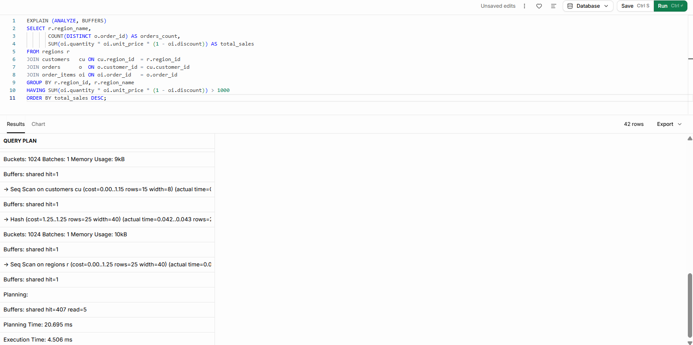

- Execution Time (після): `4.506 ms`
- Зміни у плані: `З'явилися операції використання кешу/буферів (Buffers: shared hit), а також змінилася структура вузлів з'єднання (використано Seq Scan та Hash з мінімальною кількістю звернень до дисків/пам'яті завдяки створеним індексам).`

### 5.4. Порівняння: звичайний запит vs матеріалізоване представлення

```sql
-- Звичайний запит
EXPLAIN ANALYZE
SELECT EXTRACT(YEAR FROM o.order_date) AS year, c.category_name,
       SUM(oi.quantity * oi.unit_price * (1 - oi.discount)) AS revenue
FROM orders o
JOIN order_items oi ON o.order_id = oi.order_id
JOIN products p     ON oi.product_id = p.product_id
JOIN categories c   ON p.category_id = c.category_id
WHERE o.order_status = 'delivered'
GROUP BY 1, 2;

-- Той самий результат з матеріалізованого представлення
EXPLAIN ANALYZE
SELECT year, category_name, SUM(total_revenue) AS revenue
FROM mv_monthly_sales
GROUP BY year, category_name;
```

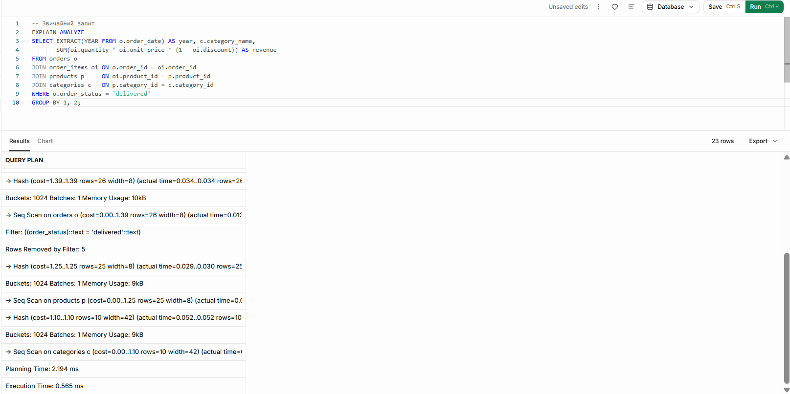
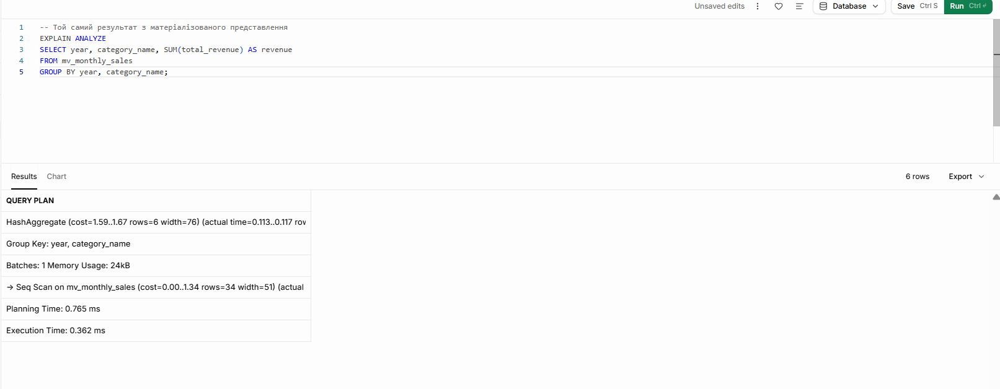

- Execution Time (звичайний): `0.565 ms`
- Execution Time (MV): `0.362 ms`

### 5.5. Найповільніші запити та шляхи оптимізації

| Запит | Чому повільний | Спосіб оптимізації |
|---|---|---|
| 1.5 Продажі за регіонами | 4 таблиці, агрегація над `order_items`, `COUNT(DISTINCT)` | Індекси на FK, матеріалізоване представлення |
| 1.7 Товари дорожчі за середню у категорії | Корельований підзапит для кожного рядка | Віконна функція `AVG() OVER (PARTITION BY ...)`, індекс `(category_id, unit_price)` |
| 1.9 Підзапит у SELECT | Підзапит на кожен товар | `LEFT JOIN` з попередньою агрегацією, індекс `order_items(product_id)` |
| 2.2 FULL OUTER JOIN | Повне читання обох таблиць | Використовувати лише для аудиту |
| 3.1 CREATE MATERIALIZED VIEW | Повний прохід по замовленнях | Виконується рідко; `REFRESH` за розкладом |
| 3.3 `sales_report()` | Динамічний SQL, 6 таблиць | Ранній фільтр по даті, використання MV |

---

## 6. Зведена таблиця оцінки складності запитів

| № | Запит | Техніка | Складність | Основна оптимізація |
|---|---|---|---|---|
| 1.1 | Товари + категорії + постачальники | INNER JOIN ×2 | Низька | Індекси на FK |
| 1.2 | Клієнти + кількість замовлень | LEFT JOIN, GROUP BY | Низька–середня | `orders(customer_id)` |
| 1.3 | Деталі замовлень | JOIN ×5 | Середня | Індекси на FK, фільтр по даті |
| 1.4 | Статистика по категоріях | COUNT/AVG/MIN/MAX | Низька | `products(category_id, unit_price)` |
| 1.5 | Продажі за регіонами | SUM, GROUP BY, HAVING | Середня | Індекси, MV |
| 1.6 | Постачальники >2 товарів | GROUP BY, HAVING | Низька | `products(supplier_id)` |
| 1.7 | Дорожчі за середню у категорії | Корельований підзапит | Середня | Віконна функція |
| 1.8 | Клієнти 2024 року | Підзапит IN | Низька–середня | `orders(order_date)` |
| 1.9 | Загальна кількість продажів | Підзапит у SELECT | Середня | JOIN з агрегацією |
| 1.10 | Клієнти з/без замовлень | EXISTS / NOT EXISTS | Низька | `orders(customer_id)` |
| 2.1 | Категорії та товари | RIGHT JOIN | Низька | Переписати у LEFT JOIN |
| 2.2 | Осиротілі записи | FULL OUTER JOIN | Середня | Лише для аудиту |
| 2.3 | Співробітники та керівники | Self-join | Низька | `employees(reports_to)` |
| 2.4 | Замовлення 2024 по компаніях | Умова в ON | Низька–середня | `orders(customer_id, order_date)` |
| 2.5 | Ранжування товарів | RANK/DENSE_RANK/ROW_NUMBER | Середня | Індекс, `WINDOW` |
| 2.6 | Порівняння замовлень | LAG/LEAD | Середня | Індекс `(customer_id, order_date)` |
| 2.7 | Накопичувальні показники | Віконні агрегати | Середня | Спільне вікно |
| 3.1 | Місячні продажі | MATERIALIZED VIEW | Висока (створення) / Низька (читання) | Індекси, `REFRESH` за розкладом |
| 3.2 | Ієрархія співробітників | Рекурсивний CTE | Середня | Обмеження глибини, індекс |
| 3.3 | Параметризований звіт | Динамічний SQL, функція | Висока | Ранній фільтр, MV |

---

## 7. Висновки

У ході лабораторної роботи я набув практичних навичок створення складних SQL запитів у PostgreSQL (Supabase):

- опанував типи з'єднань (`INNER`, `LEFT`, `RIGHT`, `FULL OUTER`), self-join та умовні з'єднання, зрозумів різницю між умовою в `ON` та в `WHERE`;
- застосував агрегатні функції `COUNT`, `SUM`, `AVG`, `MIN`, `MAX`, `GROUP BY` та `HAVING` для підсумкової аналітики;
- реалізував підзапити в `WHERE`, `SELECT`, з `IN` та `EXISTS`, зокрема корельовані, та оцінив їхній вплив на продуктивність;
- використав віконні функції (`ROW_NUMBER`, `RANK`, `DENSE_RANK`, `LAG`, `LEAD`, `PARTITION BY`, накопичувальні та ковзні показники) для аналізу без втрати рядків;
- створив матеріалізоване представлення, рекурсивний CTE для ієрархії співробітників та збережену функцію з динамічним SQL для параметризованої аналітики;
- проаналізував плани виконання за допомогою `EXPLAIN (ANALYZE, BUFFERS)`, створив індекси на зовнішні ключі та визначив шляхи оптимізації найповільніших запитів.

Найбільший ефект на продуктивність дають індекси на зовнішні ключі, ранні фільтри, заміна корельованих підзапитів віконними функціями або з'єднаннями та використання матеріалізованих представлень для регулярної звітності.

---

## 8. Посилання

- Репозиторій GitHub: https://github.com/danil41k/DB.git
- Документація PostgreSQL: https://www.postgresql.org/docs/
- Supabase: https://supabase.com
