# Звіт до лабораторної роботи №03

**Тема:** Модифікація даних та транзакції

**Виконав:** Остаповець Данило Олександрович, група_ІПЗ-31
**Дата виконання:** 11.11.2026
**Середовище:** PostgreSQL 16 у Docker-контейнері, клієнт `psql`
**База даних:** `library_lab3` (система управління бібліотекою)

---

## 🎯 Мета роботи

Здобути практичні навички безпечної модифікації даних у реляційних базах даних, опанувати механізми транзакцій для забезпечення цілісності даних, навчитися працювати з обмеженнями цілісності та каскадними операціями при зміні взаємопов'язаних записів.

---

## 0. Підготовка середовища

PostgreSQL запущено в Docker-контейнері (рекомендація методички).

```bash
# запуск контейнера
docker run --name pg-lab3 -e POSTGRES_PASSWORD=postgres -p 5432:5432 -d postgres:16

# підключення через psql всередині контейнера
docker exec -it pg-lab3 psql -U postgres
```

```sql
CREATE DATABASE library_lab3;
\c library_lab3
SELECT version();
```

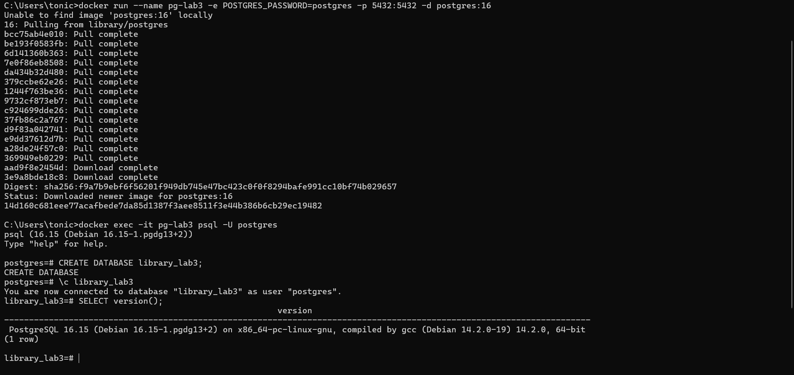
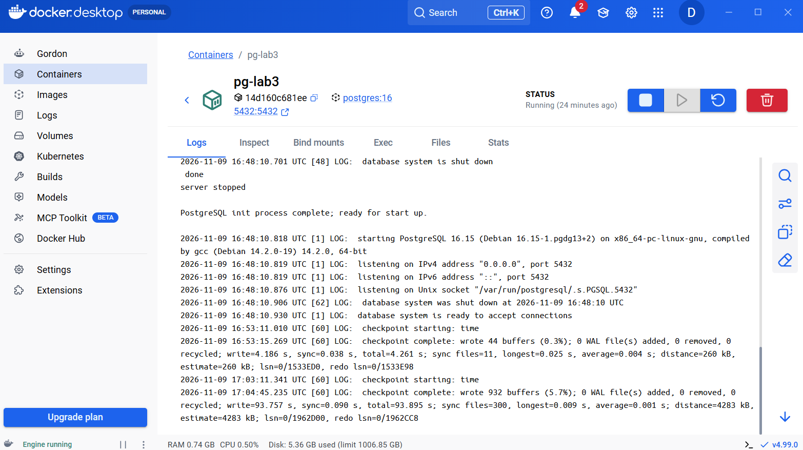

### Схема бази даних (підсумкова)

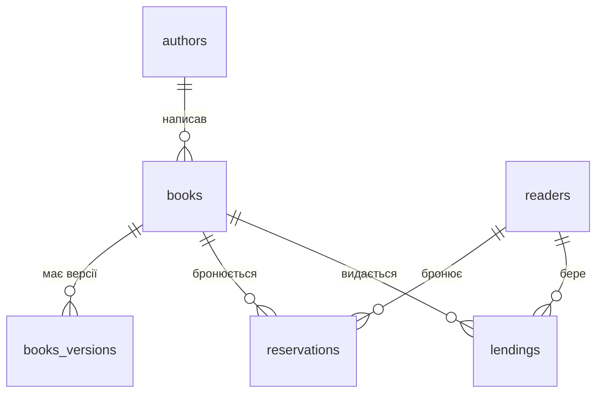

---

# Рівень 1

## 1.1. Створення структури бази даних

```sql
-- Таблиця авторів
CREATE TABLE authors (
    author_id  SERIAL PRIMARY KEY,
    first_name VARCHAR(50) NOT NULL,
    last_name  VARCHAR(50) NOT NULL,
    birth_year INTEGER CHECK (birth_year >= 1000 AND birth_year <= EXTRACT(YEAR FROM CURRENT_DATE)),
    country    VARCHAR(50),
    created_at TIMESTAMP DEFAULT CURRENT_TIMESTAMP
);

-- Таблиця книг
CREATE TABLE books (
    book_id          SERIAL PRIMARY KEY,
    isbn             VARCHAR(17) UNIQUE NOT NULL,
    title            VARCHAR(200) NOT NULL,
    author_id        INTEGER NOT NULL,
    publication_year INTEGER CHECK (publication_year >= 1450),
    genre            VARCHAR(50),
    total_copies     INTEGER DEFAULT 1 CHECK (total_copies >= 0),
    available_copies INTEGER DEFAULT 1 CHECK (available_copies >= 0),
    created_at       TIMESTAMP DEFAULT CURRENT_TIMESTAMP,
    FOREIGN KEY (author_id) REFERENCES authors(author_id) ON DELETE RESTRICT,
    CHECK (available_copies <= total_copies)
);

-- Таблиця читачів
CREATE TABLE readers (
    reader_id           SERIAL PRIMARY KEY,
    first_name          VARCHAR(50) NOT NULL,
    last_name           VARCHAR(50) NOT NULL,
    email               VARCHAR(100) UNIQUE NOT NULL,
    phone               VARCHAR(20),
    library_card_number VARCHAR(20) UNIQUE NOT NULL,
    registration_date   DATE DEFAULT CURRENT_DATE,
    status              VARCHAR(20) DEFAULT 'Active' CHECK (status IN ('Active', 'Blocked', 'Inactive'))
);

-- Таблиця видач книг
CREATE TABLE lendings (
    lending_id   SERIAL PRIMARY KEY,
    book_id      INTEGER NOT NULL,
    reader_id    INTEGER NOT NULL,
    lending_date DATE DEFAULT CURRENT_DATE,
    due_date     DATE NOT NULL,
    return_date  DATE,
    FOREIGN KEY (book_id)   REFERENCES books(book_id)     ON DELETE RESTRICT,
    FOREIGN KEY (reader_id) REFERENCES readers(reader_id) ON DELETE RESTRICT,
    CHECK (due_date > lending_date),
    CHECK (return_date IS NULL OR return_date >= lending_date)
);
```

```sql
\dt
\d books
```

**Опис:** створено 4 таблиці. Використані обмеження цілісності:

| Обмеження | Де застосовано |
|--------------------------------------|-------------------------------------------------------------------------------------------------|
| `PRIMARY KEY`                        | `author_id`, `book_id`, `reader_id`, `lending_id`                                               |
| `FOREIGN KEY` (`ON DELETE RESTRICT`) | `books → authors`, `lendings → books`, `lendings → readers`                                     |
| `UNIQUE`                             | `books.isbn`, `readers.email`, `readers.library_card_number`                                    |
| `NOT NULL`                           | імена, ISBN, назва, e-mail, номер квитка, `due_date`                                            |
| `CHECK`                              | роки, кількість примірників, `available_copies <= total_copies`, статус читача, коректність дат |
| `DEFAULT`                            | `created_at`, `status`, `lending_date`, кількість примірників                                   |

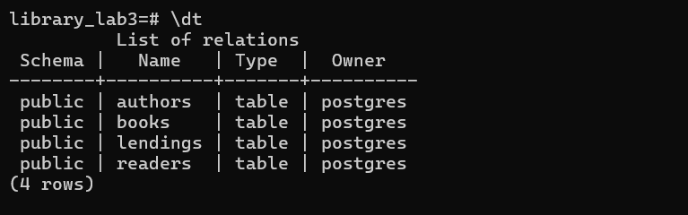
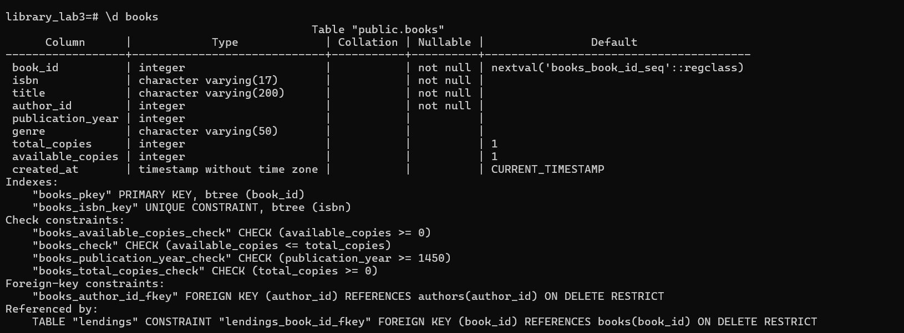

---

## 1.2. Додавання даних та перевірка обмежень

### Додавання початкових даних

```sql
-- Додавання авторів
INSERT INTO authors (first_name, last_name, birth_year, country)
VALUES
    ('Тарас',     'Шевченко',     1814, 'Україна'),
    ('Іван',      'Франко',       1856, 'Україна'),
    ('Леся',      'Українка',     1871, 'Україна'),
    ('Михайло',   'Коцюбинський', 1864, 'Україна'),
    ('Панас',     'Мирний',       1849, 'Україна');

-- Додавання книг
INSERT INTO books (isbn, title, author_id, publication_year, genre, total_copies, available_copies)
VALUES
    ('978-966-03-4561-2', 'Кобзар',                           1, 1840, 'Поезія',          10, 8),
    ('978-966-03-4562-9', 'Захар Беркут',                     2, 1883, 'Історична проза',  5, 4),
    ('978-966-03-4563-6', 'Лісова пісня',                     3, 1911, 'Драма',            7, 7),
    ('978-966-03-4564-3', 'Тіні забутих предків',             4, 1911, 'Повість',          6, 5),
    ('978-966-03-4565-0', 'Хіба ревуть воли, як ясла повні',  5, 1880, 'Повість',          4, 4);

-- Додавання читачів
INSERT INTO readers (first_name, last_name, email, phone, library_card_number)
VALUES
    ('Олена',  'Петренко',  'olena.petrenko@email.com',   '+380501234567', 'LIB-2024-001'),
    ('Андрій', 'Коваленко', 'andrii.kovalenko@email.com', '+380502345678', 'LIB-2024-002'),
    ('Марія',  'Сидоренко', 'maria.sydorenko@email.com',  '+380503456789', 'LIB-2024-003'),
    ('Іван',   'Мельник',   'ivan.melnyk@email.com',      '+380504567890', 'LIB-2024-004');

-- Перевірка кількості записів
SELECT 'authors' AS tbl, COUNT(*) FROM authors
UNION ALL SELECT 'books',   COUNT(*) FROM books
UNION ALL SELECT 'readers', COUNT(*) FROM readers;
```

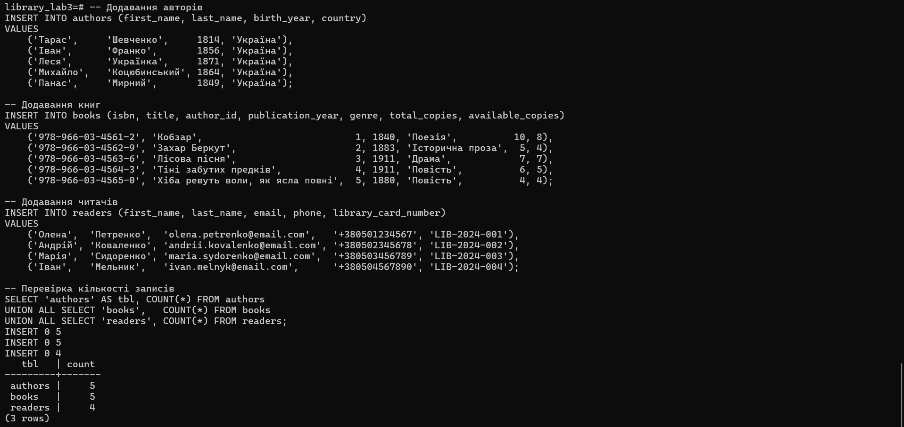

### Інші форми INSERT: RETURNING та INSERT ... SELECT

```sql
-- INSERT з RETURNING (повертає згенерований ID)
INSERT INTO authors (first_name, last_name, birth_year, country)
VALUES ('Ольга', 'Кобилянська', 1863, 'Україна')
RETURNING author_id, first_name, last_name;

-- INSERT ... SELECT: архівна таблиця з даних запиту
CREATE TABLE archive_books (
    isbn         VARCHAR(17),
    title        VARCHAR(200),
    archive_date DATE
);

INSERT INTO archive_books (isbn, title, archive_date)
SELECT isbn, title, CURRENT_DATE
FROM books
WHERE publication_year < 1900;

SELECT * FROM archive_books;
```

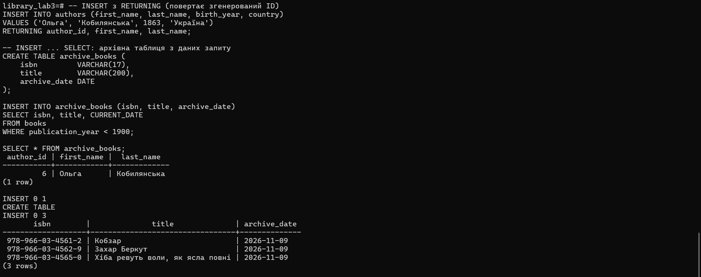

### Перевірка обмежень (кожен запит виконується окремо — очікується помилка)

```sql
-- 1) Порушення UNIQUE: дублікат ISBN
INSERT INTO books (isbn, title, author_id, publication_year, genre)
VALUES ('978-966-03-4561-2', 'Дублікат', 1, 2000, 'Тест');

-- 2) Порушення FOREIGN KEY: неіснуючий автор
INSERT INTO books (isbn, title, author_id, publication_year, genre)
VALUES ('978-966-99-0000-1', 'Книга без автора', 999, 2000, 'Тест');

-- 3) Порушення CHECK: від'ємна кількість примірників
INSERT INTO books (isbn, title, author_id, publication_year, genre, total_copies, available_copies)
VALUES ('978-966-99-0000-2', 'Мінус', 1, 2000, 'Тест', -1, 0);

-- 4) Порушення CHECK (рівень таблиці): доступних більше, ніж усього
INSERT INTO books (isbn, title, author_id, publication_year, genre, total_copies, available_copies)
VALUES ('978-966-99-0000-3', 'Забагато', 1, 2000, 'Тест', 2, 5);

-- 5) Порушення NOT NULL: ім'я читача не вказано
INSERT INTO readers (first_name, last_name, email, library_card_number)
VALUES (NULL, 'Тест', 'null.test@email.com', 'LIB-2024-900');

-- 6) Порушення CHECK: недопустимий статус
INSERT INTO readers (first_name, last_name, email, library_card_number, status)
VALUES ('Тест', 'Статус', 'status.test@email.com', 'LIB-2024-901', 'Deleted');
```

**Опис:** кожен із шести запитів відхилено СУБД з повідомленням про порушення відповідного обмеження (`unique_violation`, `foreign_key_violation`, `check_violation`, `not_null_violation`). Дані при цьому не змінились. Помилкові INSERT «спалюють» значення послідовності (`SERIAL`), тому в нумерації `book_id` можливі пропуски — це нормальна поведінка PostgreSQL.

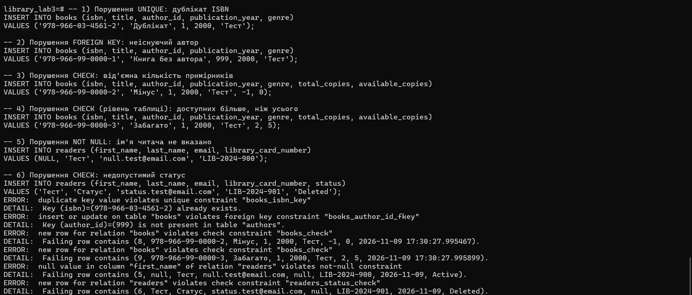

---

## 1.3. Безпечне оновлення записів (UPDATE з WHERE)

```sql
-- Перевірка перед оновленням
SELECT book_id, title, available_copies
FROM books
WHERE book_id = 1;

-- Оновлення кількості доступних примірників
UPDATE books
SET available_copies = available_copies - 1
WHERE book_id = 1 AND available_copies > 0;

-- Перевірка результату
SELECT book_id, title, available_copies
FROM books
WHERE book_id = 1;
```

```sql
-- UPDATE з RETURNING (бачимо змінені рядки відразу)
UPDATE books
SET available_copies = available_copies + 1
WHERE isbn = '978-966-03-4561-2'
RETURNING book_id, title, available_copies;

-- Оновлення кількох полів одночасно
UPDATE readers
SET email = 'olena.new@email.com',
    phone = '+380509999999'
WHERE reader_id = 1
RETURNING reader_id, email, phone;

-- Умова не виконується → змінено 0 рядків (захист від списання нижче 0)
UPDATE books
SET available_copies = available_copies - 100
WHERE book_id = 3 AND available_copies >= 100;
```

**Опис:** перед кожною зміною виконано `SELECT` з тією самою умовою `WHERE`, щоб побачити, які рядки будуть змінені. Умова `available_copies > 0` не дозволяє списати примірник, якого немає (результат `UPDATE 0`). `RETURNING` одразу показує змінені значення.

> **Примітка щодо синтаксису PostgreSQL:** в `UPDATE ... FROM` у частині `SET` не можна вказувати псевдонім таблиці (`SET b.available_copies` — помилка). Правильно: `SET available_copies = b.available_copies + 1`.

```sql
-- UPDATE з використанням іншої таблиці (у транзакції з відкатом — лише демонстрація)
BEGIN;
UPDATE books b
SET available_copies = b.available_copies + 1
FROM lendings l
WHERE b.book_id = l.book_id
  AND l.return_date = CURRENT_DATE
RETURNING b.book_id, b.available_copies;
ROLLBACK;
```
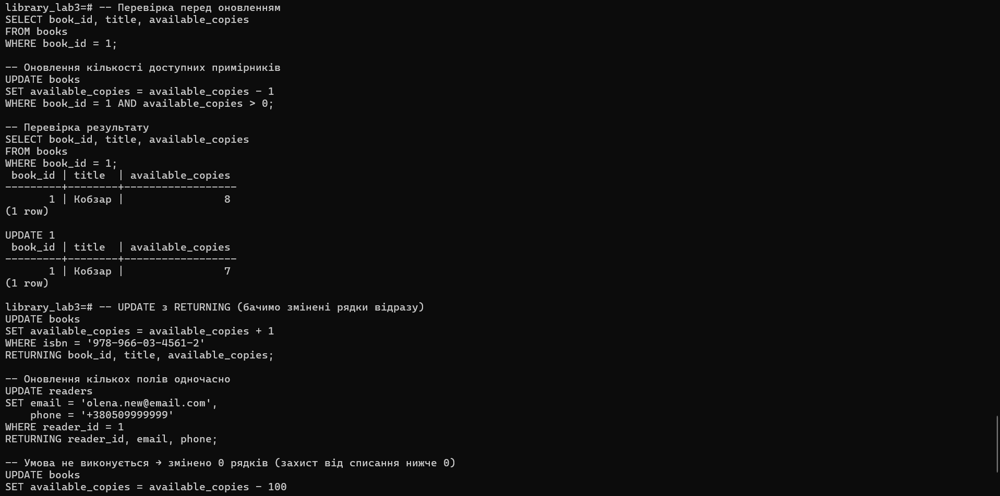
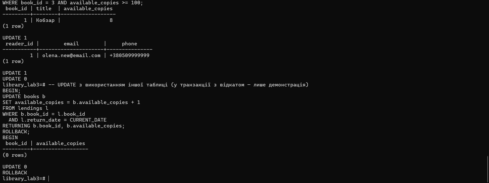

---

## 1.4. Транзакції: видача книги

```sql
BEGIN;

-- Видача книги
INSERT INTO lendings (book_id, reader_id, due_date)
VALUES (1, 1, CURRENT_DATE + INTERVAL '14 days');

-- Зменшення кількості доступних примірників
UPDATE books
SET available_copies = available_copies - 1
WHERE book_id = 1 AND available_copies > 0;

-- Перевірка результатів перед підтвердженням
SELECT * FROM lendings WHERE lending_id = currval('lendings_lending_id_seq');
SELECT book_id, title, available_copies FROM books WHERE book_id = 1;

COMMIT;
```

**Опис:** дві пов'язані операції (створення видачі та зменшення залишку) виконуються як одна транзакція: або виконуються обидві, або жодна. `currval('lendings_lending_id_seq')` повертає ID щойно доданої видачі (надійніше за `LASTVAL()`, який залежить від останньої використаної послідовності будь-якої таблиці).

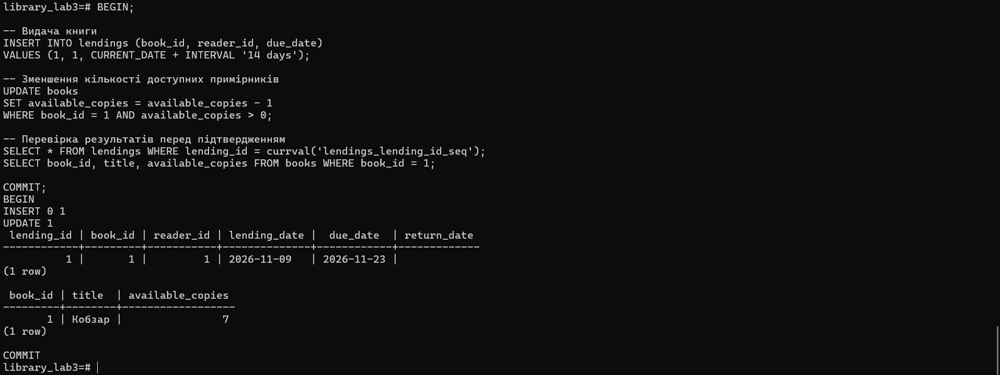

### Атомарність: помилка в середині транзакції

```sql
BEGIN;

INSERT INTO lendings (book_id, reader_id, due_date)
VALUES (2, 2, CURRENT_DATE + INTERVAL '14 days');

-- Помилка: available_copies стане від'ємним → порушення CHECK
UPDATE books SET available_copies = available_copies - 10 WHERE book_id = 2;

ROLLBACK;

-- Перевірка: видача для книги 2 НЕ збереглась
SELECT COUNT(*) AS lendings_for_book_2 FROM lendings WHERE book_id = 2;
```

**Опис:** `INSERT` у цій транзакції пройшов успішно, але наступний `UPDATE` порушив `CHECK`. Після помилки транзакція переходить у стан «aborted» і `ROLLBACK` скасовує також уже виконаний `INSERT` — результат запиту `0`. Це і є атомарність.

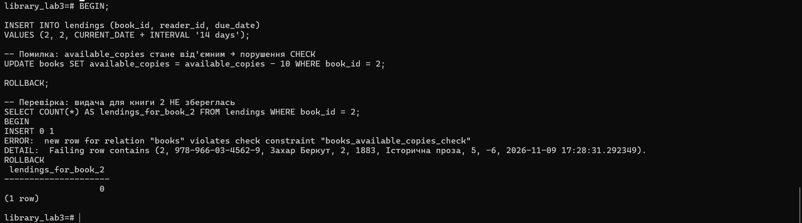

---

## 1.5. Демонстрація ROLLBACK

```sql
BEGIN;

-- Спроба видалити автора, у якого є книги
DELETE FROM authors WHERE author_id = 1;
-- ERROR: update or delete on table "authors" violates foreign key constraint ...

ROLLBACK;

-- Перевірка, що дані не змінилися
SELECT * FROM authors WHERE author_id = 1;
```

```sql
-- Ручний ROLLBACK: помилково виконаний UPDATE без WHERE
BEGIN;
UPDATE books SET available_copies = 0;           -- забули WHERE!
SELECT book_id, title, available_copies FROM books ORDER BY book_id;   -- всюди 0
ROLLBACK;
SELECT book_id, title, available_copies FROM books ORDER BY book_id;   -- значення відновлені
```

**Опис:** у першому прикладі ROLLBACK виконано після помилки зовнішнього ключа (`ON DELETE RESTRICT`). У другому — після помилкового масового оновлення: `ROLLBACK` повертає всі значення до початкових. Це демонструє, чому небезпечні операції варто виконувати всередині транзакції.

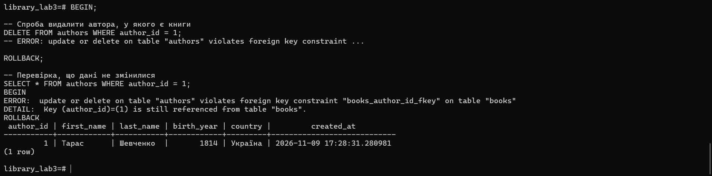
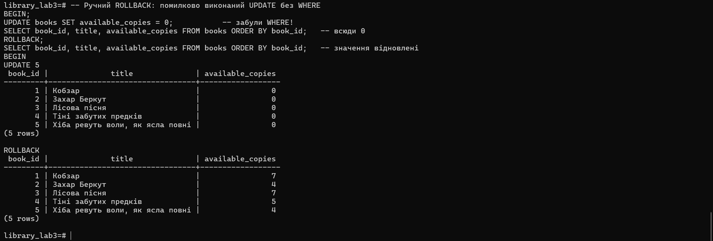

---

## 1.6. Безпечне видалення з урахуванням зовнішніх ключів

```sql
-- Додаємо неактивного читача без боргів для демонстрації
INSERT INTO readers (first_name, last_name, email, library_card_number, status)
VALUES ('Петро', 'Неактивний', 'inactive@email.com', 'LIB-2024-050', 'Inactive');

-- Перевірка перед видаленням
SELECT reader_id, last_name, status
FROM readers
WHERE status = 'Inactive'
  AND NOT EXISTS (
      SELECT 1 FROM lendings l
      WHERE l.reader_id = readers.reader_id AND l.return_date IS NULL
  );

-- Видалення неактивних читачів без боргів
DELETE FROM readers
WHERE status = 'Inactive'
  AND NOT EXISTS (
      SELECT 1 FROM lendings l
      WHERE l.reader_id = readers.reader_id AND l.return_date IS NULL
  )
RETURNING reader_id, last_name;
```

```sql
-- Спроба видалити читача, який має записи у lendings → помилка (RESTRICT)
DELETE FROM readers WHERE reader_id = 1;

-- Видалення «знизу вгору»: спочатку залежні записи, потім батьківські
BEGIN;
INSERT INTO authors (first_name, last_name, birth_year, country)
VALUES ('Тимчасовий', 'Автор', 1950, 'Україна');

INSERT INTO books (isbn, title, author_id, publication_year, genre)
VALUES ('978-966-99-1111-1', 'Тимчасова книга', currval('authors_author_id_seq'), 2000, 'Тест');

DELETE FROM authors WHERE last_name = 'Автор' AND first_name = 'Тимчасовий';   -- ПОМИЛКА: є книга
ROLLBACK;

BEGIN;
INSERT INTO authors (first_name, last_name, birth_year, country)
VALUES ('Тимчасовий', 'Автор', 1950, 'Україна');
INSERT INTO books (isbn, title, author_id, publication_year, genre)
VALUES ('978-966-99-1111-1', 'Тимчасова книга', currval('authors_author_id_seq'), 2000, 'Тест');

DELETE FROM books   WHERE isbn = '978-966-99-1111-1';                              -- спочатку книга
DELETE FROM authors WHERE last_name = 'Автор' AND first_name = 'Тимчасовий';       -- потім автор
COMMIT;
```

```sql
-- Видалення за даними з іншої таблиці: у PostgreSQL використовується USING (не JOIN)
BEGIN;
DELETE FROM lendings l
USING readers r
WHERE l.reader_id = r.reader_id
  AND r.status = 'Blocked'
RETURNING l.lending_id;
ROLLBACK;
```

**Опис:** перед `DELETE` виконано `SELECT` з тією ж умовою. Видалення читача, який має видачі, заборонено (`ON DELETE RESTRICT`). Щоб видалити батьківський запис, спочатку видаляють дочірні. У PostgreSQL замість `DELETE ... JOIN` використовується `DELETE ... USING`.

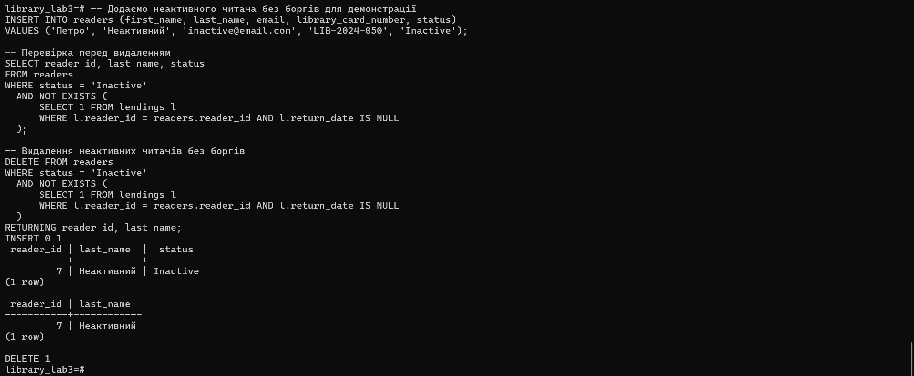
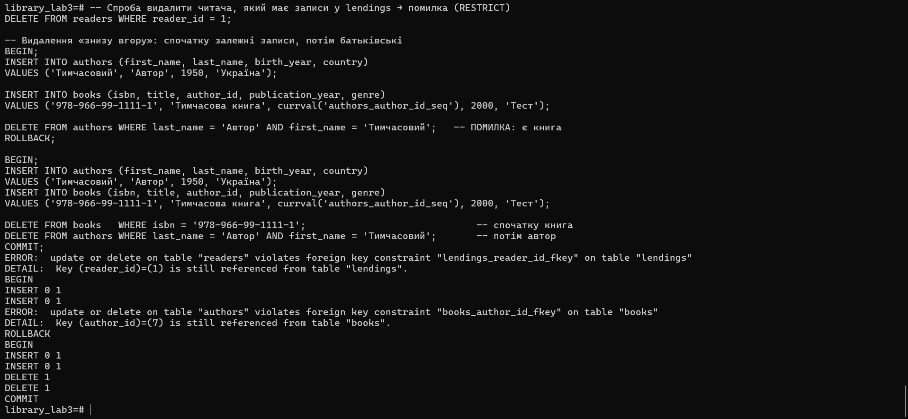
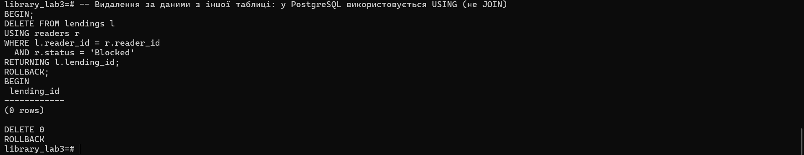

---

## Підсумок рівня 1

| Завдання                              | Виконано | Розділ   |
|---------------------------------------|----------|----------|
| Структура БД з обмеженнями цілісності | ✔        | 1.1      |
| INSERT з перевіркою обмежень          | ✔        | 1.2      |
| Безпечний UPDATE з WHERE              | ✔        | 1.3      |
| DELETE з урахуванням зовнішніх ключів | ✔        | 1.6      |
| Прості транзакції (COMMIT)            | ✔        | 1.4      |
| ROLLBACK при помилках                 | ✔        | 1.4, 1.5 |

---

# Рівень 2

## 2.1. Додаткові таблиці: бронювання та історія змін

```sql
-- Таблиця бронювань
CREATE TABLE reservations (
    reservation_id   SERIAL PRIMARY KEY,
    book_id          INTEGER NOT NULL,
    reader_id        INTEGER NOT NULL,
    reservation_date TIMESTAMP DEFAULT CURRENT_TIMESTAMP,
    expiration_date  TIMESTAMP NOT NULL,
    status           VARCHAR(20) DEFAULT 'Active'
                     CHECK (status IN ('Active', 'Fulfilled', 'Cancelled', 'Expired')),
    FOREIGN KEY (book_id)   REFERENCES books(book_id)     ON DELETE CASCADE,
    FOREIGN KEY (reader_id) REFERENCES readers(reader_id) ON DELETE CASCADE
);

-- Таблиця історії змін
CREATE TABLE audit_log (
    log_id     SERIAL PRIMARY KEY,
    table_name VARCHAR(50) NOT NULL,
    operation  VARCHAR(10) NOT NULL,
    record_id  INTEGER NOT NULL,
    old_data   JSONB,
    new_data   JSONB,
    changed_at TIMESTAMP DEFAULT CURRENT_TIMESTAMP,
    changed_by VARCHAR(100) DEFAULT CURRENT_USER
);

CREATE INDEX idx_reservations_book_status ON reservations (book_id, status);
CREATE INDEX idx_audit_log_table_record   ON audit_log (table_name, record_id);

\dt
```

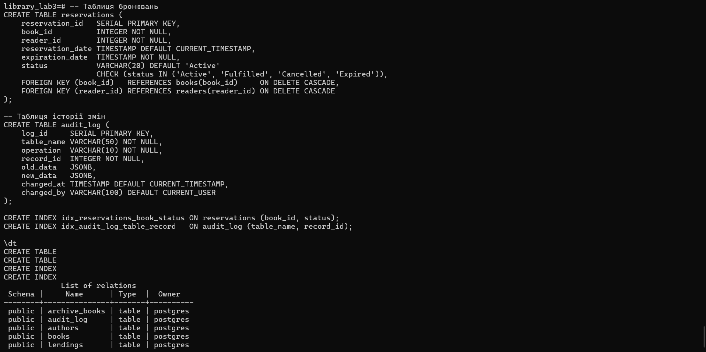


---

## 2.2. Складна транзакція: повернення книги

Спочатку додаємо бронювання на книгу, яку зараз видано (книга 1, читач 2):

```sql
INSERT INTO reservations (book_id, reader_id, expiration_date)
VALUES (1, 2, CURRENT_TIMESTAMP + INTERVAL '7 days');
```

Повернення книги — одна транзакція з трьох змін у різних таблицях:

```sql
BEGIN;

-- 1) Закриваємо видачу і одночасно отримуємо book_id; повторне повернення нічого не змінить
WITH returned AS (
    UPDATE lendings
    SET return_date = CURRENT_DATE
    WHERE lending_id = 1 AND return_date IS NULL
    RETURNING book_id
)
-- 2) Збільшуємо кількість доступних примірників тільки якщо видачу справді закрито
UPDATE books
SET available_copies = available_copies + 1
WHERE book_id IN (SELECT book_id FROM returned)
RETURNING book_id, title, available_copies;

-- 3) Перше за чергою активне бронювання на цю книгу позначаємо виконаним
UPDATE reservations
SET status = 'Fulfilled'
WHERE reservation_id = (
    SELECT reservation_id
    FROM reservations
    WHERE book_id = (SELECT book_id FROM lendings WHERE lending_id = 1)
      AND status = 'Active'
    ORDER BY reservation_date
    LIMIT 1
)
RETURNING reservation_id, reader_id, status;

COMMIT;

-- Перевірка
SELECT lending_id, return_date FROM lendings WHERE lending_id = 1;
SELECT reservation_id, status FROM reservations;
```

**Опис:** транзакція об'єднує зміни в трьох таблицях (`lendings`, `books`, `reservations`). Використання CTE з `RETURNING` гарантує, що `available_copies` збільшується лише тоді, коли видачу було реально закрито (при повторному виконанні буде 0 змінених рядків, а не «зайвий» примірник).

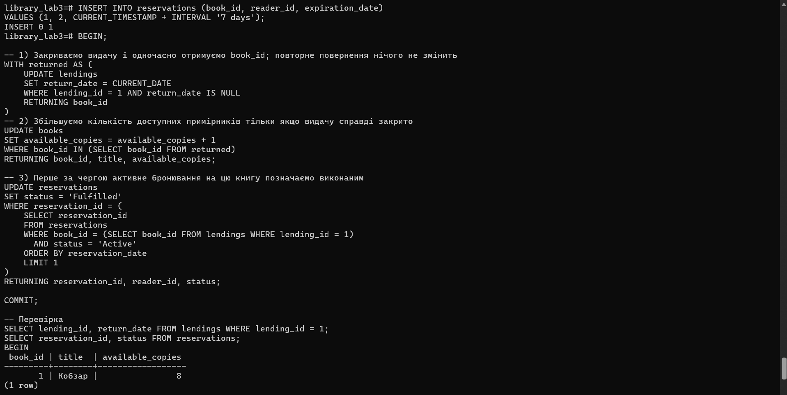
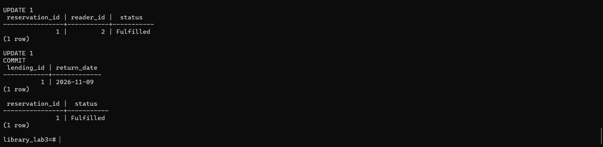

---

## 2.3. Точки збереження (SAVEPOINT)

```sql
BEGIN;

-- Додаємо нового автора
INSERT INTO authors (first_name, last_name, birth_year, country)
VALUES ('Марко', 'Вовчок', 1833, 'Україна');

SAVEPOINT after_author;

-- Додаємо книгу
INSERT INTO books (isbn, title, author_id, publication_year, genre, total_copies, available_copies)
VALUES ('978-966-03-4566-7', 'Народні оповідання', currval('authors_author_id_seq'), 1857, 'Оповідання', 3, 3);

SAVEPOINT after_book;

-- Помилка: дублікат ISBN
INSERT INTO books (isbn, title, author_id, publication_year, genre)
VALUES ('978-966-03-4566-7', 'Інша книга', currval('authors_author_id_seq'), 1865, 'Оповідання');

-- Транзакція «зламана». Відкат лише до точки after_book — перша книга ЗБЕРІГАЄТЬСЯ
ROLLBACK TO SAVEPOINT after_book;

SELECT isbn, title FROM books WHERE author_id = currval('authors_author_id_seq');   -- 1 книга

-- Додаємо другу книгу з правильним ISBN
INSERT INTO books (isbn, title, author_id, publication_year, genre, total_copies, available_copies)
VALUES ('978-966-03-4568-1', 'Інститутка', currval('authors_author_id_seq'), 1860, 'Повість', 2, 2);

SELECT isbn, title FROM books WHERE author_id = currval('authors_author_id_seq');   -- 2 книги

-- Відкат до after_author: обидві книги скасовані, автор залишається
ROLLBACK TO SAVEPOINT after_author;

SELECT isbn, title FROM books WHERE author_id = currval('authors_author_id_seq');   -- 0 книг

-- Додаємо книгу заново (остаточний варіант)
INSERT INTO books (isbn, title, author_id, publication_year, genre, total_copies, available_copies)
VALUES ('978-966-03-4567-4', 'Народні оповідання', currval('authors_author_id_seq'), 1857, 'Оповідання', 3, 3);

COMMIT;

SELECT a.last_name, b.title FROM authors a JOIN books b USING (author_id) WHERE a.last_name = 'Вовчок';
```

**Опис:** без `SAVEPOINT` помилка дублікату ISBN зробила б усю транзакцію непридатною (єдиний вихід — повний `ROLLBACK`). Завдяки точкам збереження відкочується тільки потрібна частина: автор і успішно додана книга залишаються, а некоректна операція скасовується. Другий `ROLLBACK TO` демонструє відкат до ранішої точки — все додане після неї (дві книги) зникає, а автор залишається.

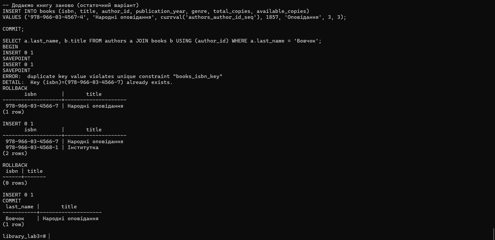

---

## 2.4. Каскадні операції

### Політика зовнішніх ключів

| Зв'язок                  | ON DELETE | ON UPDATE |                            Обґрунтування                                      |
|--------------------------|-----------|-----------|-------------------------------------------------------------------------------|
| `books → authors`        | RESTRICT  | CASCADE   | не можна втратити книги разом з автором, але зміна ID автора має поширюватись |
| `lendings → books`       | RESTRICT  | CASCADE   | історія видач не повинна зникати разом із книгою                              |
| `lendings → readers`     | RESTRICT  | CASCADE   | аналогічно                                                                    |
| `reservations → books`   | CASCADE   | CASCADE   | бронювання неіснуючої книги не має сенсу                                      |
| `reservations → readers` | CASCADE   | CASCADE   | бронювання видаленого читача не потрібні                                      |

```sql
-- Додаємо ON UPDATE CASCADE до наявних зовнішніх ключів
ALTER TABLE books
    DROP CONSTRAINT books_author_id_fkey,
    ADD  CONSTRAINT books_author_id_fkey
         FOREIGN KEY (author_id) REFERENCES authors(author_id)
         ON UPDATE CASCADE ON DELETE RESTRICT;

ALTER TABLE lendings
    DROP CONSTRAINT lendings_book_id_fkey,
    DROP CONSTRAINT lendings_reader_id_fkey,
    ADD  CONSTRAINT lendings_book_id_fkey
         FOREIGN KEY (book_id)   REFERENCES books(book_id)
         ON UPDATE CASCADE ON DELETE RESTRICT,
    ADD  CONSTRAINT lendings_reader_id_fkey
         FOREIGN KEY (reader_id) REFERENCES readers(reader_id)
         ON UPDATE CASCADE ON DELETE RESTRICT;

ALTER TABLE reservations
    DROP CONSTRAINT reservations_book_id_fkey,
    DROP CONSTRAINT reservations_reader_id_fkey,
    ADD  CONSTRAINT reservations_book_id_fkey
         FOREIGN KEY (book_id)   REFERENCES books(book_id)
         ON UPDATE CASCADE ON DELETE CASCADE,
    ADD  CONSTRAINT reservations_reader_id_fkey
         FOREIGN KEY (reader_id) REFERENCES readers(reader_id)
         ON UPDATE CASCADE ON DELETE CASCADE;

-- Перевірка визначень
SELECT conrelid::regclass AS tbl, conname,
       confupdtype AS on_update, confdeltype AS on_delete
FROM pg_constraint
WHERE contype = 'f'
ORDER BY 1, 2;
-- Коди: a = NO ACTION, r = RESTRICT, c = CASCADE, n = SET NULL, d = SET DEFAULT
```

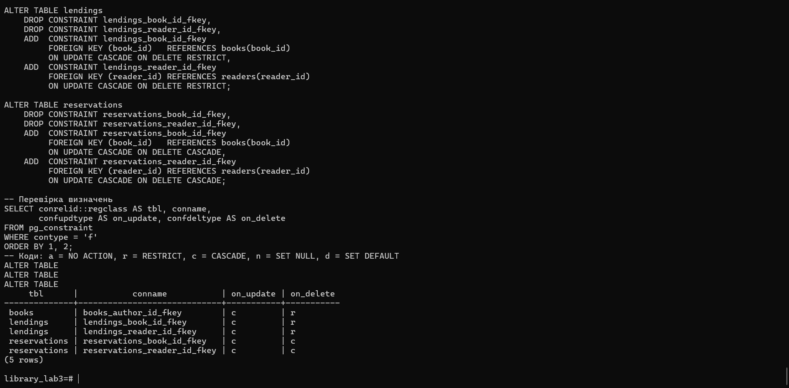

### Демонстрація ON UPDATE CASCADE, RESTRICT та ON DELETE CASCADE

```sql
-- Тестові дані
BEGIN;
INSERT INTO authors (first_name, last_name, birth_year, country)
VALUES ('Тестовий', 'Автор', 1900, 'Україна');

INSERT INTO books (isbn, title, author_id, publication_year, genre, total_copies, available_copies)
VALUES ('978-966-00-0000-0', 'Тестова книга', currval('authors_author_id_seq'), 2000, 'Тест', 1, 0);

INSERT INTO reservations (book_id, reader_id, expiration_date)
VALUES (currval('books_book_id_seq'), 1, CURRENT_TIMESTAMP + INTERVAL '7 days');
COMMIT;

-- Перевірка зв'язків
SELECT b.book_id, b.title, b.author_id, r.reservation_id
FROM books b
LEFT JOIN reservations r ON b.book_id = r.book_id
WHERE b.isbn = '978-966-00-0000-0';

-- 1) ON UPDATE CASCADE: змінюємо PK автора → author_id у книзі змінюється автоматично
UPDATE authors SET author_id = 900 WHERE first_name = 'Тестовий' AND last_name = 'Автор';

SELECT book_id, title, author_id FROM books WHERE isbn = '978-966-00-0000-0';   -- author_id = 900

-- 2) RESTRICT: видалення автора, у якого є книга, заборонено
DELETE FROM authors WHERE author_id = 900;   -- ПОМИЛКА

-- 3) ON DELETE CASCADE: видалення книги автоматично видаляє її бронювання
SELECT COUNT(*) AS reservations_before FROM reservations
WHERE book_id = (SELECT book_id FROM books WHERE isbn = '978-966-00-0000-0');

DELETE FROM books WHERE isbn = '978-966-00-0000-0';

SELECT COUNT(*) AS orphan_reservations FROM reservations
WHERE book_id NOT IN (SELECT book_id FROM books);   -- 0

-- Тепер автора можна видалити (книг більше немає)
DELETE FROM authors WHERE author_id = 900;
```

**Опис:** `ON UPDATE CASCADE` автоматично оновив `books.author_id` після зміни первинного ключа автора. `RESTRICT` не дозволив видалити автора, поки існує його книга. `ON DELETE CASCADE` разом із книгою видалив пов'язане бронювання — «осиротілих» бронювань немає.

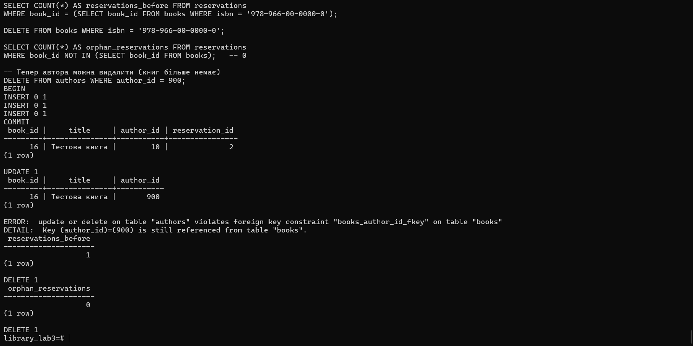

---

## 2.5. Тригери для автоматичного ведення історії змін

Один універсальний тригер для кількох таблиць (назва ключового стовпця передається аргументом).

```sql
CREATE OR REPLACE FUNCTION log_table_changes()
RETURNS TRIGGER
LANGUAGE plpgsql
SECURITY DEFINER            -- запис в audit_log виконується з правами власника функції
SET search_path = public
AS $$
DECLARE
    v_pk   TEXT := TG_ARGV[0];      -- назва стовпця первинного ключа
    v_user TEXT := CASE WHEN current_setting('role') = 'none'
                        THEN session_user ELSE current_setting('role') END;
BEGIN
    IF TG_OP = 'INSERT' THEN
        INSERT INTO audit_log (table_name, operation, record_id, new_data, changed_by)
        VALUES (TG_TABLE_NAME, TG_OP, (to_jsonb(NEW)->>v_pk)::int, to_jsonb(NEW), v_user);
    ELSIF TG_OP = 'UPDATE' THEN
        INSERT INTO audit_log (table_name, operation, record_id, old_data, new_data, changed_by)
        VALUES (TG_TABLE_NAME, TG_OP, (to_jsonb(NEW)->>v_pk)::int, to_jsonb(OLD), to_jsonb(NEW), v_user);
    ELSIF TG_OP = 'DELETE' THEN
        INSERT INTO audit_log (table_name, operation, record_id, old_data, changed_by)
        VALUES (TG_TABLE_NAME, TG_OP, (to_jsonb(OLD)->>v_pk)::int, to_jsonb(OLD), v_user);
    END IF;
    RETURN NULL;     -- для AFTER-тригера значення, що повертається, ігнорується
END;
$$;

CREATE TRIGGER trg_books_audit
AFTER INSERT OR UPDATE OR DELETE ON books
FOR EACH ROW EXECUTE FUNCTION log_table_changes('book_id');

CREATE TRIGGER trg_readers_audit
AFTER INSERT OR UPDATE OR DELETE ON readers
FOR EACH ROW EXECUTE FUNCTION log_table_changes('reader_id');

CREATE TRIGGER trg_lendings_audit
AFTER INSERT OR UPDATE OR DELETE ON lendings
FOR EACH ROW EXECUTE FUNCTION log_table_changes('lending_id');

CREATE TRIGGER trg_reservations_audit
AFTER INSERT OR UPDATE OR DELETE ON reservations
FOR EACH ROW EXECUTE FUNCTION log_table_changes('reservation_id');

-- Список тригерів
SELECT event_object_table, trigger_name, event_manipulation
FROM information_schema.triggers
WHERE trigger_schema = 'public'
ORDER BY 1, 2, 3;
```

### Тестування тригерів

```sql
-- UPDATE книги
UPDATE books SET available_copies = available_copies + 1 WHERE book_id = 1;

-- INSERT та DELETE книги
INSERT INTO books (isbn, title, author_id, publication_year, genre, total_copies, available_copies)
VALUES ('978-966-99-2222-2', 'Журнальна книга', 1, 2020, 'Тест', 1, 1);
DELETE FROM books WHERE isbn = '978-966-99-2222-2';

-- UPDATE читача
UPDATE readers SET phone = '+380508888888' WHERE reader_id = 2;

-- Перегляд логу
SELECT log_id, table_name, operation, record_id,
       COALESCE(new_data->>'title', old_data->>'title')  AS title,
       old_data->>'available_copies'                     AS old_copies,
       new_data->>'available_copies'                     AS new_copies,
       changed_at, changed_by
FROM audit_log
ORDER BY log_id DESC;
```

**Опис:** після кожного INSERT/UPDATE/DELETE тригер автоматично додає запис в `audit_log`: тип операції, старі та нові значення рядка (у форматі JSONB), час та користувача. Прикладний код не змінюється — аудит працює на рівні БД. `SECURITY DEFINER` потрібен, щоб користувачі з обмеженими правами (див. рівень 3) могли змінювати дані, не маючи прямого доступу до `audit_log`.

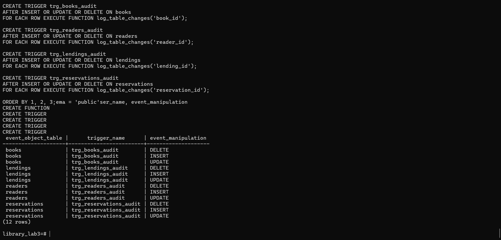
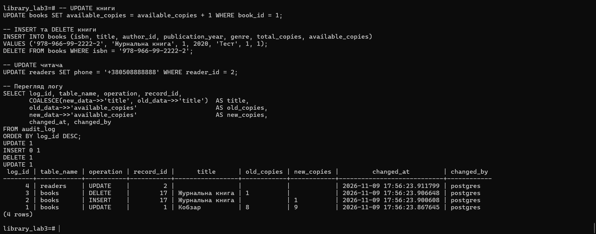

---

## 2.6. Блокування записів при паралельному доступі 

Потрібно два термінали (сеанси A і B), підключені до `library_lab3`.

### 2.6.1. Явне блокування `SELECT ... FOR UPDATE`

| Час | Сеанс A                                                                                             | Сеанс B                                              |
|-----|-----------------------------------------------------------------------------------------------------|------------------------------------------------------|
| t1  | `BEGIN;`                                                                                            |                                                      |
| t2  | `SELECT * FROM books WHERE book_id = 1 FOR UPDATE;`                                                 |                                                      |
| t3  |                                                                                                     | `BEGIN;`                                             |
| t4  |                                                                                                     | `SELECT * FROM books WHERE book_id = 1 FOR UPDATE;` → **очікує (зависає)** |
| t5  | `SELECT pg_sleep(5);` `UPDATE books SET available_copies = available_copies - 1 WHERE book_id = 1;` | _(чекає)_                                            |
| t6  | `COMMIT;`                                                                                           | запит **розблоковується** і бачить уже оновлені дані |
| t7  |                                                                                                     | `UPDATE books SET available_copies = available_copies - 1 WHERE book_id = 1;` `COMMIT;` |

```sql
-- Сеанс A
BEGIN;
SELECT * FROM books WHERE book_id = 1 FOR UPDATE;
SELECT pg_sleep(5);
UPDATE books SET available_copies = available_copies - 1 WHERE book_id = 1;
COMMIT;
```

```sql
-- Сеанс B (запускається, поки A ще не завершив транзакцію)
BEGIN;
SELECT * FROM books WHERE book_id = 1 FOR UPDATE;   -- чекає завершення A
UPDATE books SET available_copies = available_copies - 1 WHERE book_id = 1;
COMMIT;

SELECT book_id, available_copies FROM books WHERE book_id = 1;   -- обидва списання враховано
```

**Опис:** `FOR UPDATE` блокує рядок для інших транзакцій, що намагаються його змінити або заблокувати. Сеанс B чекає, поки A виконає `COMMIT`, після чого отримує вже оновлене значення, тому обидва списання враховуються і втрачених оновлень (lost update) немає.

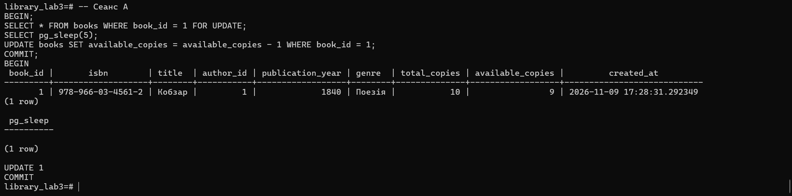
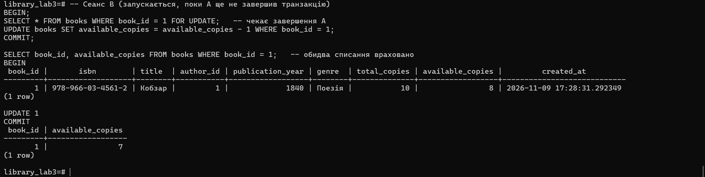

### 2.6.2. Моніторинг блокувань (третій термінал або сеанс A)   

```sql
SELECT pid,
       pg_blocking_pids(pid) AS blocked_by,
       state, wait_event_type, wait_event,
       left(query, 60) AS query
FROM pg_stat_activity
WHERE datname = 'library_lab3' AND cardinality(pg_blocking_pids(pid)) > 0;
```

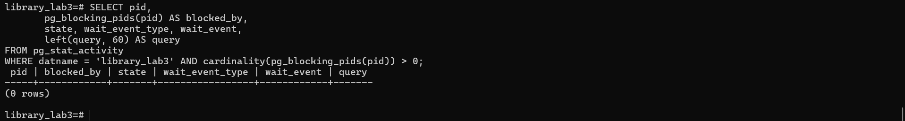

### 2.6.3. NOWAIT та SKIP LOCKED

```sql
-- Сеанс A
BEGIN;
SELECT * FROM books WHERE book_id = 2 FOR UPDATE;
-- (транзакцію не завершуємо)

-- Сеанс B
SELECT * FROM books WHERE book_id = 2 FOR UPDATE NOWAIT;
-- ERROR: could not obtain lock on row in relation "books"

SELECT book_id, title FROM books ORDER BY book_id LIMIT 3 FOR UPDATE SKIP LOCKED;
-- книга 2 пропущена, повертаються інші рядки

-- Сеанс A
ROLLBACK;
```

**Опис:** `NOWAIT` одразу повертає помилку замість очікування; `SKIP LOCKED` пропускає заблоковані рядки (зручно для черг задач).

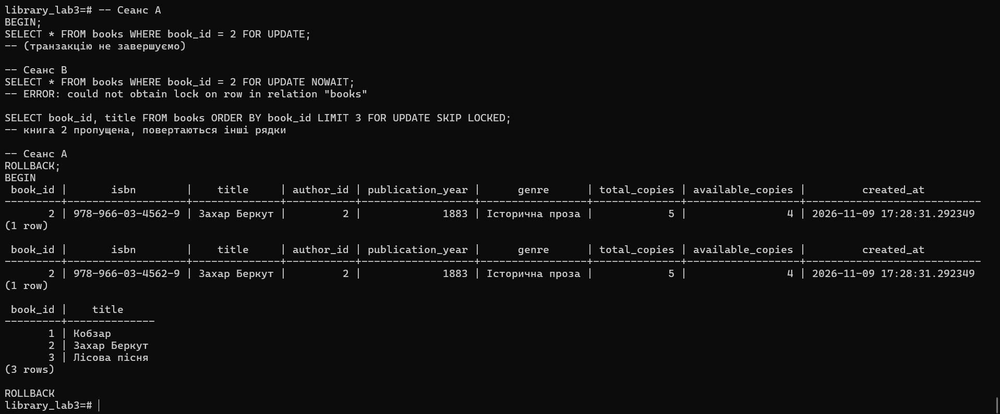

### 2.6.4. Взаємне блокування (deadlock)

| Крок | Сеанс A                                             | Сеанс B                                                                                                |
|------|-----------------------------------------------------|--------------------------------------------------------------------------------------------------------|
| 1    | `BEGIN; UPDATE books SET available_copies = available_copies WHERE book_id = 1;` |                                                                           |
| 2    |                                                     | `BEGIN; UPDATE books SET available_copies = available_copies WHERE book_id = 2;`                       |
| 3    | `UPDATE books SET available_copies = available_copies WHERE book_id = 2;` _(чекає B)_ |                                                                      |
| 4    |                                                     |`UPDATE books SET available_copies = available_copies WHERE book_id = 1;` → **ERROR: deadlock detected**|
| 5    | _(отримує блокування, може виконати `COMMIT;`)_     | `ROLLBACK;`                                                                                            |

**Опис:** кожна транзакція чекає ресурс, який утримує інша. Через `deadlock_timeout` (за замовчуванням 1 с) PostgreSQL виявляє цикл і примусово відкочує одну з транзакцій. Запобігання: завжди блокувати рядки в однаковому порядку (наприклад, за зростанням `book_id`).

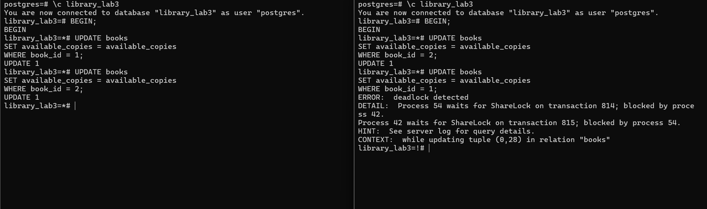

### 2.6.5. Рівні ізоляції транзакцій

```sql
-- READ COMMITTED (за замовчуванням)
-- Сеанс A
BEGIN;
SELECT available_copies FROM books WHERE book_id = 3;     -- наприклад, 7

-- Сеанс B (автокоміт)
UPDATE books SET available_copies = available_copies - 1 WHERE book_id = 3;

-- Сеанс A
SELECT available_copies FROM books WHERE book_id = 3;    -- 6: неповторюване читання 
COMMIT;
```

```sql
-- REPEATABLE READ
-- Сеанс A
BEGIN ISOLATION LEVEL REPEATABLE READ;
SELECT available_copies FROM books WHERE book_id = 3;     -- наприклад, 6

-- Сеанс B (автокоміт)
UPDATE books SET available_copies = available_copies - 1 WHERE book_id = 3;

-- Сеанс A
SELECT available_copies FROM books WHERE book_id = 3;     -- як і раніше 6: знімок даних збережено
UPDATE books SET available_copies = available_copies - 1 WHERE book_id = 3;
-- ERROR: could not serialize access due to concurrent update
ROLLBACK;
```

**Опис:** на рівні `READ COMMITTED` кожен запит бачить найновіші зафіксовані дані, тому повторне читання може дати інший результат. На `REPEATABLE READ` транзакція працює зі знімком на момент першого запиту, а спроба змінити рядок, уже змінений іншою транзакцією, завершується помилкою серіалізації — застосунок має повторити транзакцію.

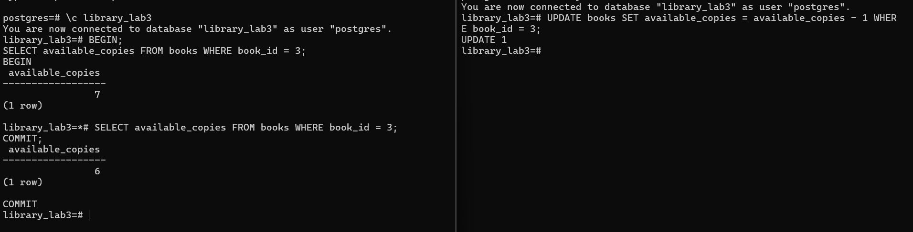
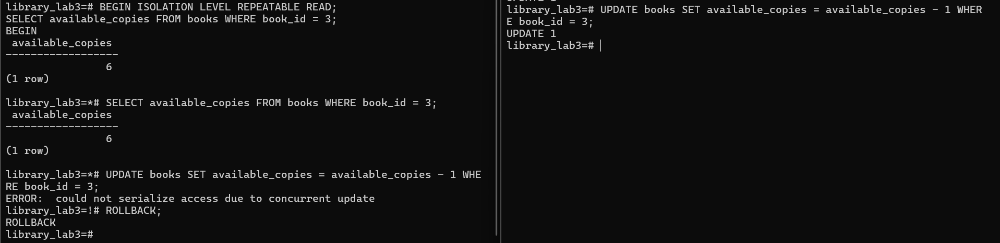

---

## Аналіз роботи транзакцій та обмежень (рівень 2)

| Властивість ACID               | Де продемонстровано                                                           |
|--------------------------------|-------------------------------------------------------------------------------|
| **Atomicity** (атомарність)    | 1.4б (ROLLBACK після помилки), 2.2 (три таблиці як одна дія), 2.3 (SAVEPOINT) |
| **Consistency** (узгодженість) | CHECK/FK/UNIQUE відхиляють некоректні дані (1.2), каскади (2.4)               |
| **Isolation** (ізольованість)  | `FOR UPDATE`, NOWAIT/SKIP LOCKED, deadlock, рівні ізоляції (2.6)              |
| **Durability** (довговічність) | зафіксовані (`COMMIT`) зміни зберігаються в WAL; бачимо їх у новому сеансі    |

---

# Рівень 3

> Порядок виконання важливий: об'єкти нижче залежать від таблиць і тригерів рівнів 1–2.

## 3.1. Система версіонування записів   

```sql
-- Таблиця версій книг
CREATE TABLE books_versions (
    version_id     SERIAL PRIMARY KEY,
    book_id        INTEGER NOT NULL,
    version_number INTEGER NOT NULL,
    data           JSONB NOT NULL,
    valid_from     TIMESTAMP DEFAULT CURRENT_TIMESTAMP,
    valid_to       TIMESTAMP,
    created_by     VARCHAR(100) DEFAULT CURRENT_USER,
    UNIQUE (book_id, version_number)
);

CREATE INDEX idx_books_versions_lookup ON books_versions (book_id, valid_from, valid_to);

-- Початкові версії для вже наявних книг (щоб історія була повною)
INSERT INTO books_versions (book_id, version_number, data, valid_from)
SELECT book_id, 1, to_jsonb(b), b.created_at
FROM books b;

-- Функція тригера: створює нову версію і закриває попередню
CREATE OR REPLACE FUNCTION create_book_version()
RETURNS TRIGGER
LANGUAGE plpgsql
SECURITY DEFINER
SET search_path = public
AS $$
DECLARE
    v_num  INTEGER;
    v_now  TIMESTAMP := clock_timestamp();
    v_user TEXT := CASE WHEN current_setting('role') = 'none'
                        THEN session_user ELSE current_setting('role') END;
BEGIN
    IF TG_OP = 'DELETE' THEN
        -- Книгу видалено: закриваємо останню версію
        UPDATE books_versions SET valid_to = v_now
        WHERE book_id = OLD.book_id AND valid_to IS NULL;
        RETURN OLD;
    END IF;

    -- Закриваємо попередню версію
    UPDATE books_versions SET valid_to = v_now
    WHERE book_id = NEW.book_id AND valid_to IS NULL;

    -- Номер нової версії
    SELECT COALESCE(MAX(version_number), 0) + 1
    INTO v_num
    FROM books_versions
    WHERE book_id = NEW.book_id;

    -- Нова версія
    INSERT INTO books_versions (book_id, version_number, data, valid_from, created_by)
    VALUES (NEW.book_id, v_num, to_jsonb(NEW), v_now, v_user);

    RETURN NEW;
END;
$$;

CREATE TRIGGER trg_book_versioning
AFTER INSERT OR UPDATE OR DELETE ON books
FOR EACH ROW EXECUTE FUNCTION create_book_version();

-- Функція: стан книги на певний момент часу
CREATE OR REPLACE FUNCTION get_book_version(p_book_id INTEGER, p_date TIMESTAMP)
RETURNS JSONB
LANGUAGE plpgsql
AS $$
BEGIN
    RETURN (
        SELECT data
        FROM books_versions
        WHERE book_id = p_book_id
          AND valid_from <= p_date
          AND (valid_to IS NULL OR valid_to > p_date)
        ORDER BY version_number DESC
        LIMIT 1
    );
END;
$$;

-- Зручне представлення історії версій
CREATE OR REPLACE VIEW books_version_history AS
SELECT book_id, version_number,
       data->>'title'            AS title,
       data->>'available_copies' AS available_copies,
       data->>'total_copies'     AS total_copies,
       valid_from, valid_to, created_by
FROM books_versions;
```

### Демонстрація

```sql
-- Робимо кілька змін книги 2 з паузами
UPDATE books SET available_copies = available_copies - 1 WHERE book_id = 2;
SELECT pg_sleep(2);
UPDATE books SET title = 'Захар Беркут (нове видання)' WHERE book_id = 2;
SELECT pg_sleep(2);
UPDATE books SET total_copies = total_copies + 3, available_copies = available_copies + 3 WHERE book_id = 2;

-- Усі версії книги
SELECT * FROM books_version_history WHERE book_id = 2 ORDER BY version_number;

-- Історичні стани: книга на момент початку кожної версії
SELECT v.version_number,
       get_book_version(2, v.valid_from)->>'title'            AS title_at_that_time,
       get_book_version(2, v.valid_from)->>'available_copies' AS copies_at_that_time
FROM books_versions v
WHERE v.book_id = 2
ORDER BY v.version_number;
```

**Опис:** кожна зміна книги створює нову версію (повна копія рядка у JSONB) з інтервалом чинності `[valid_from, valid_to)`. Остання версія має `valid_to IS NULL`. Функція `get_book_version` повертає стан запису на будь-який момент часу. Початкові версії створено для вже наявних книг, інакше історія до першої зміни була б втрачена.

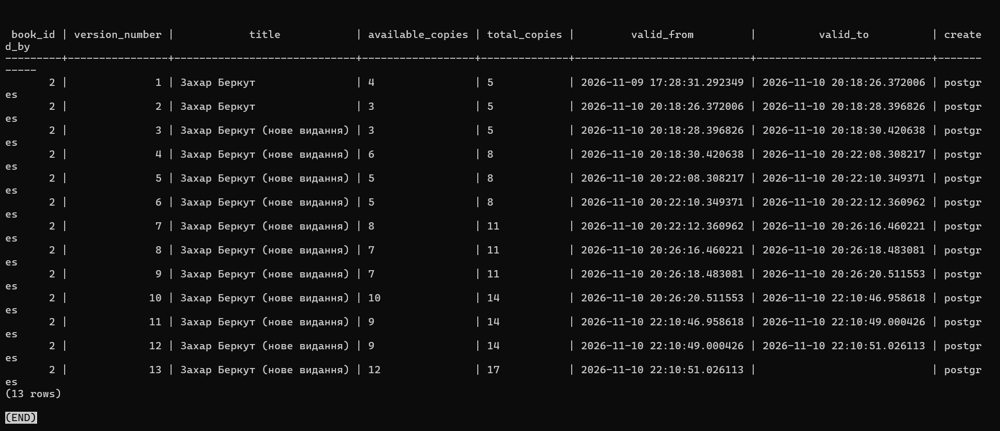
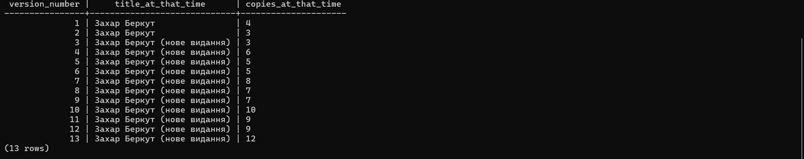

### Відкат запису до обраної версії

```sql
CREATE OR REPLACE FUNCTION rollback_book_to_version(p_book_id INTEGER, p_version INTEGER)
RETURNS TEXT
LANGUAGE plpgsql
AS $$
DECLARE
    v_data JSONB;
BEGIN
    SELECT data INTO v_data
    FROM books_versions
    WHERE book_id = p_book_id AND version_number = p_version;

    IF v_data IS NULL THEN
        RAISE EXCEPTION 'Версію % книги % не знайдено', p_version, p_book_id;
    END IF;

    UPDATE books b
    SET isbn             = s.isbn,
        title            = s.title,
        author_id        = s.author_id,
        publication_year = s.publication_year,
        genre            = s.genre,
        total_copies     = s.total_copies,
        available_copies = s.available_copies
    FROM jsonb_populate_record(NULL::books, v_data) AS s
    WHERE b.book_id = p_book_id;

    IF NOT FOUND THEN
        -- Книгу було видалено — створюємо її заново
        INSERT INTO books SELECT * FROM jsonb_populate_record(NULL::books, v_data);
    END IF;

    RETURN format('Книгу %s відкотено до версії %s', p_book_id, p_version);
END;
$$;

SELECT rollback_book_to_version(2, 1);

SELECT * FROM books_version_history WHERE book_id = 2 ORDER BY version_number;
SELECT book_id, title, total_copies, available_copies FROM books WHERE book_id = 2;
```

**Опис:** відкат — це нова зміна, яка теж версіонується (з'являється нова версія з даними версії 1). Історія не перезаписується, а лише доповнюється.

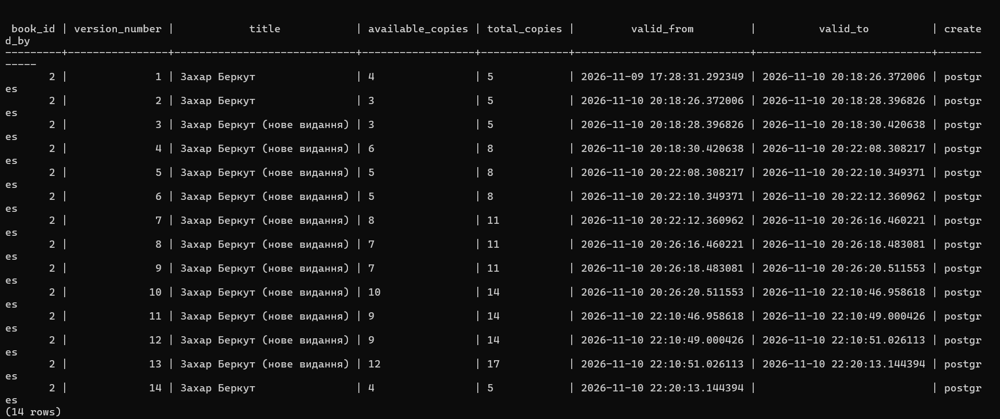
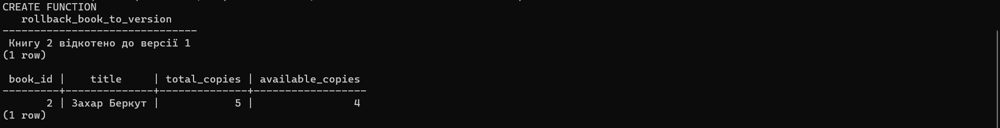

---

## 3.2. Відкладені операції з автоматичним виконанням

```sql
-- Таблиця відкладених операцій
CREATE TABLE scheduled_operations (
    operation_id    SERIAL PRIMARY KEY,
    operation_type  VARCHAR(50) NOT NULL,
    target_table    VARCHAR(50) NOT NULL,
    operation_data  JSONB NOT NULL,
    scheduled_for   TIMESTAMP NOT NULL,
    repeat_interval INTERVAL,                       -- NULL = одноразова операція
    status          VARCHAR(20) DEFAULT 'Pending'
                    CHECK (status IN ('Pending', 'Executed', 'Failed', 'Cancelled')),
    executed_at     TIMESTAMP,
    error_message   TEXT,
    created_at      TIMESTAMP DEFAULT CURRENT_TIMESTAMP
);

CREATE INDEX idx_scheduled_pending ON scheduled_operations (scheduled_for) WHERE status = 'Pending';

-- Функція виконання відкладених операцій
CREATE OR REPLACE FUNCTION execute_scheduled_operations()
RETURNS INTEGER
LANGUAGE plpgsql
AS $$
DECLARE
    v_op    RECORD;
    v_count INTEGER := 0;
BEGIN
    FOR v_op IN
        SELECT * FROM scheduled_operations
        WHERE status = 'Pending' AND scheduled_for <= CURRENT_TIMESTAMP
        ORDER BY scheduled_for
        FOR UPDATE SKIP LOCKED          -- паралельні виконавці не дублюють операції
    LOOP
        BEGIN
            CASE v_op.operation_type
                WHEN 'UPDATE_BOOK_STATUS' THEN
                    UPDATE books
                    SET available_copies = (v_op.operation_data->>'available_copies')::INTEGER
                    WHERE book_id = (v_op.operation_data->>'book_id')::INTEGER;

                WHEN 'EXPIRE_RESERVATION' THEN
                    UPDATE reservations
                    SET status = 'Expired'
                    WHERE reservation_id = (v_op.operation_data->>'reservation_id')::INTEGER
                      AND status = 'Active';

                WHEN 'BLOCK_READER' THEN
                    UPDATE readers
                    SET status = 'Blocked'
                    WHERE reader_id = (v_op.operation_data->>'reader_id')::INTEGER;

                WHEN 'CREATE_BACKUP' THEN
                    PERFORM create_backup_point(
                        COALESCE(v_op.operation_data->>'name', 'scheduled_backup'),
                        'Автоматична контрольна точка за розкладом',
                        TRUE);

                ELSE
                    RAISE EXCEPTION 'Невідомий тип операції: %', v_op.operation_type;
            END CASE;

            UPDATE scheduled_operations
            SET status = 'Executed', executed_at = CURRENT_TIMESTAMP
            WHERE operation_id = v_op.operation_id;

            -- Періодична операція: планується наступний запуск
            IF v_op.repeat_interval IS NOT NULL THEN
                INSERT INTO scheduled_operations
                    (operation_type, target_table, operation_data, scheduled_for, repeat_interval)
                VALUES
                    (v_op.operation_type, v_op.target_table, v_op.operation_data,
                     v_op.scheduled_for + v_op.repeat_interval, v_op.repeat_interval);
            END IF;

            v_count := v_count + 1;
        EXCEPTION WHEN OTHERS THEN
            UPDATE scheduled_operations
            SET status = 'Failed', executed_at = CURRENT_TIMESTAMP, error_message = SQLERRM
            WHERE operation_id = v_op.operation_id;
        END;
    END LOOP;

    RETURN v_count;
END;
$$;

-- Тригер: при створенні бронювання автоматично планується його закінчення
CREATE OR REPLACE FUNCTION schedule_reservation_expiry()
RETURNS TRIGGER
LANGUAGE plpgsql
SECURITY DEFINER
SET search_path = public
AS $$
BEGIN
    INSERT INTO scheduled_operations (operation_type, target_table, operation_data, scheduled_for)
    SELECT 'EXPIRE_RESERVATION', 'reservations',
           jsonb_build_object('reservation_id', NEW.reservation_id),
           NEW.expiration_date
    WHERE NOT EXISTS (
        SELECT 1 FROM scheduled_operations
        WHERE operation_type = 'EXPIRE_RESERVATION'
          AND status = 'Pending'
          AND (operation_data->>'reservation_id')::INTEGER = NEW.reservation_id
    );
    RETURN NEW;
END;
$$;

CREATE TRIGGER trg_reservation_schedule_expiry
AFTER INSERT ON reservations
FOR EACH ROW EXECUTE FUNCTION schedule_reservation_expiry();
```

### Демонстрація

```sql
-- 1) Бронювання, що вже прострочене: тригер сам створить відкладену операцію
INSERT INTO reservations (book_id, reader_id, expiration_date)
VALUES (3, 3, CURRENT_TIMESTAMP - INTERVAL '1 minute');

-- 2) Операція на майбутнє (через 1 годину) — залишиться Pending
INSERT INTO scheduled_operations (operation_type, target_table, operation_data, scheduled_for)
VALUES ('BLOCK_READER', 'readers', '{"reader_id": 4}'::jsonb, CURRENT_TIMESTAMP + INTERVAL '1 hour');

-- 3) Операція з помилкою (невідомий тип) — буде позначена Failed
INSERT INTO scheduled_operations (operation_type, target_table, operation_data, scheduled_for)
VALUES ('UNKNOWN_OP', 'books', '{}'::jsonb, CURRENT_TIMESTAMP);

SELECT operation_id, operation_type, scheduled_for, status FROM scheduled_operations ORDER BY operation_id;

-- Запуск виконавця
SELECT execute_scheduled_operations() AS executed;

SELECT operation_id, operation_type, status, executed_at, error_message FROM scheduled_operations ORDER BY operation_id;
SELECT reservation_id, book_id, status FROM reservations ORDER BY reservation_id;
```
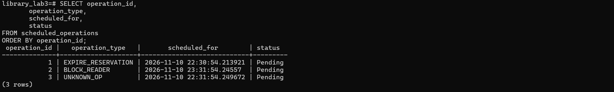
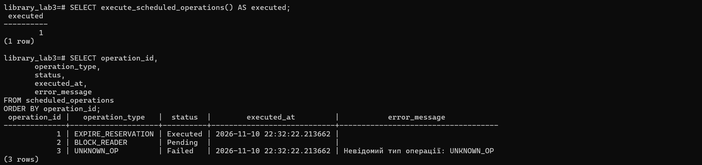

### Автоматичний запуск

Функцію `execute_scheduled_operations()` необхідно викликати періодично. Варіанти:

```sql
-- Варіант 1 (psql, працює в будь-якому PostgreSQL): виклик кожні 10 секунд
SELECT execute_scheduled_operations() \watch 10
```

```sql
-- Варіант 2 (розширення pg_cron; потрібен образ/сервер із pg_cron та shared_preload_libraries='pg_cron')
CREATE EXTENSION pg_cron;
SELECT cron.schedule('exec-scheduled-ops', '* * * * *', 'SELECT execute_scheduled_operations()');
```

```bash
# Варіант 3: cron хост-системи
* * * * * docker exec pg-lab3 psql -U postgres -d library_lab3 -c "SELECT execute_scheduled_operations()"
```

**Опис:** у роботі автоматичний запуск показано через `\watch` (додайте бронювання з `expiration_date` через кілька секунд і спостерігайте, як воно змінює статус на `Expired` без ручного виклику). `FOR UPDATE SKIP LOCKED` гарантує, що кілька виконавців не виконають одну операцію двічі. Операції з `repeat_interval` після виконання самі планують наступний запуск.

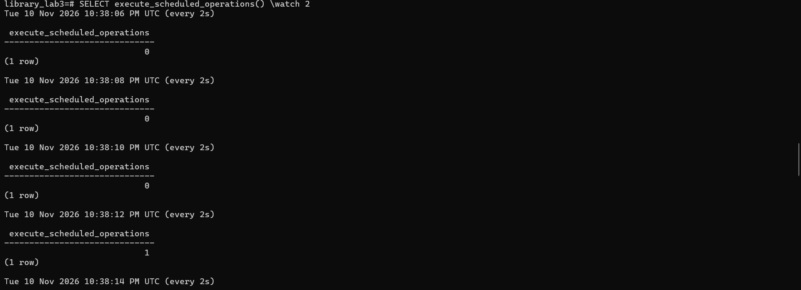
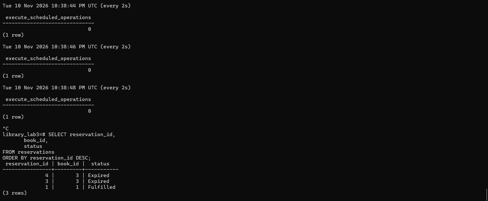

---

## 3.3. Збережені процедури складної бізнес-логіки 

```sql
-- Процедура видачі книги з усіма бізнес-перевірками
CREATE OR REPLACE PROCEDURE issue_book(
    p_book_id   INTEGER,
    p_reader_id INTEGER,
    p_days      INTEGER DEFAULT 14
)
LANGUAGE plpgsql
AS $$
DECLARE
    v_status VARCHAR(20);
    v_avail  INTEGER;
    v_active INTEGER;
BEGIN
    IF p_days NOT BETWEEN 1 AND 60 THEN
        RAISE EXCEPTION 'Термін видачі має бути від 1 до 60 днів';
    END IF;

    SELECT status INTO v_status FROM readers WHERE reader_id = p_reader_id;
    IF NOT FOUND THEN
        RAISE EXCEPTION 'Читача % не знайдено', p_reader_id;
    END IF;
    IF v_status <> 'Active' THEN
        RAISE EXCEPTION 'Читач має статус %, видача неможлива', v_status;
    END IF;

    SELECT COUNT(*) INTO v_active
    FROM lendings WHERE reader_id = p_reader_id AND return_date IS NULL;
    IF v_active >= 5 THEN
        RAISE EXCEPTION 'Перевищено ліміт: у читача вже % книг на руках', v_active;
    END IF;

    -- Блокуємо рядок книги, щоб два бібліотекарі не видали останній примірник одночасно
    SELECT available_copies INTO v_avail FROM books WHERE book_id = p_book_id FOR UPDATE;
    IF NOT FOUND THEN
        RAISE EXCEPTION 'Книгу % не знайдено', p_book_id;
    END IF;
    IF v_avail < 1 THEN
        RAISE EXCEPTION 'Немає вільних примірників книги %', p_book_id;
    END IF;

    INSERT INTO lendings (book_id, reader_id, due_date)
    VALUES (p_book_id, p_reader_id, CURRENT_DATE + p_days);

    UPDATE books SET available_copies = available_copies - 1 WHERE book_id = p_book_id;

    RAISE NOTICE 'Книгу % видано читачу % до %', p_book_id, p_reader_id, CURRENT_DATE + p_days;
END;
$$;

-- Процедура повернення книги з обробкою черги бронювань
CREATE OR REPLACE PROCEDURE return_book(p_lending_id INTEGER)
LANGUAGE plpgsql
AS $$
DECLARE
    v_book_id INTEGER;
    v_res_id  INTEGER;
BEGIN
    UPDATE lendings SET return_date = CURRENT_DATE
    WHERE lending_id = p_lending_id AND return_date IS NULL
    RETURNING book_id INTO v_book_id;

    IF NOT FOUND THEN
        RAISE EXCEPTION 'Активну видачу % не знайдено', p_lending_id;
    END IF;

    UPDATE books SET available_copies = available_copies + 1 WHERE book_id = v_book_id;

    SELECT reservation_id INTO v_res_id
    FROM reservations
    WHERE book_id = v_book_id AND status = 'Active' AND expiration_date > CURRENT_TIMESTAMP
    ORDER BY reservation_date
    LIMIT 1
    FOR UPDATE SKIP LOCKED;

    IF v_res_id IS NOT NULL THEN
        UPDATE reservations SET status = 'Fulfilled' WHERE reservation_id = v_res_id;
        RAISE NOTICE 'Бронювання % виконано', v_res_id;
    END IF;
END;
$$;

-- Функція продовження терміну видачі
CREATE OR REPLACE FUNCTION extend_lending(p_lending_id INTEGER, p_days INTEGER DEFAULT 7)
RETURNS TABLE (success BOOLEAN, message TEXT, new_due_date DATE)
LANGUAGE plpgsql
AS $$
DECLARE
    v_reader_id INTEGER;
    v_book_id   INTEGER;
    v_status    VARCHAR(20);
    v_due       DATE;
    v_returned  DATE;
    v_overdue   INTEGER;
    v_other_res INTEGER;
BEGIN
    SELECT l.reader_id, l.book_id, r.status, l.due_date, l.return_date
    INTO v_reader_id, v_book_id, v_status, v_due, v_returned
    FROM lendings l
    JOIN readers r ON r.reader_id = l.reader_id
    WHERE l.lending_id = p_lending_id
    FOR UPDATE OF l;

    IF NOT FOUND THEN
        RETURN QUERY SELECT FALSE, 'Видачу не знайдено'::TEXT, NULL::DATE; RETURN;
    END IF;
    IF v_returned IS NOT NULL THEN
        RETURN QUERY SELECT FALSE, 'Книгу вже повернуто'::TEXT, NULL::DATE; RETURN;
    END IF;
    IF p_days NOT BETWEEN 1 AND 30 THEN
        RETURN QUERY SELECT FALSE, 'Продовження: від 1 до 30 днів'::TEXT, NULL::DATE; RETURN;
    END IF;
    IF v_status = 'Blocked' THEN
        RETURN QUERY SELECT FALSE, 'Читач заблокований'::TEXT, NULL::DATE; RETURN;
    END IF;

    SELECT COUNT(*) INTO v_overdue
    FROM lendings
    WHERE reader_id = v_reader_id AND return_date IS NULL AND due_date < CURRENT_DATE;
    IF v_overdue > 0 THEN
        RETURN QUERY SELECT FALSE, 'У читача є прострочені книги'::TEXT, NULL::DATE; RETURN;
    END IF;

    SELECT COUNT(*) INTO v_other_res
    FROM reservations
    WHERE book_id = v_book_id AND status = 'Active' AND reader_id <> v_reader_id;
    IF v_other_res > 0 THEN
        RETURN QUERY SELECT FALSE, 'На книгу є бронювання іншого читача'::TEXT, NULL::DATE; RETURN;
    END IF;

    UPDATE lendings SET due_date = due_date + p_days WHERE lending_id = p_lending_id;

    RETURN QUERY SELECT TRUE, 'Термін продовжено'::TEXT, (v_due + p_days)::DATE;
END;
$$;
```

### Демонстрація

```sql
-- Успішна видача
CALL issue_book(4, 3, 14);

-- Помилки бізнес-логіки
CALL issue_book(4, 999, 14);      -- читача не існує
CALL issue_book(999, 3, 14);      -- книги не існує
CALL issue_book(4, 3, 100);       -- некоректний термін

-- Продовження останньої видачі
SELECT * FROM extend_lending((SELECT MAX(lending_id) FROM lendings), 7);

-- Повернення і повторне повернення (друга спроба — помилка)
CALL return_book((SELECT MAX(lending_id) FROM lendings));
CALL return_book((SELECT MAX(lending_id) FROM lendings));

-- Продовження вже поверненої книги
SELECT * FROM extend_lending((SELECT MAX(lending_id) FROM lendings), 7);
```

**Опис:** уся бізнес-логіка інкапсульована в БД: перевірка статусу читача, ліміту книг, наявності примірників, блокування рядка книги, обробка черги бронювань. Помилка (`RAISE EXCEPTION`) відкочує всю процедуру, тому дані завжди залишаються узгодженими.

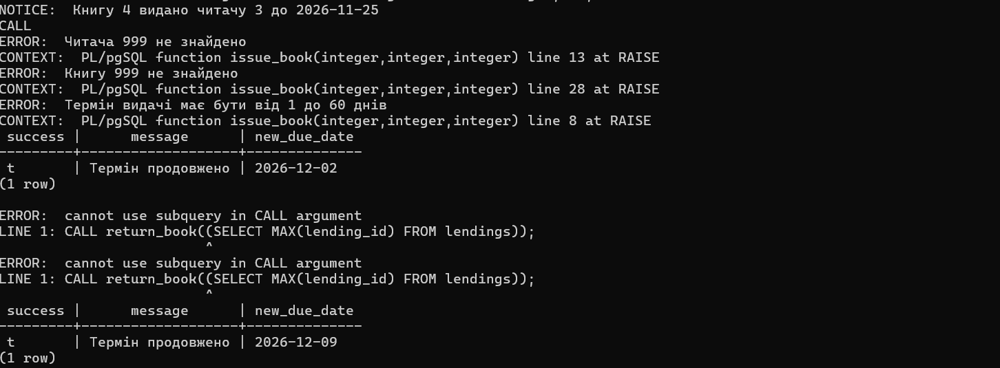

---

## 3.4. Система прав доступу на рівні операцій модифікації

```sql
-- Ролі
CREATE ROLE librarian_read  NOLOGIN;
CREATE ROLE librarian_write NOLOGIN;
CREATE ROLE library_admin   NOLOGIN;

GRANT USAGE ON SCHEMA public TO librarian_read, librarian_write, library_admin;

-- Читання: усі таблиці та представлення (також майбутні)
GRANT SELECT ON ALL TABLES IN SCHEMA public TO librarian_read;
ALTER DEFAULT PRIVILEGES IN SCHEMA public GRANT SELECT ON TABLES TO librarian_read;

-- Бібліотекар із правом запису успадковує читання
GRANT librarian_read TO librarian_write;

-- Права на модифікацію
GRANT INSERT, UPDATE ON books, lendings, reservations TO librarian_write;
GRANT DELETE ON reservations TO librarian_write;                    -- тільки бронювання
GRANT INSERT ON readers TO librarian_write;
GRANT UPDATE (phone, email) ON readers TO librarian_write;          -- права на рівні стовпців
GRANT USAGE, SELECT ON ALL SEQUENCES IN SCHEMA public TO librarian_write;

-- Дозвіл виконувати бізнес-процедури
GRANT EXECUTE ON PROCEDURE issue_book(INTEGER, INTEGER, INTEGER), return_book(INTEGER) TO librarian_write;
GRANT EXECUTE ON FUNCTION extend_lending(INTEGER, INTEGER) TO librarian_write;

-- Повні права для адміністратора
GRANT ALL PRIVILEGES ON ALL TABLES    IN SCHEMA public TO library_admin;
GRANT ALL PRIVILEGES ON ALL SEQUENCES IN SCHEMA public TO library_admin;

-- Користувачі (замініть паролі на власні)
CREATE USER librarian1 WITH PASSWORD 'secure_password1';
CREATE USER librarian2 WITH PASSWORD 'secure_password2';
CREATE USER admin1     WITH PASSWORD 'admin_password';

GRANT librarian_read  TO librarian1;
GRANT librarian_write TO librarian2;
GRANT library_admin   TO admin1;

\du
```

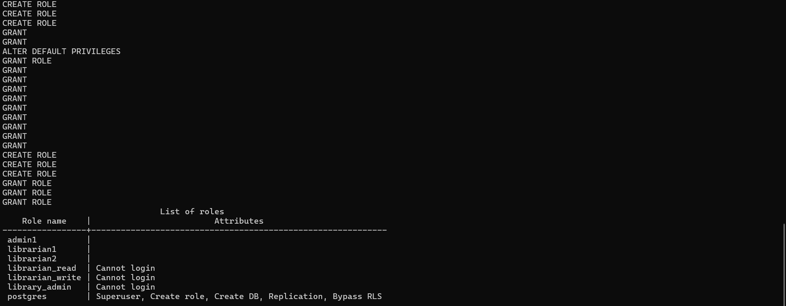

### Тестування прав доступу

```sql
-- Від імені librarian1 (тільки читання)
SET ROLE librarian1;
SELECT COUNT(*) FROM books;                                       -- успішно
UPDATE books SET available_copies = 5 WHERE book_id = 1;          -- ПОМИЛКА: permission denied
RESET ROLE;

-- Від імені librarian2 (читання + обмежений запис)
SET ROLE librarian2;
UPDATE books SET available_copies = available_copies WHERE book_id = 1;   -- успішно
UPDATE readers SET phone = '+380507777777' WHERE reader_id = 3;           -- успішно (дозволений стовпець)
UPDATE readers SET status = 'Blocked' WHERE reader_id = 3;                -- ПОМИЛКА (стовпець status)
DELETE FROM authors WHERE author_id = 1;                                  -- ПОМИЛКА: permission denied
DELETE FROM books WHERE book_id = 1;                                      -- ПОМИЛКА: permission denied
CALL issue_book(5, 3, 7);                                                 -- успішно (процедура)
RESET ROLE;

-- Від імені admin1 (повні права)
SET ROLE admin1;
UPDATE readers SET status = 'Active' WHERE reader_id = 3;                 -- успішно
RESET ROLE;

-- Аудит зафіксував реальних виконавців
SELECT log_id, table_name, operation, record_id, changed_by, changed_at
FROM audit_log
ORDER BY log_id DESC
LIMIT 8;
```

**Опис:** `librarian1` лише читає; `librarian2` може змінювати книги, видачі, бронювання, контакти читачів і користуватись процедурами, але не видаляє автора/книги та не змінює статус читача (права на рівні стовпців). Адміністратор має повні права. Записи в `audit_log` та `books_versions` з'являються, хоча в `librarian2` немає прямих прав на ці таблиці — завдяки `SECURITY DEFINER` у тригерах; при цьому в `changed_by` зберігається ім'я реального користувача.

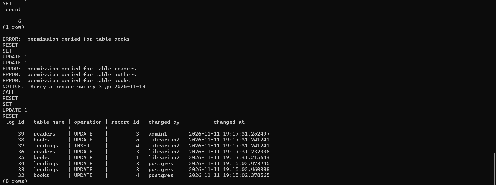

---

## 3.5. Автоматичне відновлення даних та контрольні точки

```sql
-- Таблиця контрольних точок
CREATE TABLE backup_points (
    backup_id        SERIAL PRIMARY KEY,
    backup_name      VARCHAR(100) NOT NULL,
    backup_timestamp TIMESTAMP DEFAULT CURRENT_TIMESTAMP,
    is_auto          BOOLEAN DEFAULT FALSE,
    description      TEXT,
    data_snapshot    JSONB
);

-- Знімок даних не повинен бути доступним на читання звичайним користувачам
REVOKE ALL ON backup_points FROM librarian_read, librarian_write;

-- Створення контрольної точки (знімок усіх бізнес-таблиць)
CREATE OR REPLACE FUNCTION create_backup_point(
    p_name        TEXT,
    p_description TEXT    DEFAULT NULL,
    p_auto        BOOLEAN DEFAULT FALSE
)
RETURNS INTEGER
LANGUAGE plpgsql
AS $$
DECLARE
    v_id       INTEGER;
    v_snapshot JSONB;
BEGIN
    SELECT jsonb_build_object(
        'authors',      COALESCE((SELECT jsonb_agg(to_jsonb(a)) FROM authors      a), '[]'::jsonb),
        'readers',      COALESCE((SELECT jsonb_agg(to_jsonb(r)) FROM readers      r), '[]'::jsonb),
        'books',        COALESCE((SELECT jsonb_agg(to_jsonb(b)) FROM books        b), '[]'::jsonb),
        'lendings',     COALESCE((SELECT jsonb_agg(to_jsonb(l)) FROM lendings     l), '[]'::jsonb),
        'reservations', COALESCE((SELECT jsonb_agg(to_jsonb(s)) FROM reservations s), '[]'::jsonb)
    ) INTO v_snapshot;

    INSERT INTO backup_points (backup_name, description, is_auto, data_snapshot)
    VALUES (p_name, p_description, p_auto, v_snapshot)
    RETURNING backup_id INTO v_id;

    RETURN v_id;
END;
$$;

-- Відновлення з контрольної точки (виконується атомарно: при помилці всі зміни скасовуються)
CREATE OR REPLACE FUNCTION restore_from_backup   (p_backup_id INTEGER)
RETURNS TEXT
LANGUAGE plpgsql
AS $$
DECLARE
    v JSONB;
BEGIN
    SELECT data_snapshot INTO v FROM backup_points WHERE backup_id = p_backup_id;
    IF v IS NULL THEN
        RAISE EXCEPTION 'Контрольну точку % не знайдено', p_backup_id;
    END IF;

    -- Страхувальна контрольна точка перед відновленням
    PERFORM create_backup_point('before_restore_' || p_backup_id,
                                'Автоматично створено перед відновленням', TRUE);

    TRUNCATE reservations, lendings, books, readers, authors;

    INSERT INTO authors      SELECT * FROM jsonb_populate_recordset(NULL::authors,      v->'authors');
    INSERT INTO readers      SELECT * FROM jsonb_populate_recordset(NULL::readers,      v->'readers');
    INSERT INTO books        SELECT * FROM jsonb_populate_recordset(NULL::books,        v->'books');
    INSERT INTO lendings     SELECT * FROM jsonb_populate_recordset(NULL::lendings,     v->'lendings');
    INSERT INTO reservations SELECT * FROM jsonb_populate_recordset(NULL::reservations, v->'reservations');

    -- Синхронізація послідовностей з відновленими даними
    PERFORM setval('authors_author_id_seq',
                   COALESCE((SELECT MAX(author_id) FROM authors), 1), (SELECT COUNT(*) > 0 FROM authors));
    PERFORM setval('readers_reader_id_seq',
                   COALESCE((SELECT MAX(reader_id) FROM readers), 1), (SELECT COUNT(*) > 0 FROM readers));
    PERFORM setval('books_book_id_seq',
                   COALESCE((SELECT MAX(book_id) FROM books), 1), (SELECT COUNT(*) > 0 FROM books));
    PERFORM setval('lendings_lending_id_seq',
                   COALESCE((SELECT MAX(lending_id) FROM lendings), 1), (SELECT COUNT(*) > 0 FROM lendings));
    PERFORM setval('reservations_reservation_id_seq',
                   COALESCE((SELECT MAX(reservation_id) FROM reservations), 1), (SELECT COUNT(*) > 0 FROM reservations));

    RETURN format('Дані відновлено з контрольної точки %s', p_backup_id);
END;
$$;
```

### Демонстрація: контрольна точка → «аварія» → відновлення

```sql
-- Кількість записів до
SELECT 'books' AS tbl, COUNT(*) FROM books
UNION ALL SELECT 'lendings', COUNT(*) FROM lendings
UNION ALL SELECT 'readers',  COUNT(*) FROM readers;

-- Створення контрольної точки
SELECT create_backup_point('Before major update', 'Backup before system upgrade') AS backup_id;

-- «Аварія»: помилкове масове видалення і псування даних
DELETE FROM reservations;
DELETE FROM lendings;
UPDATE books SET available_copies = 0, title = 'ПОШКОДЖЕНО';

SELECT 'books' AS tbl, COUNT(*) FROM books
UNION ALL SELECT 'lendings', COUNT(*) FROM lendings;
SELECT book_id, title, available_copies FROM books ORDER BY book_id LIMIT 3;

-- Відновлення
SELECT restore_from_backup(1);

-- Перевірка
SELECT 'books' AS tbl, COUNT(*) FROM books
UNION ALL SELECT 'lendings', COUNT(*) FROM lendings
UNION ALL SELECT 'readers',  COUNT(*) FROM readers;
SELECT book_id, title, available_copies FROM books ORDER BY book_id LIMIT 3;

SELECT backup_id, backup_name, is_auto, backup_timestamp FROM backup_points ORDER BY backup_id;
```

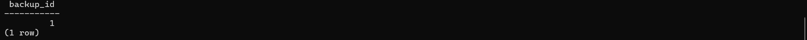
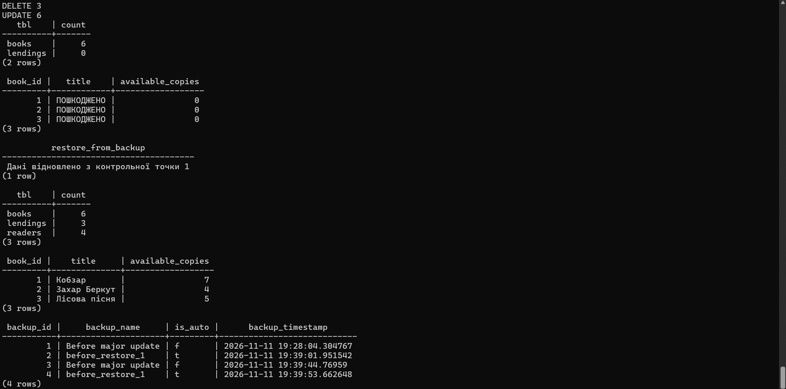

### Автоматичне створення контрольних точок

```sql
-- 1) Автоматична контрольна точка перед масовим видаленням (тригер рівня оператора)
CREATE OR REPLACE FUNCTION auto_checkpoint_before_delete()
RETURNS TRIGGER
LANGUAGE plpgsql
SECURITY DEFINER
SET search_path = public
AS $$
BEGIN
    -- не частіше ніж раз на хвилину
    IF NOT EXISTS (
        SELECT 1 FROM backup_points
        WHERE is_auto AND backup_name LIKE 'auto_before_delete_%'
          AND backup_timestamp > CURRENT_TIMESTAMP - INTERVAL '1 minute'
    ) THEN
        PERFORM create_backup_point('auto_before_delete_' || TG_TABLE_NAME,
                                    'Автоматична контрольна точка перед видаленням з ' || TG_TABLE_NAME,
                                    TRUE);
    END IF;
    RETURN NULL;
END;
$$;

CREATE TRIGGER trg_books_auto_checkpoint
BEFORE DELETE ON books
FOR EACH STATEMENT EXECUTE FUNCTION auto_checkpoint_before_delete();

CREATE TRIGGER trg_readers_auto_checkpoint
BEFORE DELETE ON readers
FOR EACH STATEMENT EXECUTE FUNCTION auto_checkpoint_before_delete();

-- Перевірка: видаляємо тимчасову книгу
INSERT INTO books (isbn, title, author_id, publication_year, genre)
VALUES ('978-966-99-3333-3', 'Книга для видалення', 1, 2020, 'Тест');

DELETE FROM books WHERE isbn = '978-966-99-3333-3';

SELECT backup_id, backup_name, is_auto, description, backup_timestamp
FROM backup_points
ORDER BY backup_id DESC
LIMIT 3;
```

```sql
-- 2) Періодична контрольна точка за розкладом (використовує механізм із 3.2)
INSERT INTO scheduled_operations
    (operation_type, target_table, operation_data, scheduled_for, repeat_interval)
VALUES
    ('CREATE_BACKUP', 'backup_points', '{"name": "scheduled_hourly"}'::jsonb, CURRENT_TIMESTAMP, INTERVAL '1 hour');

SELECT execute_scheduled_operations();

SELECT backup_id, backup_name, is_auto, backup_timestamp FROM backup_points ORDER BY backup_id DESC LIMIT 3;
SELECT operation_id, operation_type, status, scheduled_for FROM scheduled_operations
WHERE operation_type = 'CREATE_BACKUP' ORDER BY operation_id;
```

**Опис:** контрольні точки створюються автоматично двома способами: (1) тригером перед видаленням даних із `books`/`readers` (з обмеженням частоти), (2) періодичною відкладеною операцією `CREATE_BACKUP`, яка після виконання планує наступний запуск через годину. Функція відновлення виконується як одна транзакція (при збої відкочується повністю) та перед відновленням сама створює страхувальну точку.

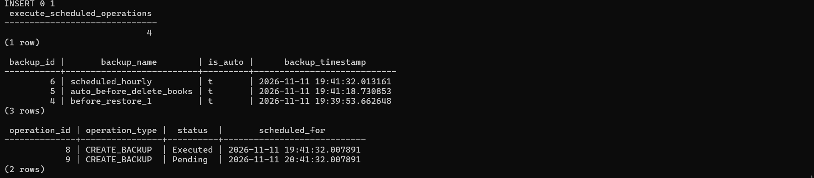

### Резервна копія на рівні СУБД (pg_dump) та відновлення

```bash
# повна резервна копія
docker exec pg-lab3 pg_dump -U postgres -d library_lab3 -F c -f /tmp/library_lab3.dump
docker cp pg-lab3:/tmp/library_lab3.dump ./library_lab3.dump

# відновлення у нову базу
docker exec pg-lab3 psql -U postgres -c "CREATE DATABASE library_lab3_restored;"
docker exec pg-lab3 pg_restore -U postgres -d library_lab3_restored /tmp/library_lab3.dump
docker exec pg-lab3 psql -U postgres -d library_lab3_restored -c "SELECT COUNT(*) FROM books;"
```

**Опис:** логічні контрольні точки в таблиці `backup_points` захищають від помилок користувачів. Від фізичних збоїв сервера захищає `pg_dump`/`pg_restore`, а для відновлення на довільний момент часу (PITR) у промисловому середовищі використовують безперервну архівацію WAL (`archive_mode`, `pg_basebackup`, `recovery_target_time`).

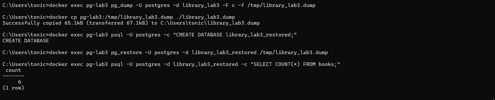

---

## 3.6. Інтерфейс перегляду та відкату змін за період

```sql
-- Представлення історії змін книг із текстовим описом змін
CREATE OR REPLACE VIEW books_change_history AS
SELECT
    a.log_id,
    a.operation,
    a.record_id AS book_id,
    COALESCE(a.new_data->>'title', a.old_data->>'title') AS title,
    CASE a.operation
        WHEN 'INSERT' THEN 'Додано нову книгу'
        WHEN 'DELETE' THEN 'Видалено книгу'
        ELSE 'Оновлено: ' || COALESCE((
            SELECT string_agg(
                       k || ': ' || COALESCE(a.old_data->>k, 'NULL') || ' → ' || COALESCE(a.new_data->>k, 'NULL'),
                       '; ' ORDER BY k)
            FROM jsonb_object_keys(a.new_data) AS t(k)
            WHERE a.old_data->k IS DISTINCT FROM a.new_data->k
        ), 'без змін')
    END AS change_description,
    a.changed_at,
    a.changed_by
FROM audit_log a
WHERE a.table_name = 'books';

-- Звіт про зміни за період (з необов'язковим фільтром за таблицею)
CREATE OR REPLACE FUNCTION get_changes_report(
    p_start_date TIMESTAMP,
    p_end_date   TIMESTAMP DEFAULT CURRENT_TIMESTAMP,
    p_table      TEXT      DEFAULT NULL
)
RETURNS TABLE (
    change_date   DATE,
    total_changes BIGINT,
    inserts       BIGINT,
    updates       BIGINT,
    deletes       BIGINT
)
LANGUAGE plpgsql
AS $$
BEGIN
    RETURN QUERY
    SELECT DATE(a.changed_at),
           COUNT(*),
           COUNT(*) FILTER (WHERE a.operation = 'INSERT'),
           COUNT(*) FILTER (WHERE a.operation = 'UPDATE'),
           COUNT(*) FILTER (WHERE a.operation = 'DELETE')
    FROM audit_log a
    WHERE a.changed_at BETWEEN p_start_date AND p_end_date
      AND (p_table IS NULL OR a.table_name = p_table)
    GROUP BY 1
    ORDER BY 1 DESC;
END;
$$;

-- Відкат усіх книг до стану на певний момент часу
CREATE OR REPLACE FUNCTION rollback_books_since(p_since TIMESTAMP)
RETURNS INTEGER
LANGUAGE plpgsql
AS $$
DECLARE
    v_id    INTEGER;
    v_data  JSONB;
    v_count INTEGER := 0;
BEGIN
    FOR v_id IN
        SELECT DISTINCT book_id FROM books_versions WHERE valid_from > p_since ORDER BY book_id
    LOOP
        v_data := get_book_version(v_id, p_since);
        CONTINUE WHEN v_data IS NULL;          -- книга створена після p_since: не чіпаємо

        UPDATE books b
        SET isbn             = s.isbn,
            title            = s.title,
            author_id        = s.author_id,
            publication_year = s.publication_year,
            genre            = s.genre,
            total_copies     = s.total_copies,
            available_copies = s.available_copies
        FROM jsonb_populate_record(NULL::books, v_data) AS s
        WHERE b.book_id = v_id;

        IF NOT FOUND THEN
            INSERT INTO books SELECT * FROM jsonb_populate_record(NULL::books, v_data);
        END IF;

        v_count := v_count + 1;
    END LOOP;

    RETURN v_count;
END;
$$;
```

### Фінальне налаштування прав на службові функції

```sql
-- Відкат, відновлення та планувальник — тільки для адміністратора
REVOKE EXECUTE ON FUNCTION
    rollback_book_to_version(INTEGER, INTEGER),
    rollback_books_since(TIMESTAMP),
    restore_from_backup(INTEGER),
    create_backup_point(TEXT, TEXT, BOOLEAN),
    execute_scheduled_operations()
FROM PUBLIC;

GRANT EXECUTE ON FUNCTION
    rollback_book_to_version(INTEGER, INTEGER),
    rollback_books_since(TIMESTAMP),
    restore_from_backup(INTEGER),
    create_backup_point(TEXT, TEXT, BOOLEAN),
    execute_scheduled_operations()
TO library_admin;

GRANT SELECT ON books_change_history, books_version_history TO librarian_read;

-- Перевірка: бібліотекар не може відновлювати дані
SET ROLE librarian2;
SELECT restore_from_backup(1);          -- ПОМИЛКА: permission denied
RESET ROLE;
```

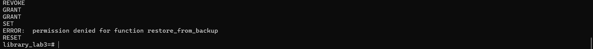

### Використання

```sql
-- Перегляд історії змін книг
SELECT log_id, operation, book_id, title, change_description, changed_at, changed_by
FROM books_change_history
ORDER BY log_id DESC
LIMIT 10;

-- Звіт про зміни за останні 30 днів
SELECT * FROM get_changes_report(CURRENT_DATE - INTERVAL '30 days');
SELECT * FROM get_changes_report(CURRENT_DATE - INTERVAL '30 days', CURRENT_TIMESTAMP, 'readers');
```

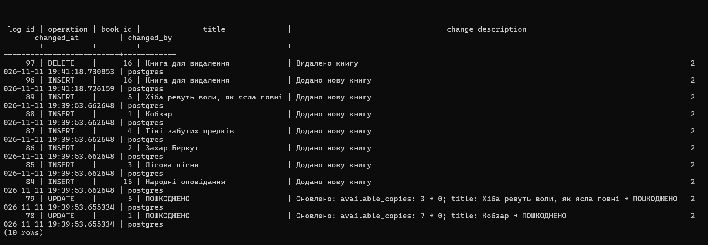
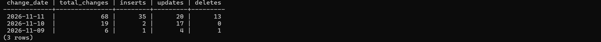

### Відкат змін за період

```sql
-- Фіксуємо момент часу (psql: змінна t0)
SELECT clock_timestamp()::timestamp AS t0 \gset

-- «Помилкові» зміни
UPDATE books SET title = 'Кобзар (ПОМИЛКОВА ЗМІНА)' WHERE book_id = 1;
UPDATE books SET available_copies = 0 WHERE book_id = 3;

SELECT book_id, title, available_copies FROM books WHERE book_id IN (1, 3) ORDER BY book_id;

-- Що змінилося після t0
SELECT log_id, book_id, change_description, changed_at
FROM books_change_history
WHERE changed_at >= :'t0'
ORDER BY log_id;

-- Відкат до стану на момент t0
SELECT rollback_books_since(:'t0') AS books_restored;

SELECT book_id, title, available_copies FROM books WHERE book_id IN (1, 3) ORDER BY book_id;
```

> Якщо використовується не `psql`, а інший клієнт — підставте часову мітку вручну, наприклад `rollback_books_since('2025-01-01 12:00:00')`.

**Опис:** представлення `books_change_history` формує зрозумілий опис змін (які поля змінились і як). Функція `rollback_books_since` повертає кожну книгу до стану, який вона мала на вказаний момент, використовуючи історію версій. Сам відкат також фіксується в `audit_log` та `books_versions`, тож історія залишається повною.


---

## Підсумок рівня 3

| Завдання                                        | Виконано | Розділ |
|-------------------------------------------------|----------|--------|
| Версіонування записів, історичні стани          | ✔        | 3.1    |
| Відкладені операції з автоматичним виконанням   | ✔        | 3.2    |
| Збережені процедури бізнес-логіки               | ✔        | 3.3    |
| Ролі та права на операції модифікації           | ✔        | 3.4    |
| Відновлення даних, автоматичні контрольні точки | ✔        | 3.5    |
| Інтерфейс перегляду та відкату змін за період   | ✔        | 3.6    |

---

## Висновки

У ході лабораторної роботи в PostgreSQL (Docker) створено базу даних для управління бібліотекою та реалізовано безпечну модифікацію даних:

- **Рівень 1.** Створено структуру з обмеженнями `PRIMARY KEY`, `FOREIGN KEY`, `UNIQUE`, `NOT NULL`, `CHECK`, `DEFAULT`; виконано INSERT/UPDATE/DELETE з перевіркою через `SELECT` та `RETURNING`; показано, що транзакції гарантують атомарність, а `ROLLBACK` скасовує помилкові зміни.
- **Рівень 2.** Додано бронювання та журнал змін; реалізовано складні транзакції у кількох таблицях, часткові відкати через `SAVEPOINT`, каскадні правила (`CASCADE`, `RESTRICT`), тригери аудиту, блокування (`FOR UPDATE`, `NOWAIT`, `SKIP LOCKED`), deadlock та різницю рівнів ізоляції.
- **Рівень 3.** Реалізовано версіонування записів з історичними станами та відкатом, відкладені операції з автоматичним виконанням, збережені процедури бізнес-логіки, систему ролей із правами на рівні операцій і стовпців, контрольні точки з автоматичним створенням та відновленням, а також представлення і функції для перегляду та відкату змін за період.

Практично встановлено, що цілісність даних забезпечується комбінацією обмежень, транзакцій, блокувань і тригерів, а аудит і версіонування на рівні БД не залежать від прикладного коду.

---

## Посилання

- Репозиторій GitHub: https://github.com/danil41k/DB.git
- Документація PostgreSQL: https://www.postgresql.org/docs/
- Docker-образ PostgreSQL: https://hub.docker.com/_/postgres
