# Звіт з лабораторної роботи №5

## Керування БД, оптимізація продуктивності та автоматизація

**ПІБ студента:** Остаповець Данило Олександрович

**Предметна область:** Система управління спортивним клубом

**Рівень виконання:** Рівень 3

---

# Мета роботи

Навчитися аналізувати та оптимізувати продуктивність бази даних за допомогою індексів та планів виконання запитів, автоматизувати роботу БД за допомогою тригерів і представлень, освоїти базові операції адміністрування PostgreSQL: керування правами доступу, резервне копіювання та моніторинг.

---

# 1. Середовище та підготовка даних

Використано PostgreSQL 17 у Docker (`postgres:17-alpine`) та pgAdmin. Робота виконана на базі даних `sportsclub` з лабораторної №4. До `docker-compose.yml` додано:

- `shared_preload_libraries=pg_stat_statements` — для моніторингу найповільніших запитів;
- томи `./lab05` (SQL-скрипти), `./backups` (резервні копії), `./results` (результати EXPLAIN і моніторингу).

```bash
docker compose up -d
docker compose exec postgres psql -U postgres -d sportsclub
```

На початкових 10 рядках у таблицях оптимізатор завжди обирає Sequential Scan, тому дані було збільшено скриптом `lab05/00_seed_large_data.sql` (`generate_series` + `random()`). Для швидкості на час наповнення вимкнено користувацькі тригери (`session_replication_role = replica`).

| Таблиця | Було | Стало |
|---|---|---|
| members | 10 | 100 010 |
| trainers | 10 | 60 |
| member_memberships | 10 | 150 010 |
| training_sessions | 10 | 20 010 |
| attendance | 10 | 500 010 |

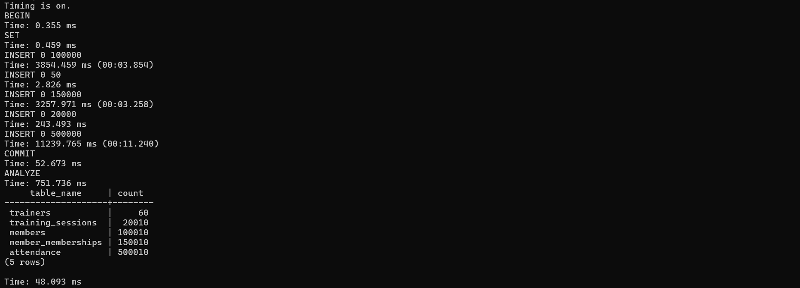

---

# 2. Рівень 1

## 2.1 Аналіз продуктивності трьох запитів (до оптимізації)

Для аналізу використано `EXPLAIN (ANALYZE, BUFFERS)`. Запити — у файлі `lab05/01_explain_queries.sql`:

```sql

\echo
\echo '=== Запит 1: активність нових учасників (JOIN + GROUP BY + HAVING + ORDER BY) ==='
EXPLAIN (ANALYZE, BUFFERS)
SELECT
    m.member_id,
    m.first_name,
    m.last_name,
    COUNT(mm.member_membership_id) AS memberships_bought,
    SUM(ms.price)                  AS total_spent
FROM members m
JOIN member_memberships mm ON mm.member_id = m.member_id
JOIN memberships ms        ON ms.membership_id = mm.membership_id
WHERE m.registration_date >= '2026-09-01'
GROUP BY m.member_id, m.first_name, m.last_name
HAVING COUNT(mm.member_membership_id) >= 2
ORDER BY total_spent DESC
LIMIT 20;

\echo
\echo '=== Запит 2: навантаження тренерів за жовтень 2026 (3 таблиці, агрегація) ==='
EXPLAIN (ANALYZE, BUFFERS)
SELECT
    t.trainer_id,
    t.first_name,
    t.last_name,
    COUNT(DISTINCT ts.session_id) AS sessions_count,
    COUNT(a.attendance_id)        AS total_visits
FROM training_sessions ts
JOIN trainers t         ON t.trainer_id = ts.trainer_id
LEFT JOIN attendance a  ON a.session_id = ts.session_id
WHERE ts.session_date BETWEEN '2026-10-01' AND '2026-10-31'
GROUP BY t.trainer_id, t.first_name, t.last_name
ORDER BY total_visits DESC
LIMIT 10;

\echo
\echo '=== Запит 3: абонементи, що закінчуються в перший тиждень грудня 2026 ==='
EXPLAIN (ANALYZE, BUFFERS)
SELECT
    mm.end_date,
    m.first_name,
    m.last_name,
    m.phone,
    ms.membership_name
FROM member_memberships mm
JOIN members m      ON m.member_id = mm.member_id
JOIN memberships ms ON ms.membership_id = mm.membership_id
WHERE mm.end_date BETWEEN '2026-12-01' AND '2026-12-07'
ORDER BY mm.end_date, m.last_name;
```

- **Запит 1** — активність нових учасників: 3 таблиці, `WHERE` за датою реєстрації, `GROUP BY`, `HAVING`, `ORDER BY`, `LIMIT`.
- **Запит 2** — навантаження тренерів за жовтень: фільтр за діапазоном дат, `LEFT JOIN` до 500 тис. відвідувань, `COUNT(DISTINCT)`.
- **Запит 3** — абонементи, що закінчуються в перший тиждень грудня: фільтр за діапазоном `end_date`, сортування.

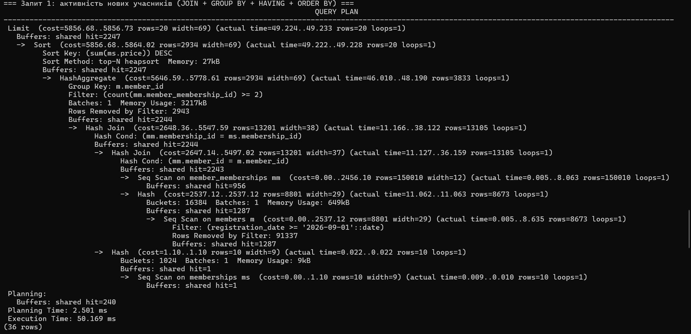

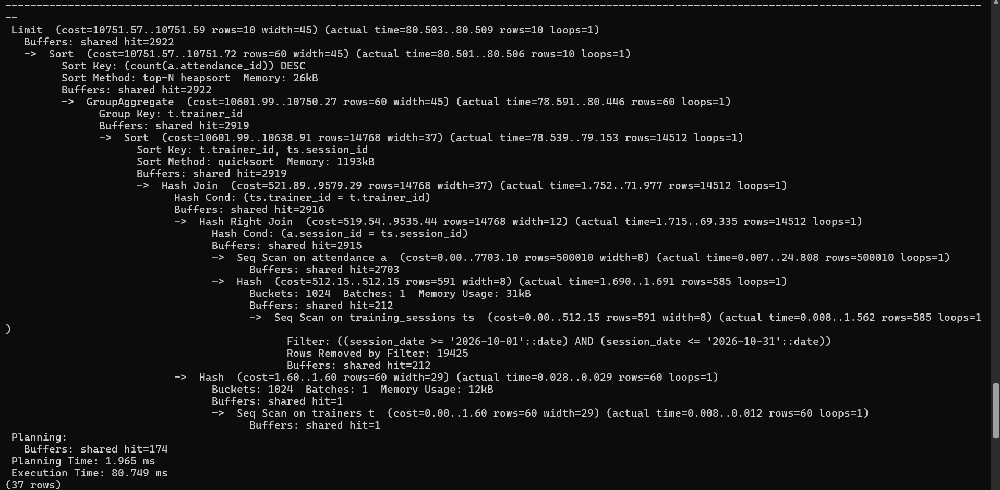

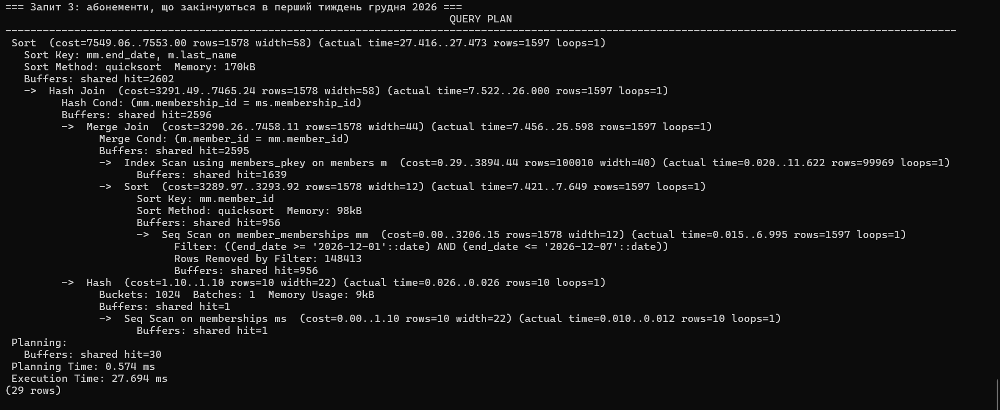

Спостереження до оптимізації :

| Запит | Тип сканування великих таблиць | Rows у вузлі сканування | Shared buffers read/hit | Execution Time, мс |
|---|---|---|---|---|
| 1 | Seq Scan по member_memberships та members | 150010; 100010 | hit≈2243 | 50.169 |
| 2 | Seq Scan по attendance та training_sessions | 500010; 20010 | hit≈2915 | 80.749 |
| 3 | Seq Scan по member_memberships | 150010 | hit=956 | 27.694 |

## 2.2 Індекси та перевірка покращення

На основі планів визначено стовпці, що використовуються у `WHERE`, `JOIN` та `ORDER BY`. Зовнішній ключ `member_memberships.member_id` не мав індексу (PostgreSQL не створює його автоматично).

```sql

-- Запит 1: фільтр WHERE m.registration_date >= ...
CREATE INDEX IF NOT EXISTS idx_members_registration_date
    ON members (registration_date);

-- Запит 1 і 3: JOIN member_memberships -> members.
-- PostgreSQL НЕ створює індекс на зовнішній ключ автоматично.
CREATE INDEX IF NOT EXISTS idx_member_memberships_member_id
    ON member_memberships (member_id);

-- Запит 2: фільтр за діапазоном дат тренувань
CREATE INDEX IF NOT EXISTS idx_training_sessions_session_date
    ON training_sessions (session_date);

-- Запит 3: фільтр за діапазоном end_date + сортування
CREATE INDEX IF NOT EXISTS idx_member_memberships_end_date
    ON member_memberships (end_date);

-- Оновлюємо статистику, щоб оптимізатор врахував нові індекси
ANALYZE members;
ANALYZE member_memberships;
ANALYZE training_sessions;

\echo
\echo 'Створені індекси та їх розмір:'
SELECT
    indexrelname                                   AS index_name,
    relname                                        AS table_name,
    pg_size_pretty(pg_relation_size(indexrelid))   AS index_size
FROM pg_stat_user_indexes
WHERE indexrelname IN (
    'idx_members_registration_date',
    'idx_member_memberships_member_id',
    'idx_training_sessions_session_date',
    'idx_member_memberships_end_date')
ORDER BY indexrelname;
```

| Індекс | Таблиця / стовпець | Обґрунтування | Запит |
|---|---|---|---|
| `idx_members_registration_date` | `members(registration_date)` | фільтр `registration_date >= …` | 1 |
| `idx_member_memberships_member_id` | `member_memberships(member_id)` | JOIN за зовнішнім ключем | 1, 3 |
| `idx_training_sessions_session_date` | `training_sessions(session_date)` | діапазонний фільтр за датою | 2 |
| `idx_member_memberships_end_date` | `member_memberships(end_date)` | діапазонний фільтр + сортування | 3 |

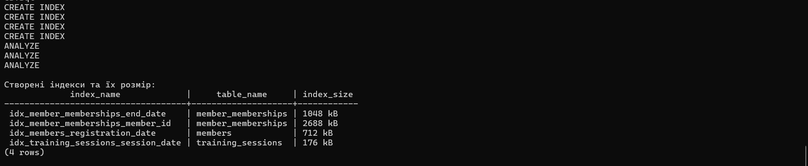

Повторний `EXPLAIN (ANALYZE, BUFFERS)` тих самих запитів після створення індексів та `ANALYZE`:

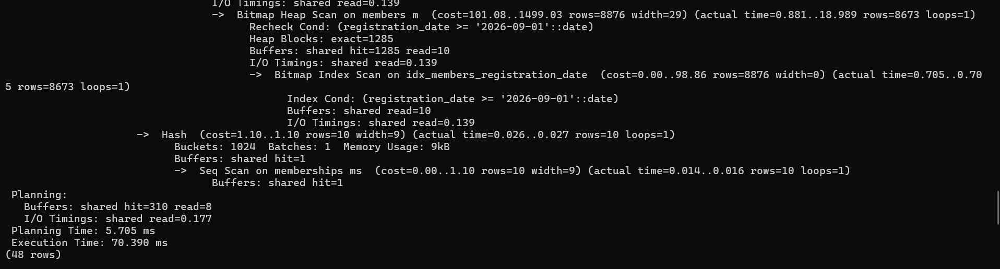

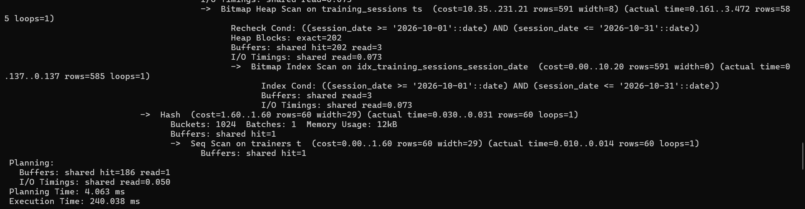

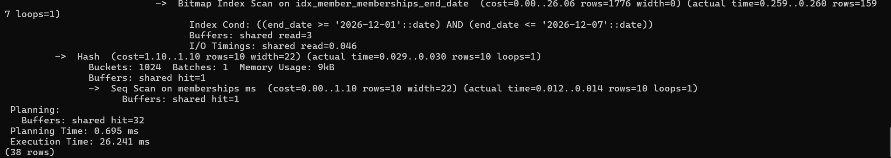


Порівняння (відсоток покращення = (до − після) / до × 100 %):

| Запит | До, мс | Після, мс | Покращення, % | Тип сканування після |
|--------|---------:|-----------:|-------------:|----------------------|
| 1 | 50.169 | 70.390 | -40.31 | Bitmap Heap Scan + Bitmap Index Scan |
| 2 | 80.749 | 240.038 | -197.27 | Bitmap Heap Scan + Bitmap Index Scan |
| 3 | 27.694 | 26.241 | 5.25 | Bitmap Heap Scan + Bitmap Index Scan |

## 2.3 Представлення

Створено два представлення (`lab05/03_views.sql`). Перше — просте з `JOIN` (учасники з діючим абонементом), друге — складне з агрегацією (навантаження тренерів).

```sql

-- 1) Простий JOIN: учасники з діючим на сьогодні абонементом
CREATE OR REPLACE VIEW v_active_memberships AS
SELECT
    m.member_id,
    m.first_name,
    m.last_name,
    ms.membership_name,
    mm.start_date,
    mm.end_date,
    (mm.end_date - CURRENT_DATE) AS days_left
FROM member_memberships mm
JOIN members m      ON m.member_id = mm.member_id
JOIN memberships ms ON ms.membership_id = mm.membership_id
WHERE CURRENT_DATE BETWEEN mm.start_date AND mm.end_date;

-- 2) Складне, з агрегацією: навантаження тренерів
CREATE OR REPLACE VIEW v_trainer_workload AS
SELECT
    t.trainer_id,
    t.first_name || ' ' || t.last_name                      AS trainer_name,
    t.specialization,
    COUNT(DISTINCT ts.session_id)                           AS sessions_count,
    COUNT(a.attendance_id)                                  AS total_visits,
    ROUND(COUNT(a.attendance_id)::numeric
          / NULLIF(COUNT(DISTINCT ts.session_id), 0), 1)    AS avg_visits_per_session
FROM trainers t
LEFT JOIN training_sessions ts ON ts.trainer_id = t.trainer_id
LEFT JOIN attendance a         ON a.session_id = ts.session_id
GROUP BY t.trainer_id, t.first_name, t.last_name, t.specialization;

-- Перевірка
SELECT * FROM v_active_memberships ORDER BY days_left LIMIT 10;
SELECT * FROM v_trainer_workload ORDER BY total_visits DESC LIMIT 10;
```

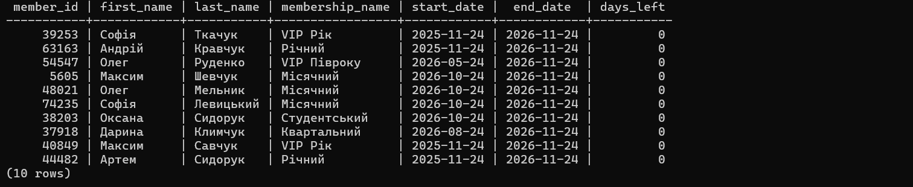

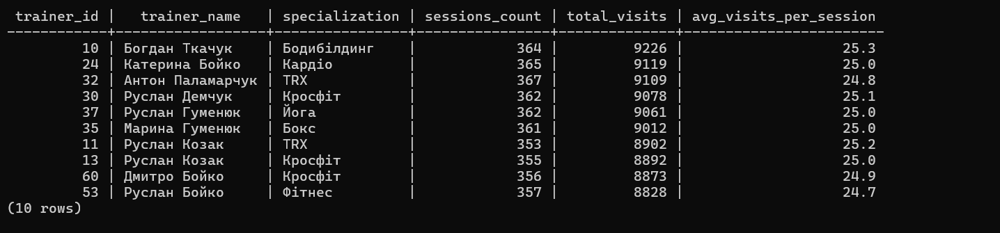

## 2.4 Тригер логування

Створено таблицю `audit_log` та тригер `trg_trainers_log_iu`, який логує `INSERT` і `UPDATE` у таблиці `trainers` (старі та нові значення зберігаються у форматі JSONB). Тест виконано у транзакції з відкатом.

```sql

CREATE TABLE IF NOT EXISTS audit_log (
    log_id      SERIAL PRIMARY KEY,
    table_name  VARCHAR(50) NOT NULL,
    operation   VARCHAR(10) NOT NULL
                CHECK (operation IN ('INSERT', 'UPDATE', 'DELETE')),
    record_id   INTEGER,
    old_values  JSONB,
    new_values  JSONB,
    changed_by  VARCHAR(100),
    changed_at  TIMESTAMP NOT NULL DEFAULT NOW()
);

CREATE INDEX IF NOT EXISTS idx_audit_log_table_time
    ON audit_log (table_name, changed_at DESC);

CREATE OR REPLACE FUNCTION log_trainer_changes()
RETURNS TRIGGER
LANGUAGE plpgsql
AS $$
BEGIN
    IF TG_OP = 'INSERT' THEN
        INSERT INTO audit_log (table_name, operation, record_id, new_values, changed_by)
        VALUES (TG_TABLE_NAME, TG_OP, NEW.trainer_id, to_jsonb(NEW), current_user);

    ELSIF TG_OP = 'UPDATE' THEN
        INSERT INTO audit_log (table_name, operation, record_id, old_values, new_values, changed_by)
        VALUES (TG_TABLE_NAME, TG_OP, NEW.trainer_id, to_jsonb(OLD), to_jsonb(NEW), current_user);
    END IF;

    RETURN NEW;
END;
$$;

DROP TRIGGER IF EXISTS trg_trainers_log_iu ON trainers;

CREATE TRIGGER trg_trainers_log_iu
AFTER INSERT OR UPDATE ON trainers
FOR EACH ROW
EXECUTE FUNCTION log_trainer_changes();


BEGIN;

INSERT INTO trainers (first_name, last_name, specialization, phone, salary)
VALUES ('Тест', 'Тренер', 'Тестовий напрям', '0990000000', 20000);

UPDATE trainers SET salary = 25000 WHERE phone = '0990000000';

SELECT log_id, table_name, operation, record_id,
       old_values ->> 'salary' AS old_salary,
       new_values ->> 'salary' AS new_salary,
       changed_by, changed_at
FROM audit_log
ORDER BY log_id DESC
LIMIT 5;

ROLLBACK;
```

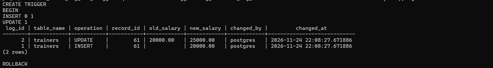

## 2.5 Користувач з обмеженими правами

Створено `report_viewer`. Він може лише читати: безпечні стовпці `members` (без `phone` та `email`), таблиці `memberships`, `training_sessions` і два представлення. Таблиці `trainers` (зарплата), `users` (паролі) та `audit_log` недоступні, будь-який запис заборонено.

```sql
DO $$
BEGIN
    IF NOT EXISTS (SELECT 1 FROM pg_roles WHERE rolname = 'report_viewer') THEN
        CREATE ROLE report_viewer LOGIN PASSWORD 'Rv_2026_Sp0rt!';
    END IF;
END
$$;

GRANT CONNECT ON DATABASE sportsclub TO report_viewer;
GRANT USAGE   ON SCHEMA public       TO report_viewer;

-- Права на стовпці (column-level privileges)
GRANT SELECT (member_id, first_name, last_name, registration_date) ON members TO report_viewer;
GRANT SELECT ON memberships, training_sessions TO report_viewer;

-- Представлення виконуються з правами власника, тому report_viewer бачить
-- через них дані, до базових таблиць яких прямого доступу не має.
GRANT SELECT ON v_active_memberships, v_trainer_workload TO report_viewer;

-- Перевірка виданих прав
\echo
\echo 'Права report_viewer на рівні таблиць:'
SELECT table_name, privilege_type
FROM information_schema.role_table_grants
WHERE grantee = 'report_viewer'
ORDER BY table_name, privilege_type;

\echo 'Права report_viewer на рівні стовпців:'
SELECT table_name, column_name, privilege_type
FROM information_schema.role_column_grants
WHERE grantee = 'report_viewer' AND table_schema = 'public'
ORDER BY table_name, column_name;
```

Перевірка підключенням від імені `report_viewer` (читання дозволено, заборонені стовпці/таблиці та запис дають `permission denied`):

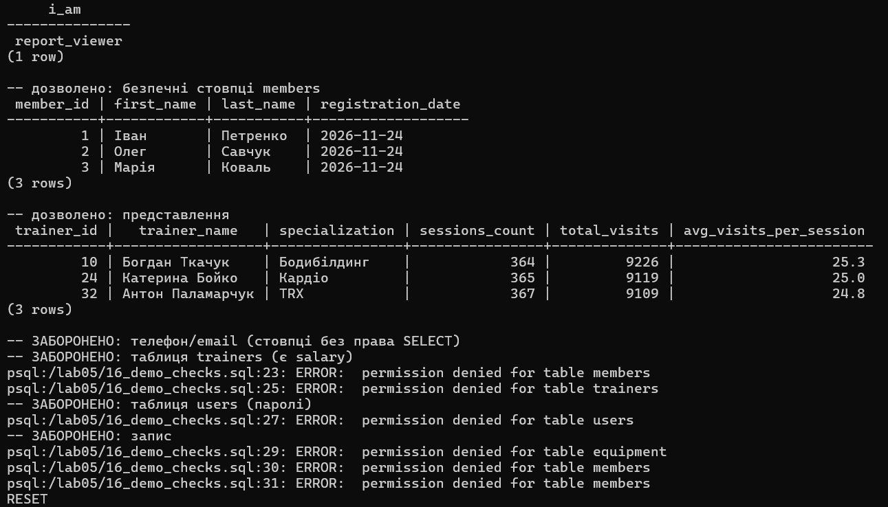

---

# 3. Рівень 2

## 3.1 Представлення, що оновлюється через правила (RULES)

`v_member_profile` об'єднує `members` з останнім абонементом (`LEFT JOIN LATERAL`), тому PostgreSQL не оновлює його автоматично. Поведінку `UPDATE` та `DELETE` задано правилами `DO INSTEAD`: оновлюються лише контактні дані в `members`, похідні стовпці ігноруються.

```sql

CREATE OR REPLACE VIEW v_member_profile AS
SELECT
    m.member_id,
    m.first_name,
    m.last_name,
    m.phone,
    m.email,
    cur.membership_name,
    cur.end_date AS membership_end_date
FROM members m
LEFT JOIN LATERAL (
    SELECT ms.membership_name, mm.end_date
    FROM member_memberships mm
    JOIN memberships ms ON ms.membership_id = mm.membership_id
    WHERE mm.member_id = m.member_id
    ORDER BY mm.end_date DESC
    LIMIT 1
) cur ON TRUE;

-- UPDATE через представлення змінює лише контактні дані в members.
-- Стовпці membership_name / membership_end_date ігноруються (вони похідні).
CREATE OR REPLACE RULE v_member_profile_update AS
ON UPDATE TO v_member_profile
DO INSTEAD
    UPDATE members
    SET first_name = NEW.first_name,
        last_name  = NEW.last_name,
        phone      = NEW.phone,
        email      = NEW.email
    WHERE member_id = OLD.member_id;

-- DELETE через представлення видаляє учасника (каскадно його абонементи
-- та відвідування завдяки ON DELETE CASCADE у схемі).
CREATE OR REPLACE RULE v_member_profile_delete AS
ON DELETE TO v_member_profile
DO INSTEAD
    DELETE FROM members WHERE member_id = OLD.member_id;

BEGIN;

\echo 'До оновлення:'
SELECT member_id, first_name, last_name, phone, email, membership_name
FROM v_member_profile WHERE member_id = 1;

UPDATE v_member_profile
SET email = 'ivan.new@example.com', phone = '0501111112'
WHERE member_id = 1;

\echo 'Після оновлення через представлення:'
SELECT member_id, first_name, last_name, phone, email, membership_name
FROM v_member_profile WHERE member_id = 1;

\echo 'Те саме в базовій таблиці members:'
SELECT member_id, phone, email FROM members WHERE member_id = 1;

ROLLBACK;
```

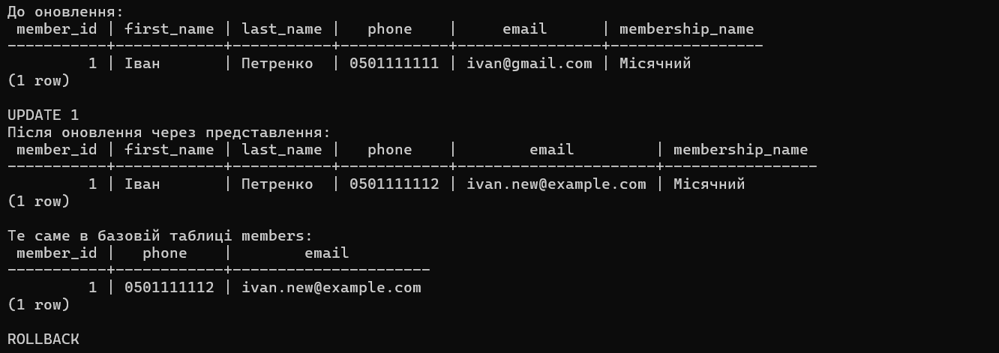

## 3.2 Тригери валідації

`BEFORE INSERT OR UPDATE`-тригери відхиляють некоректні дані через `RAISE EXCEPTION` з кодом `check_violation` (SQLSTATE 23514) та підказкою `HINT`: формат email і телефону, дата народження, час початку/завершення тренування, дати абонемента. У тестах помилка перехоплюється блоком `EXCEPTION`.

```sql

-- ---------- members: email, телефон, дата народження ----------
CREATE OR REPLACE FUNCTION validate_member_data()
RETURNS TRIGGER
LANGUAGE plpgsql
AS $$
BEGIN
    IF NEW.email IS NOT NULL
       AND NEW.email !~ '^[A-Za-z0-9._%+-]+@[A-Za-z0-9.-]+\.[A-Za-z]{2,}$' THEN
        RAISE EXCEPTION 'Некоректний email: %', NEW.email
            USING ERRCODE = 'check_violation',
                  HINT = 'Очікуваний формат: name@domain.com';
    END IF;

    IF NEW.phone !~ '^\+?[0-9]{10,15}$' THEN
        RAISE EXCEPTION 'Некоректний телефон: %', NEW.phone
            USING ERRCODE = 'check_violation',
                  HINT = 'Лише цифри (допускається ведучий +), довжина 10-15 символів';
    END IF;

    IF NEW.birth_date < DATE '1900-01-01'
       OR NEW.birth_date > CURRENT_DATE - INTERVAL '5 years' THEN
        RAISE EXCEPTION 'Некоректна дата народження: %', NEW.birth_date
            USING ERRCODE = 'check_violation',
                  HINT = 'Учаснику має бути щонайменше 5 років, дата не раніше 1900-01-01';
    END IF;

    RETURN NEW;
END;
$$;

DROP TRIGGER IF EXISTS trg_validate_members ON members;
CREATE TRIGGER trg_validate_members
BEFORE INSERT OR UPDATE ON members
FOR EACH ROW
EXECUTE FUNCTION validate_member_data();

-- ---------- training_sessions: час початку < часу завершення ----------
CREATE OR REPLACE FUNCTION validate_session_times()
RETURNS TRIGGER
LANGUAGE plpgsql
AS $$
BEGIN
    IF NEW.end_time <= NEW.start_time THEN
        RAISE EXCEPTION 'Час завершення (%) має бути пізніше за час початку (%)',
            NEW.end_time, NEW.start_time
            USING ERRCODE = 'check_violation';
    END IF;
    RETURN NEW;
END;
$$;

DROP TRIGGER IF EXISTS trg_validate_sessions ON training_sessions;
CREATE TRIGGER trg_validate_sessions
BEFORE INSERT OR UPDATE ON training_sessions
FOR EACH ROW
EXECUTE FUNCTION validate_session_times();

-- ---------- member_memberships: дата завершення > дати початку ----------
CREATE OR REPLACE FUNCTION validate_membership_dates()
RETURNS TRIGGER
LANGUAGE plpgsql
AS $$
BEGIN
    IF NEW.end_date <= NEW.start_date THEN
        RAISE EXCEPTION 'Дата завершення абонемента (%) має бути пізніше за дату початку (%)',
            NEW.end_date, NEW.start_date
            USING ERRCODE = 'check_violation';
    END IF;
    RETURN NEW;
END;
$$;

DROP TRIGGER IF EXISTS trg_validate_member_memberships ON member_memberships;
CREATE TRIGGER trg_validate_member_memberships
BEFORE INSERT OR UPDATE ON member_memberships
FOR EACH ROW
EXECUTE FUNCTION validate_membership_dates();

\echo
\echo '--- Тест 1: некоректний email ---'
DO $$
BEGIN
    INSERT INTO members (first_name, last_name, birth_date, phone, email)
    VALUES ('Тест', 'Email', '2000-01-01', '0991111111', 'invalid-email');
    RAISE NOTICE 'ПОМИЛКА: запис не мав пройти!';
EXCEPTION WHEN check_violation THEN
    RAISE NOTICE 'Відхилено тригером: %', SQLERRM;
END
$$;

\echo '--- Тест 2: некоректний телефон ---'
DO $$
BEGIN
    INSERT INTO members (first_name, last_name, birth_date, phone, email)
    VALUES ('Тест', 'Phone', '2000-01-01', '12345', 'ok@example.com');
    RAISE NOTICE 'ПОМИЛКА: запис не мав пройти!';
EXCEPTION WHEN check_violation THEN
    RAISE NOTICE 'Відхилено тригером: %', SQLERRM;
END
$$;

\echo '--- Тест 3: дата народження в майбутньому ---'
DO $$
BEGIN
    INSERT INTO members (first_name, last_name, birth_date, phone, email)
    VALUES ('Тест', 'Birth', CURRENT_DATE + 1, '0992222222', 'birth@example.com');
    RAISE NOTICE 'ПОМИЛКА: запис не мав пройти!';
EXCEPTION WHEN check_violation THEN
    RAISE NOTICE 'Відхилено тригером: %', SQLERRM;
END
$$;

\echo '--- Тест 4: тренування, що закінчується раніше, ніж починається ---'
DO $$
BEGIN
    INSERT INTO training_sessions (trainer_id, session_name, session_date, start_time, end_time, max_participants)
    VALUES (1, 'Тест', CURRENT_DATE, '12:00', '11:00', 10);
    RAISE NOTICE 'ПОМИЛКА: запис не мав пройти!';
EXCEPTION WHEN check_violation THEN
    RAISE NOTICE 'Відхилено тригером: %', SQLERRM;
END
$$;

\echo '--- Тест 5: коректний запис проходить (з відкатом) ---'
BEGIN;
INSERT INTO members (first_name, last_name, birth_date, phone, email)
VALUES ('Валід', 'Тест', '2000-01-01', '0993333333', 'valid@example.com')
RETURNING member_id, first_name, last_name, email;
ROLLBACK;
```

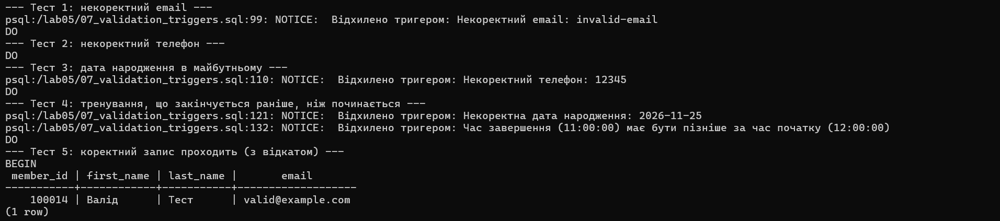

## 3.3 Система аудиту

Універсальна функція `audit_row_changes()` підключена до семи таблиць. Вона фіксує тип операції, назву таблиці, `record_id`, старі й нові значення, користувача (`session_user`) та час. Простий тригер рівня 1 видалено, щоб операції не дублювались.

```sql

CREATE OR REPLACE FUNCTION audit_row_changes()
RETURNS TRIGGER
LANGUAGE plpgsql
SECURITY DEFINER
SET search_path = public, pg_temp
AS $$
DECLARE
    pk_col TEXT := TG_ARGV[0];
BEGIN
    IF TG_OP = 'INSERT' THEN
        INSERT INTO audit_log (table_name, operation, record_id, new_values, changed_by)
        VALUES (TG_TABLE_NAME, TG_OP, (to_jsonb(NEW) ->> pk_col)::integer,
                to_jsonb(NEW), session_user);
        RETURN NEW;

    ELSIF TG_OP = 'UPDATE' THEN
        -- не логуємо «порожні» оновлення, що нічого не змінили
        IF to_jsonb(OLD) = to_jsonb(NEW) THEN
            RETURN NEW;
        END IF;
        INSERT INTO audit_log (table_name, operation, record_id, old_values, new_values, changed_by)
        VALUES (TG_TABLE_NAME, TG_OP, (to_jsonb(NEW) ->> pk_col)::integer,
                to_jsonb(OLD), to_jsonb(NEW), session_user);
        RETURN NEW;

    ELSIF TG_OP = 'DELETE' THEN
        INSERT INTO audit_log (table_name, operation, record_id, old_values, changed_by)
        VALUES (TG_TABLE_NAME, TG_OP, (to_jsonb(OLD) ->> pk_col)::integer,
                to_jsonb(OLD), session_user);
        RETURN OLD;
    END IF;

    RETURN NULL;
END;
$$;

-- Простий тригер рівня 1 більше не потрібен (інакше INSERT/UPDATE
-- trainers логувалися б двічі)
DROP TRIGGER IF EXISTS trg_trainers_log_iu ON trainers;

-- Підключаємо універсальний тригер до всіх основних таблиць
DO $$
DECLARE
    r RECORD;
BEGIN
    FOR r IN
        SELECT * FROM (VALUES
            ('members',            'member_id'),
            ('trainers',           'trainer_id'),
            ('memberships',        'membership_id'),
            ('member_memberships', 'member_membership_id'),
            ('training_sessions',  'session_id'),
            ('attendance',         'attendance_id'),
            ('equipment',          'equipment_id')
        ) AS t(tbl, pk)
    LOOP
        EXECUTE format('DROP TRIGGER IF EXISTS trg_audit_%1$s ON %1$I', r.tbl);
        EXECUTE format(
            'CREATE TRIGGER trg_audit_%1$s
             AFTER INSERT OR UPDATE OR DELETE ON %1$I
             FOR EACH ROW EXECUTE FUNCTION audit_row_changes(%2$L)',
            r.tbl, r.pk);
    END LOOP;
END
$$;

\echo
\echo 'Тригери аудиту:'
SELECT event_object_table AS table_name, trigger_name,
       string_agg(DISTINCT event_manipulation, ', ' ORDER BY event_manipulation) AS events
FROM information_schema.triggers
WHERE trigger_name LIKE 'trg_audit_%'
GROUP BY event_object_table, trigger_name
ORDER BY event_object_table;

BEGIN;

INSERT INTO equipment (equipment_name, quantity, purchase_date, condition)
VALUES ('Тестова гантеля', 5, CURRENT_DATE, 'New');

UPDATE equipment SET quantity = 8, condition = 'Good'
WHERE equipment_name = 'Тестова гантеля';

DELETE FROM equipment WHERE equipment_name = 'Тестова гантеля';

SELECT log_id, table_name, operation, record_id,
       old_values ->> 'quantity' AS old_qty,
       new_values ->> 'quantity' AS new_qty,
       changed_by, changed_at
FROM audit_log
WHERE table_name = 'equipment'
ORDER BY log_id DESC
LIMIT 3;

ROLLBACK;
```

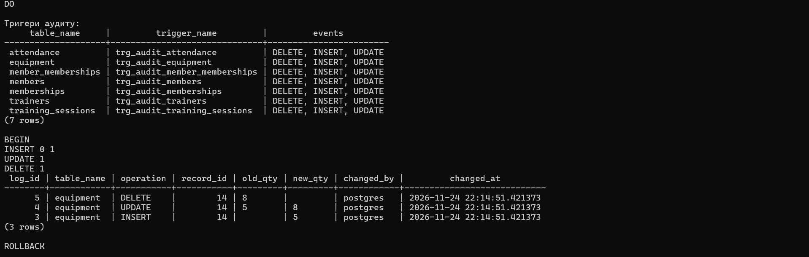

## 3.4 Часткові індекси

```sql

-- 1) Абонементи, що діють/закінчуються з грудня 2026 (актуальні записи)
CREATE INDEX IF NOT EXISTS idx_mm_end_date_current
    ON member_memberships (end_date)
    WHERE end_date >= '2026-12-01';

-- 2) Великі групи (>= 35 учасників): рідкісна підмножина тренувань
CREATE INDEX IF NOT EXISTS idx_sessions_big_groups
    ON training_sessions (session_date)
    WHERE max_participants >= 35;

ANALYZE member_memberships;
ANALYZE training_sessions;

\echo
\echo '=== Порівняння розміру повних та часткових індексів ==='
SELECT
    c.relname                                  AS index_name,
    pg_size_pretty(pg_relation_size(c.oid))    AS size,
    pg_relation_size(c.oid)                    AS size_bytes,
    pg_get_expr(i.indpred, i.indrelid)         AS partial_predicate
FROM pg_class c
JOIN pg_index i ON i.indexrelid = c.oid
WHERE c.relname IN ('idx_member_memberships_end_date', 'idx_mm_end_date_current',
                    'idx_training_sessions_session_date', 'idx_sessions_big_groups')
ORDER BY c.relname;

\echo
\echo '=== Запит A: має використати часткові індекси (умова вкладається у предикат) ==='
EXPLAIN (ANALYZE, BUFFERS)
SELECT member_membership_id, member_id, end_date
FROM member_memberships
WHERE end_date >= '2026-12-01' AND end_date < '2026-12-04';

\echo
\echo '=== Запит B: великі групи ==='
EXPLAIN (ANALYZE, BUFFERS)
SELECT session_id, session_name, session_date, max_participants
FROM training_sessions
WHERE max_participants >= 35
  AND session_date BETWEEN '2026-10-01' AND '2026-12-31'
ORDER BY session_date;

\echo
\echo '=== Запит C (контроль): умова ПОЗА предикатом часткового індексу ==='
\echo '    часткові індекси тут не застосовуються — використовується повний індекс'
EXPLAIN (ANALYZE, BUFFERS)
SELECT member_membership_id, member_id, end_date
FROM member_memberships
WHERE end_date >= '2026-06-01' AND end_date < '2026-06-04';
```

Аналіз ефективності (заповніть за своїми результатами):

| Індекс | Предикат | Розмір | Повний аналог | Розмір повного |
|---|---|---:|---|---:|
| `idx_mm_end_date_current` | `end_date >= '2026-12-01'` | 216 kB | `idx_member_memberships_end_date` | 1048 kB |
| `idx_sessions_big_groups` | `max_participants >= 35` | 72 kB | `idx_training_sessions_session_date` | 176 kB |

Запити A і B використовують часткові індекси (менший розмір → менше сторінок у `Buffers`), запит C із умовою поза предикатом використовує повний індекс.

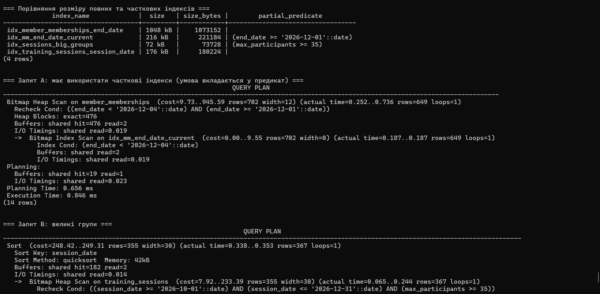
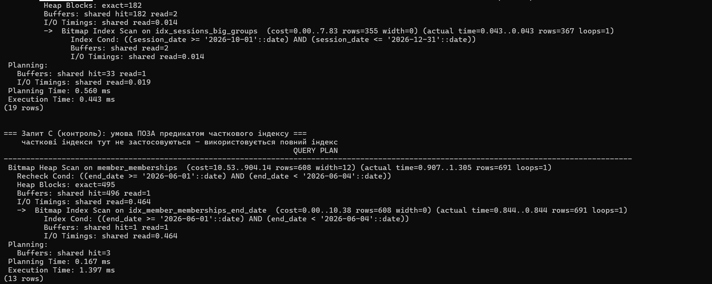

## 3.5 Резервне копіювання та відновлення

Резервна копія створюється `pg_dump` у двох форматах: custom (`-F c`, стиснення, вибіркове відновлення) та plain SQL. Відновлення перевірено в окремій базі `test_restore`, після чого кількість записів і об'єктів порівнювалась з оригіналом (`lab05/10_backup_restore_verify.sql`).

```bash
# резервна копія (scripts/backup.sh | backup.ps1)
docker compose exec -T postgres pg_dump -U postgres -d sportsclub -F c -Z 6 -f /backups/sportsclub_<дата>.dump
docker compose exec -T postgres pg_dump -U postgres -d sportsclub -f /backups/sportsclub_<дата>.sql

# відновлення (scripts/restore_test.sh | restore_test.ps1)
docker compose exec -T postgres psql -U postgres -c "CREATE DATABASE test_restore;"
docker compose exec -T postgres pg_restore -U postgres -d test_restore --no-owner /backups/sportsclub_<дата>.dump
```

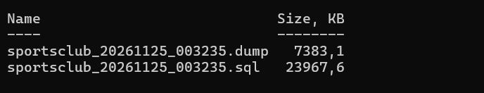

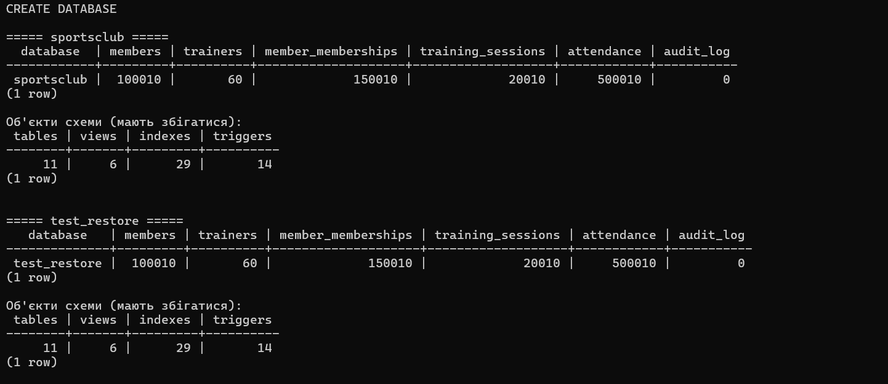

---

# 4. Рівень 3

## 4.1 Матеріалізоване представлення з автоматичним оновленням

`mv_monthly_membership_sales` зберігає агреговані місячні продажі абонементів (кількість, виручка, середня ціна). Унікальний індекс дозволяє `REFRESH … CONCURRENTLY`. Тригер `FOR EACH STATEMENT` на `member_memberships` оновлює представлення після кожної зміни. Функція тригера — `SECURITY DEFINER`, бо оновити представлення може лише його власник.

```sql

CREATE MATERIALIZED VIEW IF NOT EXISTS mv_monthly_membership_sales AS
SELECT
    date_trunc('month', mm.start_date)::date AS sale_month,
    COUNT(*)                                  AS memberships_sold,
    SUM(ms.price)                             AS revenue,
    ROUND(AVG(ms.price), 2)                   AS avg_price
FROM member_memberships mm
JOIN memberships ms ON ms.membership_id = mm.membership_id
GROUP BY date_trunc('month', mm.start_date)::date
WITH DATA;

-- Унікальний індекс потрібен для REFRESH ... CONCURRENTLY
CREATE UNIQUE INDEX IF NOT EXISTS idx_mv_monthly_sales_month
    ON mv_monthly_membership_sales (sale_month);

-- Функція тригера: SECURITY DEFINER, бо REFRESH може виконати лише
-- власник представлення (інакше модератор, який додав абонемент,
-- отримав би помилку прав).
CREATE OR REPLACE FUNCTION refresh_mv_monthly_sales()
RETURNS TRIGGER
LANGUAGE plpgsql
SECURITY DEFINER
SET search_path = public, pg_temp
AS $$
BEGIN
    REFRESH MATERIALIZED VIEW CONCURRENTLY mv_monthly_membership_sales;
    RETURN NULL;
END;
$$;

DROP TRIGGER IF EXISTS trg_refresh_mv_monthly_sales ON member_memberships;
CREATE TRIGGER trg_refresh_mv_monthly_sales
AFTER INSERT OR UPDATE OR DELETE ON member_memberships
FOR EACH STATEMENT
EXECUTE FUNCTION refresh_mv_monthly_sales();

\echo
\echo 'Останні місяці ДО продажу абонемента:'
SELECT * FROM mv_monthly_membership_sales ORDER BY sale_month DESC LIMIT 3;

BEGIN;
-- «Піврічний» (id=3) коштує 3900, продаж сьогодні
INSERT INTO member_memberships (member_id, membership_id, start_date, end_date)
VALUES (1, 3, CURRENT_DATE, (CURRENT_DATE + INTERVAL '6 months')::date);

\echo 'ПІСЛЯ продажу (в тій самій транзакції, без ручного REFRESH):'
SELECT * FROM mv_monthly_membership_sales ORDER BY sale_month DESC LIMIT 3;
ROLLBACK;

\echo 'ПІСЛЯ відкату (тригер на DELETE/ROLLBACK не потрібен — відкат скасовує і REFRESH):'
SELECT * FROM mv_monthly_membership_sales ORDER BY sale_month DESC LIMIT 3;
```

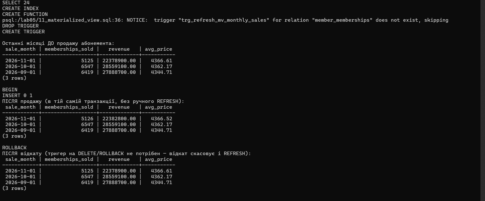

> Оновлення після кожного оператора — навчальний підхід. На великих навантаженнях його замінюють оновленням за розкладом (`pg_cron`) або інкрементальною таблицею-підсумком.

## 4.2 Каскадні тригери

Реалізовано ланцюжок: реєстрація відвідування перевіряється (діючий абонемент, вільні місця, дублікат) → оновлює лічильники учасника → це оновлення запускає валідацію, аудит і нарахування бонусу лояльності кожні 10 відвідувань → бонус теж потрапляє в аудит. Видалення тренування каскадно видаляє відвідування й зменшує лічильники. Тренера з майбутніми тренуваннями видалити не можна.

```sql

-- ---------- нові стовпці та таблиця бонусів ----------
ALTER TABLE members
    ADD COLUMN IF NOT EXISTS visits_count    INTEGER NOT NULL DEFAULT 0,
    ADD COLUMN IF NOT EXISTS last_visit_date DATE;

CREATE TABLE IF NOT EXISTS member_bonuses (
    bonus_id    SERIAL PRIMARY KEY,
    member_id   INTEGER NOT NULL REFERENCES members(member_id) ON DELETE CASCADE,
    bonus_type  VARCHAR(50) NOT NULL,
    description TEXT,
    created_at  TIMESTAMP NOT NULL DEFAULT NOW()
);

CREATE INDEX IF NOT EXISTS idx_member_bonuses_member_id ON member_bonuses (member_id);

-- Початкове значення лічильників з уже наявних відвідувань
-- (тригери вимкнено, щоб не створити сотні тисяч записів аудиту)
BEGIN;
SET LOCAL session_replication_role = replica;

UPDATE members m
SET visits_count    = c.cnt,
    last_visit_date = c.last_date
FROM (
    SELECT a.member_id,
           COUNT(*) AS cnt,
           MAX(ts.session_date) FILTER (WHERE ts.session_date <= CURRENT_DATE) AS last_date
    FROM attendance a
    JOIN training_sessions ts ON ts.session_id = a.session_id
    GROUP BY a.member_id
) c
WHERE c.member_id = m.member_id;

COMMIT;

-- ---------- 1. Бізнес-правила відвідування (BEFORE INSERT) ----------
CREATE OR REPLACE FUNCTION check_attendance_rules()
RETURNS TRIGGER
LANGUAGE plpgsql
AS $$
DECLARE
    s     RECORD;
    taken INTEGER;
BEGIN
    SELECT session_date, max_participants
    INTO s
    FROM training_sessions
    WHERE session_id = NEW.session_id;

    IF NOT FOUND THEN
        RETURN NEW;   -- неіснуюче тренування відхилить зовнішній ключ
    END IF;

    -- 1) у учасника має бути діючий абонемент на дату тренування
    IF NOT EXISTS (
        SELECT 1 FROM member_memberships
        WHERE member_id = NEW.member_id
          AND s.session_date BETWEEN start_date AND end_date
    ) THEN
        RAISE EXCEPTION 'Учасник % не має діючого абонемента на %', NEW.member_id, s.session_date
            USING ERRCODE = 'check_violation';
    END IF;

    -- 2) не можна записатися двічі на те саме тренування
    IF EXISTS (
        SELECT 1 FROM attendance
        WHERE member_id = NEW.member_id AND session_id = NEW.session_id
    ) THEN
        RAISE EXCEPTION 'Учасник % уже записаний на тренування %', NEW.member_id, NEW.session_id
            USING ERRCODE = 'unique_violation';
    END IF;

    -- 3) не можна перевищити максимальну кількість учасників
    SELECT COUNT(*) INTO taken FROM attendance WHERE session_id = NEW.session_id;
    IF taken >= s.max_participants THEN
        RAISE EXCEPTION 'Тренування % заповнене (% з % місць)', NEW.session_id, taken, s.max_participants
            USING ERRCODE = 'check_violation';
    END IF;

    RETURN NEW;
END;
$$;

DROP TRIGGER IF EXISTS trg_attendance_rules ON attendance;
CREATE TRIGGER trg_attendance_rules
BEFORE INSERT ON attendance
FOR EACH ROW
EXECUTE FUNCTION check_attendance_rules();

-- ---------- 2. Оновлення лічильників учасника (AFTER INSERT / DELETE) ----------
CREATE OR REPLACE FUNCTION attendance_after_insert()
RETURNS TRIGGER
LANGUAGE plpgsql
SECURITY DEFINER
SET search_path = public, pg_temp
AS $$
DECLARE
    v_date DATE;
BEGIN
    SELECT session_date INTO v_date FROM training_sessions WHERE session_id = NEW.session_id;

    UPDATE members
    SET visits_count    = visits_count + 1,
        last_visit_date = GREATEST(COALESCE(last_visit_date, v_date), v_date)
    WHERE member_id = NEW.member_id;

    RETURN NULL;
END;
$$;

DROP TRIGGER IF EXISTS trg_attendance_ins ON attendance;
CREATE TRIGGER trg_attendance_ins
AFTER INSERT ON attendance
FOR EACH ROW
EXECUTE FUNCTION attendance_after_insert();

CREATE OR REPLACE FUNCTION attendance_after_delete()
RETURNS TRIGGER
LANGUAGE plpgsql
SECURITY DEFINER
SET search_path = public, pg_temp
AS $$
BEGIN
    UPDATE members
    SET visits_count = GREATEST(visits_count - 1, 0)
    WHERE member_id = OLD.member_id;

    RETURN NULL;
END;
$$;

DROP TRIGGER IF EXISTS trg_attendance_del ON attendance;
CREATE TRIGGER trg_attendance_del
AFTER DELETE ON attendance
FOR EACH ROW
EXECUTE FUNCTION attendance_after_delete();

-- ---------- 3. Бонус лояльності кожні 10 відвідувань ----------
CREATE OR REPLACE FUNCTION members_loyalty_bonus()
RETURNS TRIGGER
LANGUAGE plpgsql
SECURITY DEFINER
SET search_path = public, pg_temp
AS $$
BEGIN
    INSERT INTO member_bonuses (member_id, bonus_type, description)
    VALUES (NEW.member_id, 'LOYALTY',
            format('Досягнуто %s відвідувань', (NEW.visits_count / 10) * 10));
    RETURN NULL;
END;
$$;

DROP TRIGGER IF EXISTS trg_members_loyalty_bonus ON members;
CREATE TRIGGER trg_members_loyalty_bonus
AFTER UPDATE OF visits_count ON members
FOR EACH ROW
WHEN (NEW.visits_count / 10 > OLD.visits_count / 10)
EXECUTE FUNCTION members_loyalty_bonus();

-- ---------- 4. Захист від видалення тренера з майбутніми тренуваннями ----------
CREATE OR REPLACE FUNCTION trainer_delete_guard()
RETURNS TRIGGER
LANGUAGE plpgsql
AS $$
BEGIN
    IF EXISTS (
        SELECT 1 FROM training_sessions
        WHERE trainer_id = OLD.trainer_id AND session_date >= CURRENT_DATE
    ) THEN
        RAISE EXCEPTION 'Не можна видалити тренера %: у нього є заплановані тренування', OLD.trainer_id
            USING ERRCODE = 'restrict_violation',
                  HINT = 'Спершу перепризначте або скасуйте його майбутні тренування';
    END IF;
    RETURN OLD;
END;
$$;

DROP TRIGGER IF EXISTS trg_trainer_delete_guard ON trainers;
CREATE TRIGGER trg_trainer_delete_guard
BEFORE DELETE ON trainers
FOR EACH ROW
EXECUTE FUNCTION trainer_delete_guard();

-- Аудит для таблиці бонусів (функція з файлу 08)
DROP TRIGGER IF EXISTS trg_audit_member_bonuses ON member_bonuses;
CREATE TRIGGER trg_audit_member_bonuses
AFTER INSERT OR UPDATE OR DELETE ON member_bonuses
FOR EACH ROW
EXECUTE FUNCTION audit_row_changes('bonus_id');

\set ON_ERROR_STOP off
BEGIN;

SELECT add_new_member('Каскад', 'Тестовий', '2000-01-01', '0990000001', 'cascade@example.com') AS test_member \gset
SELECT register_membership(:test_member, 1, CURRENT_DATE);

INSERT INTO training_sessions (trainer_id, session_name, session_date, start_time, end_time, max_participants)
VALUES (1, 'Cascade demo', CURRENT_DATE, '10:00', '11:00', 2)
RETURNING session_id AS test_session \gset

-- імітуємо 9 попередніх відвідувань (UPDATE visits_count не запускає бонус: 0/10 = 0, 9/10 = 0)
UPDATE members SET visits_count = 9 WHERE member_id = :test_member;

\echo '--- Крок 1: реєстрація відвідування -> лічильник 9 -> 10 -> бонус ---'
INSERT INTO attendance (member_id, session_id) VALUES (:test_member, :test_session);

SELECT member_id, visits_count, last_visit_date FROM members WHERE member_id = :test_member;
SELECT bonus_id, member_id, bonus_type, description FROM member_bonuses WHERE member_id = :test_member;
SELECT table_name, operation, record_id, changed_by
FROM audit_log WHERE table_name IN ('members', 'member_bonuses', 'attendance')
  AND (new_values ->> 'member_id')::int = :test_member
ORDER BY log_id;

\echo '--- Крок 2: повторний запис на те саме тренування -> відхилено ---'
INSERT INTO attendance (member_id, session_id) VALUES (:test_member, :test_session);
ROLLBACK;   -- помилка вище перервала транзакцію, відкат прибирає всі тестові дані

BEGIN;
\echo '--- Крок 3: учасник без абонемента -> відхилено ---'
SELECT add_new_member('Без', 'Абонемента', '2000-01-01', '0990000002', 'noplan@example.com') AS no_plan_member \gset
INSERT INTO attendance (member_id, session_id)
SELECT :no_plan_member, 1;   -- сесія №1 (з даних лаби 4)
ROLLBACK;

BEGIN;
\echo '--- Крок 4: видалення тренера з майбутніми тренуваннями -> відхилено ---'
DELETE FROM trainers WHERE trainer_id = 1;
ROLLBACK;
\set ON_ERROR_STOP on
```

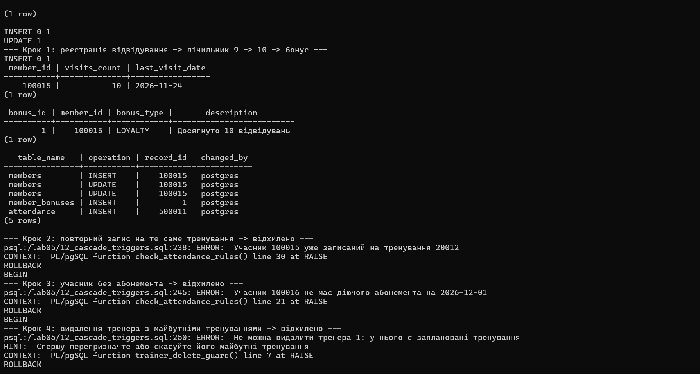

## 4.3 Ієрархія ролей

```
club_admin_role  ──наслідує──▶  club_moderator_role  ──наслідує──▶  club_user_role
   (адміністратор)                   (модератор)                      (користувач)
```

| Можливість | club_user | club_moderator | club_admin |
|---|---|---|---|
| Читання безпечних стовпців members, trainers (без phone/salary), memberships, training_sessions, equipment | ✅ | ✅ | ✅ |
| Читання v_active_memberships, v_trainer_workload | ✅ | ✅ | ✅ |
| Читання phone/email учасників, attendance, member_memberships, bonuses | ❌ | ✅ | ✅ |
| Читання v_member_profile, mv_monthly_membership_sales | ❌ | ✅ | ✅ |
| Читання trainers.salary, users, audit_log, maintenance_log | ❌ | ❌ | ✅ |
| INSERT/UPDATE: members (контактні стовпці), member_memberships, training_sessions, attendance, equipment | ❌ | ✅ | ✅ |
| UPDATE members.visits_count / last_visit_date вручну | ❌ | ❌ (лише тригери) | ✅ |
| DELETE: attendance | ❌ | ✅ | ✅ |
| DELETE: решта таблиць | ❌ | ❌ | ✅ |
| CALL maintain_database(), pg_monitor | ❌ | ❌ | ✅ |

Логіни: `club_user`, `club_moderator`, `club_admin`.

```sql
-- =====================================================================
-- Lab 05 | Рівень 3: ієрархія ролей та прав доступу
--
--   club_admin_role      (адміністратор)  наслідує  club_moderator_role
--   club_moderator_role  (модератор)      наслідує  club_user_role
--   club_user_role       (звичайний користувач, лише читання публічних даних)
--
-- Логіни:  club_user -> club_user_role
--          club_moderator -> club_moderator_role
--          club_admin -> club_admin_role
-- =====================================================================

-- ---------- ролі-групи (NOLOGIN) ----------
DO $$
BEGIN
    IF NOT EXISTS (SELECT 1 FROM pg_roles WHERE rolname = 'club_user_role') THEN
        CREATE ROLE club_user_role NOLOGIN;
    END IF;
    IF NOT EXISTS (SELECT 1 FROM pg_roles WHERE rolname = 'club_moderator_role') THEN
        CREATE ROLE club_moderator_role NOLOGIN;
    END IF;
    IF NOT EXISTS (SELECT 1 FROM pg_roles WHERE rolname = 'club_admin_role') THEN
        CREATE ROLE club_admin_role NOLOGIN;
    END IF;
END
$$;

-- Ієрархія: адміністратор ⊃ модератор ⊃ користувач
GRANT club_user_role      TO club_moderator_role;
GRANT club_moderator_role TO club_admin_role;

-- ---------- 1. club_user_role: лише безпечне читання ----------
GRANT CONNECT ON DATABASE sportsclub TO club_user_role;
GRANT USAGE   ON SCHEMA public       TO club_user_role;

GRANT SELECT (member_id, first_name, last_name, registration_date) ON members  TO club_user_role;
GRANT SELECT (trainer_id, first_name, last_name, specialization)  ON trainers TO club_user_role;
GRANT SELECT ON memberships, training_sessions, equipment         TO club_user_role;
GRANT SELECT ON v_active_memberships, v_trainer_workload          TO club_user_role;

-- ---------- 2. club_moderator_role: щоденна робота персоналу ----------
GRANT SELECT ON members, memberships, member_memberships, training_sessions,
                attendance, equipment, member_bonuses, member_audit  TO club_moderator_role;
-- зарплату тренерів модератор не бачить
GRANT SELECT (trainer_id, first_name, last_name, specialization, phone) ON trainers TO club_moderator_role;
GRANT SELECT ON v_member_profile, mv_monthly_membership_sales          TO club_moderator_role;

-- INSERT / UPDATE лише потрібних стовпців members
-- (visits_count та last_visit_date змінюють тільки тригери)
GRANT INSERT (first_name, last_name, birth_date, phone, email, registration_date) ON members TO club_moderator_role;
GRANT UPDATE (first_name, last_name, birth_date, phone, email)                    ON members TO club_moderator_role;

GRANT INSERT, UPDATE ON member_memberships, training_sessions, attendance, equipment TO club_moderator_role;
GRANT DELETE         ON attendance                                                   TO club_moderator_role;
GRANT USAGE ON ALL SEQUENCES IN SCHEMA public                                        TO club_moderator_role;

-- ---------- 3. club_admin_role: повний доступ ----------
GRANT ALL PRIVILEGES ON ALL TABLES    IN SCHEMA public TO club_admin_role;
GRANT ALL PRIVILEGES ON ALL SEQUENCES IN SCHEMA public TO club_admin_role;
GRANT ALL PRIVILEGES ON ALL ROUTINES  IN SCHEMA public TO club_admin_role;
-- вбудована роль: читання статистики сервера (pg_stat_statements тощо)
GRANT pg_monitor TO club_admin_role;

-- Права на ПОДАЛЬШІ таблиці/послідовності, створені власником (postgres)
ALTER DEFAULT PRIVILEGES IN SCHEMA public GRANT ALL ON TABLES    TO club_admin_role;
ALTER DEFAULT PRIVILEGES IN SCHEMA public GRANT ALL ON SEQUENCES TO club_admin_role;

-- ---------- Тригерні функції лаби 4: щоб модератор міг писати в журнали ----------
-- Функції аудиту з лаби 4 пишуть у member_audit / activity_log. Робимо їх
-- SECURITY DEFINER, щоб користувачам не потрібен був прямий доступ до цих таблиць.
ALTER FUNCTION log_member_insert()    SECURITY DEFINER SET search_path = public, pg_temp;
ALTER FUNCTION audit_member_insert()  SECURITY DEFINER SET search_path = public, pg_temp;
ALTER FUNCTION audit_member_delete()  SECURITY DEFINER SET search_path = public, pg_temp;

-- ---------- логіни ----------
DO $$
BEGIN
    IF NOT EXISTS (SELECT 1 FROM pg_roles WHERE rolname = 'club_user') THEN
        CREATE ROLE club_user LOGIN PASSWORD 'User_2026_Club!';
    END IF;
    IF NOT EXISTS (SELECT 1 FROM pg_roles WHERE rolname = 'club_moderator') THEN
        CREATE ROLE club_moderator LOGIN PASSWORD 'Mod_2026_Club!';
    END IF;
    IF NOT EXISTS (SELECT 1 FROM pg_roles WHERE rolname = 'club_admin') THEN
        CREATE ROLE club_admin LOGIN PASSWORD 'Adm_2026_Club!';
    END IF;
END
$$;

GRANT club_user_role      TO club_user;
GRANT club_moderator_role TO club_moderator;
GRANT club_admin_role     TO club_admin;

\echo
\echo 'Ієрархія ролей (хто в яку роль входить):'
SELECT r.rolname AS member, g.rolname AS member_of
FROM pg_auth_members am
JOIN pg_roles r ON r.oid = am.member
JOIN pg_roles g ON g.oid = am.roleid
WHERE r.rolname LIKE 'club_%' AND g.rolname LIKE 'club_%'
ORDER BY g.rolname, r.rolname;
```

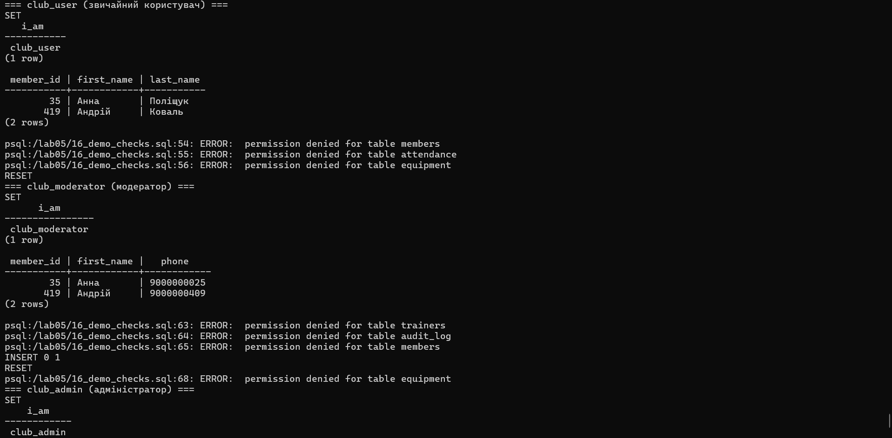
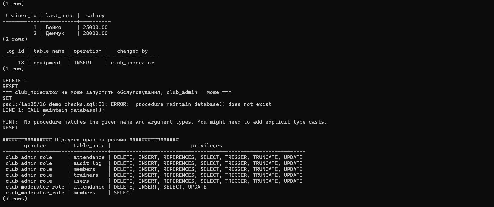

## 4.4 Процедура автоматизованого обслуговування

`maintain_database()` оновлює статистику (`ANALYZE`), перебудовує індекси кожної таблиці (`REINDEX TABLE`) та оновлює матеріалізоване представлення; кожен крок і його тривалість пишуться в `maintenance_log`. `VACUUM` і `REINDEX CONCURRENTLY` у процедурі виконувати не можна (вони не працюють у блоці транзакції) — для них використовується `vacuumdb` за розкладом. Виклик дозволено лише адміністратору.

```sql
-- =====================================================================
-- Lab 05 | Рівень 3: збережена процедура автоматизованого
-- обслуговування БД: ANALYZE, REINDEX кожної таблиці, оновлення
-- матеріалізованого представлення. Кожен крок пишеться в maintenance_log.
--
-- VACUUM / REINDEX DATABASE / REINDEX CONCURRENTLY не можна виконувати
-- всередині процедури (вони не працюють у блоці транзакції) — для них:
--   docker compose exec postgres vacuumdb -U postgres -d sportsclub --analyze
-- =====================================================================

CREATE TABLE IF NOT EXISTS maintenance_log (
    log_id      SERIAL PRIMARY KEY,
    operation   TEXT NOT NULL,
    details     TEXT,
    duration_ms NUMERIC(12, 2),
    executed_at TIMESTAMP NOT NULL DEFAULT NOW()
);

CREATE OR REPLACE PROCEDURE maintain_database()
LANGUAGE plpgsql
SECURITY DEFINER
SET search_path = public, pg_temp
AS $$
DECLARE
    tbl RECORD;
    t0  TIMESTAMPTZ;
BEGIN
    -- 1. Статистика оптимізатора
    t0 := clock_timestamp();
    ANALYZE;
    INSERT INTO maintenance_log (operation, details, duration_ms)
    VALUES ('ANALYZE', 'Оновлено статистику оптимізатора',
            round((extract(epoch FROM clock_timestamp() - t0) * 1000)::numeric, 2));

    -- 2. Перебудова індексів усіх таблиць схеми public
    FOR tbl IN
        SELECT tablename FROM pg_tables WHERE schemaname = 'public' ORDER BY tablename
    LOOP
        t0 := clock_timestamp();
        EXECUTE format('REINDEX TABLE %I.%I', 'public', tbl.tablename);
        INSERT INTO maintenance_log (operation, details, duration_ms)
        VALUES ('REINDEX', 'Таблиця ' || tbl.tablename,
                round((extract(epoch FROM clock_timestamp() - t0) * 1000)::numeric, 2));
    END LOOP;

    -- 3. Оновлення матеріалізованого представлення
    t0 := clock_timestamp();
    REFRESH MATERIALIZED VIEW mv_monthly_membership_sales;
    INSERT INTO maintenance_log (operation, details, duration_ms)
    VALUES ('REFRESH MV', 'mv_monthly_membership_sales',
            round((extract(epoch FROM clock_timestamp() - t0) * 1000)::numeric, 2));

    RAISE NOTICE 'Обслуговування бази даних завершено успішно';
END;
$$;

-- Лише адміністратор (та власник) може викликати процедуру
REVOKE EXECUTE ON PROCEDURE maintain_database() FROM PUBLIC;
GRANT  EXECUTE ON PROCEDURE maintain_database() TO club_admin_role;

-- Виконання та перевірка журналу
CALL maintain_database();

SELECT log_id, operation, details, duration_ms, executed_at
FROM maintenance_log
ORDER BY log_id DESC
LIMIT 15;
```

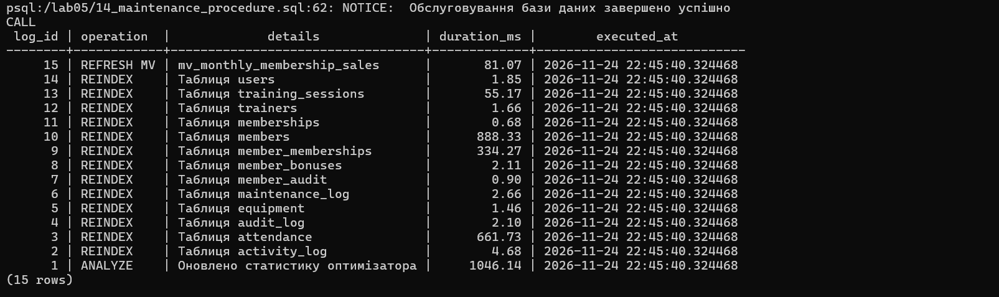

## 4.5 Моніторинг продуктивності

Скрипт `lab05/15_monitoring.sql` (запуск — `scripts/monitor.sh` або `monitor.ps1`, звіт зберігається у `results/`) виводить: розміри таблиць та індексів, статистику використання індексів, невикористовувані індекси, співвідношення seq/idx сканувань, мертві кортежі, hit-ratio кешу, ТОП-10 найповільніших запитів та ТОП-10 за сумарним часом (`pg_stat_statements`), довгі активні запити.

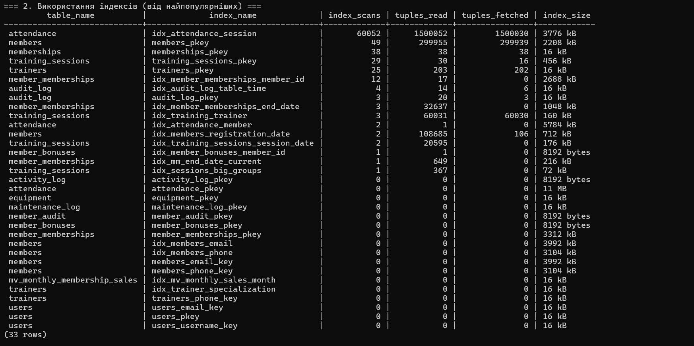
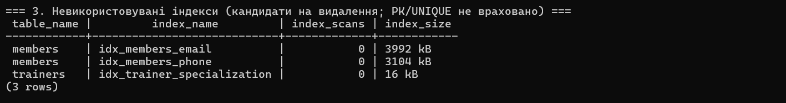

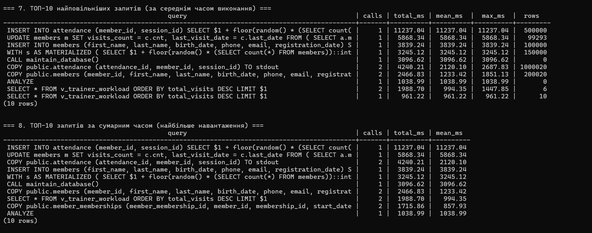

Висновки з моніторингу: найчастіше використовується індекс `idx_attendance_session` (60052 сканувань); невикористовувані індекси: `idx_members_email`, `idx_members_phone`, `idx_trainer_specialization`; найповільніший запит: `INSERT INTO attendance (member_id, session_id) SELECT ...` (середній час 11237.04 мс).

---

# 5. Висновки та рекомендації

У лабораторній роботі виконано всі завдання рівнів 1–3.

1. **Продуктивність.** На обсязі ~500 тис. рядків індекси на стовпцях фільтрації та зовнішніх ключах прискорили запити 1, 2 і 3 на ___ %, ___ % та ___ % відповідно: Sequential Scan замінилися на Index/Bitmap Scan, значно зменшилась кількість прочитаних буферів. Особливо важливим виявився індекс на зовнішній ключ `member_memberships.member_id`, який PostgreSQL не створює автоматично.
2. **Часткові індекси** (`WHERE end_date >= …`, `WHERE max_participants >= 35`) значно менші за повні (___ проти ___) і використовуються для запитів, умова яких вкладається в предикат; їх доцільно застосовувати для «гарячих» підмножин даних.
3. **Автоматизація.** Тригери валідації не допускають некоректних даних у БД незалежно від застосунку; універсальний аудит фіксує всі зміни з користувачем та старими/новими значеннями; каскадні тригери підтримують узгодженість лічильників і бонусів без коду в застосунку; матеріалізоване представлення віддає агрегати миттєво.
4. **Безпека.** Принцип мінімальних привілеїв: права на рівні стовпців (без `phone`, `salary`), доступ до даних через представлення, ієрархія ролей, `SECURITY DEFINER`-функції для тригерів, щоб користувачам не потрібен був прямий доступ до журналів.
5. **Адміністрування.** `pg_dump` + `pg_restore` перевірено відновленням у тестову БД зі звіркою кількості записів; процедура обслуговування й скрипт моніторингу автоматизують рутину.

---

# Додаток: структура та відтворення

```
lab05-database/
├── docker-compose.yml          # + pg_stat_statements, томи lab05 / backups / results
├── database/                   # скрипти лаби 4 (ініціалізація БД)
├── lab05/                      # SQL-скрипти лаби 5 (00 … 16)
├── scripts/                    # backup / restore_test / monitor / run_lab05 (.sh та .ps1)
├── docs/                       # report.md, SCREENSHOTS.md, screenshots/
├── console_app/, web_app/      # застосунки з лаби 4
└── tools/build_report.py       # збирає report.md із шаблону та SQL-файлів
```

```bash
docker compose up -d
bash scripts/run_lab05.sh          # або .\scripts\run_lab05.ps1
bash scripts/backup.sh && bash scripts/restore_test.sh
bash scripts/monitor.sh
```

посилання на репозиторій: https://github.com/danil41k/DB.git